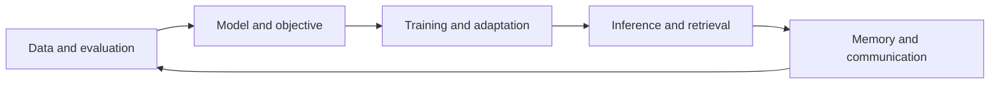

# 📚 KeyNotes

Understand a concept, work through an example, and connect it to the system that uses it. KeyNotes brings machine learning and infrastructure into one learning path: model quality and system performance are often two sides of the same engineering decision.

## 🧭 Choose a starting point

| Your question | Start here | What you will learn to do |
| --- | --- | --- |
| How do models learn from data? | [Machine learning foundations](ml/mle/index.md) | Choose a loss, split data correctly, and evaluate generalization |
| How does a language model work? | [LLM learning map](ml/llm/index.md) | Follow tokens through attention, training, adaptation, and generation |
| How do images, speech, and language meet? | [Multimodal foundations](ml/llm/multimodal/foundations.md) | Distinguish representation, alignment, fusion, and evaluation |
| Why is an accelerator waiting for data? | [Infrastructure learning map](infra/index.md) | Trace memory, transfers, interconnects, and completion |
| How do I prepare a trustworthy dataset? | [SQL](ml/sql.md) and [Pandas](ml/pandas.md) | Preserve row meaning, handle missingness, and avoid join mistakes |

## 🎯 Learn in two passes

On the first pass, read the motivation, diagrams, and worked example. Explain the mechanism in your own words before memorizing its name. On the second pass, derive the equations, check assumptions, and ask when the technique fails. The exercises and links between chapters support this second pass.

For example, [KV caching](ml/llm/inference/kv-cache.md) starts as a way to reuse attention computations. Its memory cost leads naturally to [quantization](ml/llm/inference/quantization.md), [paged storage](ml/llm/inference/layers-pages.md), and [cross-node transfers](infra/end-to-end-transfer.md). A faster mathematical algorithm can still stall on memory bandwidth.

The arrows are a learning loop: deployment failures often reveal missing data or evaluation cases, not only implementation defects.

## 📌 Languages and figures

Use the language icon in the top-right corner to switch between English and Chinese on the corresponding topic. Technical names remain recognizable in both editions. Original note figures are retained; surrounding explanations clarify abbreviations, assumptions, and corrections where a screenshot contains an error. New diagrams provide a view of the mechanism without replacing the original images.

Explore [ML](ml/index.md) or [Infra](infra/index.md).
