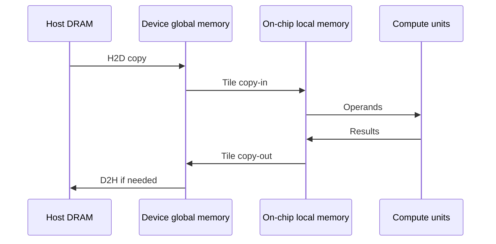

# Data movement: H2D, DMA, and asynchronous copies

A tensor can be available to the CPU yet unavailable to an accelerator kernel. Moving it to device global memory is one step; bringing a tile into on-chip storage is another. Distinguishing these steps explains many apparent “compute” bottlenecks.

H2D completion does not imply that every operand is already in an AI Core's local buffers. Kernel scheduling and internal data movement still matter.

## Directions, engines, and paths

| Term | What it tells you | What it does not tell you |
| --- | --- | --- |
| H2D / D2H | Host-to-device / device-to-host direction | Exact link, engine, or synchronization semantics |
| D2D | Copy within or between devices, depending on the API | Whether another physical card is involved |
| H2H | Host-memory endpoints | Whether endpoints are local or remote |
| P2P | Peer-device access or transfer capability | Which path is selected or whether a fallback occurs |
| DMA | An engine moves data without CPU byte-by-byte copying | That setup, coordination, and completion need no CPU |
| SDMA | A device transfer-engine/path term in Ascend contexts | That it is identical to AI Core MTE |
| MTE | AI Core movement between storage levels, with supported conversions | A general network transport |
| RDMA | Remote access to memory prepared for communication | Automatic access to any device pointer |

A typical H2D copy traverses a host I/O path such as PCIe. A device transfer may traverse PCIe, a dedicated interconnect, or a network. Ask separately about endpoints, physical route, transfer API, and completion mechanism.

## Asynchrony is a lifetime contract

A synchronous interface has a documented completion point; inspect its precise guarantees. An asynchronous interface can return after enqueueing work. The application must keep source and destination storage alive and prevent conflicting access until the relevant completion.

For a pipeline, the intended dependency is `fill input → copy → compute → consume output`. Streams or queues order some operations; events connect dependencies across streams. Reusing a host buffer immediately after submission can race the DMA reader. Timing only the enqueue call measures submission overhead, not transfer bandwidth.

Pinned host memory can reduce preparation costs and enable efficient DMA paths. It is a limited resource, so reuse a bounded pool instead of pinning arbitrary amounts. Overlap requires supported engines, independent work, and correct dependencies; “async” alone does not prove overlap.

## Estimate the bottleneck

A first-order model is $T(S)=L+S/B$, where $L$ is fixed overhead, $S$ bytes, and $B$ sustained bytes/s. For $L=10\,\mu s$ and $B=20$ GB/s, a 4 KB copy takes about $10.2\,\mu s$, while a 20 MB copy takes about $1.01$ ms. Small transfers benefit from batching; large transfers expose bandwidth limits.

The effective bandwidth cannot exceed the slowest participating memory, link, or engine, and contention lowers it further. NUMA placement, shared PCIe uplinks, registration, and synchronization all contribute.

Record direction, size, count, buffer type, NUMA placement, warmup, and completion timing. Compare a large steady-state copy with many small copies and inspect unnecessary round trips. Continue with [performance measurement](performance-tools.md).

Source: [Ascend AI Core architecture and MTE](https://www.hiascend.com/doc_center/source/en/canncommercial/800/opdevg/tbeaicpudevg/atlasopdev_10_0008.html). The documented architecture is version-specific; use the relevant programming guide for actual engine behavior.
