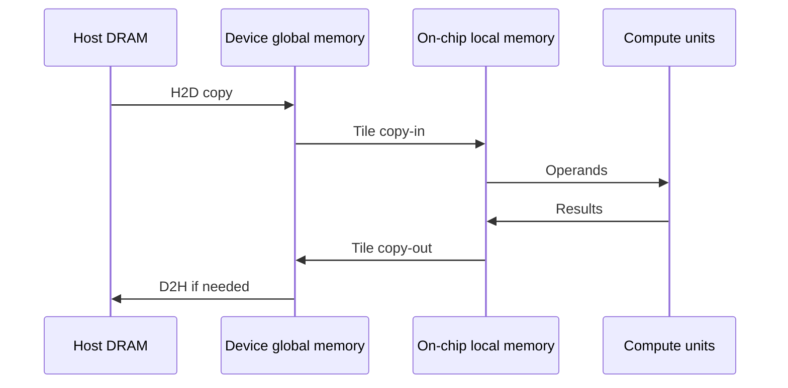
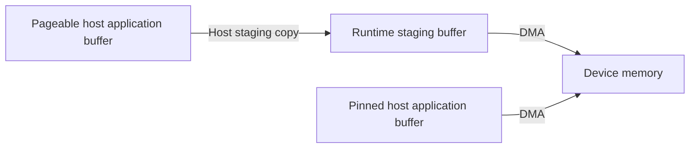

# 🔄 Data movement: H2D, DMA, and asynchronous copies

A tensor can be available to the CPU yet unavailable to an accelerator kernel. Moving it to device global memory is one step; bringing a tile into on-chip storage is another. Distinguishing these steps explains many apparent “compute” bottlenecks.

H2D completion does not imply that every operand is already in an AI Core's local buffers. Kernel scheduling and internal data movement still matter.

## 🧭 Directions, engines, and paths

| Term | What it tells you | What it does not tell you |
| --- | --- | --- |
| H2D / D2H | Host-to-device / device-to-host direction | Exact link, engine, or synchronization semantics |
| D2D | Copy within or between devices, depending on the API | Whether another physical card is involved |
| H2H | Host-memory endpoints | Whether endpoints are local or remote |
| P2P | Peer-device access or transfer capability | Which path is selected or whether a fallback occurs |
| DMA | An engine moves data without CPU byte-by-byte copying | That setup, coordination, and completion need no CPU |
| SDMA | A device transfer-engine/path term in Ascend contexts | That it is identical to AI Core MTE |
| MTE | AI Core movement between storage levels, with supported conversions | A general network transport |
| RDMA | Remote access to memory prepared for communication | Automatic access to any device pointer |

A typical H2D copy traverses a host I/O path such as PCIe. A device transfer may traverse PCIe, a dedicated interconnect, or a network. Ask separately about endpoints, physical route, transfer API, and completion mechanism.

## 🧷 Why pageable memory needs a staging copy {#pageable-staging}

CANN 9.0's official [Host page-locked memory guide](https://www.hiascend.com/document/detail/zh/CANNCommunityEdition/900/programug/acldevg/runtime_doc_dev_0006.html) describes these H2D paths:

**A copy API using DMA can still involve a host-side copy.** In the pageable path above, DMA handles the second leg; staging adds overhead. This staging buffer is distinct from an AI Core's on-chip local buffers.

Pinning removes that staging step, while the host-to-device transfer remains. As a further inference, manually copying an existing pageable buffer into a pinned buffer still incurs a host copy; producing data directly in a reusable pinned buffer can avoid it. See [pinned memory](memory-addressing.md#host-pinned-memory) for memory types, registration, and release.

### Async return behavior depends on host memory type {#cann-copy-completion}

The official [memory management overview](https://www.hiascend.com/doc_center/source/en/CANNCommunityEdition/900/programug/acldevg/runtime_doc_dev_0004.html) identifies `aclrtMemcpy` and `aclrtMemcpyAsync` as synchronous and asynchronous copy APIs. The 9.0 [`memcpy_async` reference, including the `aclrtMemcpyAsync` C prototype](https://www.hiascend.com/doc_center/source/en/CANNCommunityEdition/900/API/runtimeapi/aclpythondevg_01_0121.html), further distinguishes:

| Call | Return behavior |
| --- | --- |
| `aclrtMemcpy` | Synchronous copy; pageable host memory can still require staging |
| `aclrtMemcpyAsync` with pinned host memory | Success means submission; completion needs confirmation |
| `aclrtMemcpyAsync` with non-pinned host memory | Returns after the copy completes, according to the cited 9.0 documentation |

**Consider the Async name, buffer type, and actual completion point together.** The cited copy API also requires 64-byte-aligned source and destination addresses; check product mode, direction, and version support. This copy alignment differs from `aclrtHostRegisterV2`'s 4KB host-base alignment requirement; neither replaces the other.

The pinned H2D lifetime is `aclrtMallocHost → fill → aclrtMemcpyAsync → confirm completion with aclrtSynchronizeStream → reuse or aclrtFreeHost after all users finish`. Do not modify or free a source while DMA may still read it. For D2H, wait before consuming the destination.

### Measurement: HugeTLB is not automatically Runtime-pinned host memory {#hugetlb-runtime-pinned}

**Being non-swappable at the OS level does not mean CANN Runtime recognizes and prepares a buffer for its pinned asynchronous host-copy path.** HugeTLB supplies huge-page and residency semantics; `aclrtMallocHost` supplies Runtime-managed pinned host allocations. HugeTLB alone does not establish the same asynchronous return behavior.

The note contributor reported the following approximate measurements. The **call phase** measures the host-side copy API calls; **synchronization** measures the subsequent stream wait. The individual-copy path retains the reported call-phase scope; it is not interpreted as the duration of each small copy. Complete software/hardware versions, byte counts, batch counts, and timing boundaries were not supplied with this note, so these values describe this observation rather than a general bandwidth benchmark.

| Host buffer source | Copy path | API call phase | Subsequent stream synchronization |
| --- | --- | --- | --- |
| HugeTLB / hugetlb | `aclrtMemcpyBatchAsync` | About 3.5 ms | About 6 µs |
| `aclrtMallocHost` | `aclrtMemcpyBatchAsync` | About 0.33 ms | About 2.67 ms |
| HugeTLB / hugetlb | Individual `aclrtMemcpyAsync` calls | About 3.5 ms | About 9 µs |

Interpret the distribution as follows:

1. **HugeTLB with BatchAsync:** most waiting occurs inside the API call, followed by about 6 µs of synchronization. This is consistent with the copy completing before API return, leaving almost none of this copy work for the later stream wait.
2. **`aclrtMallocHost` with BatchAsync:** about 0.33 ms in the call and 2.67 ms in synchronization is consistent with submission followed by asynchronous stream progress, with synchronization waiting for the remaining work. Transfers can begin after submission; they do not wait for the synchronization call to start.
3. **HugeTLB with individual MemcpyAsync calls:** about 3.5 ms in the call phase and 9 µs in synchronization shows a similar distribution. The observation is not confined to the batch interface.

Thus, **the tested HugeTLB buffer did not exhibit the Runtime-pinned asynchronous behavior of the `aclrtMallocHost` buffer; non-swappability alone does not make them equivalent.** This interpretation agrees with the earlier official `aclrtMemcpyAsync` distinction between non-pinned and pinned host return behavior; the batch-path conclusion here relies on the reported measurement. Timing alone cannot establish Runtime registration internals, use of a particular staging buffer, or the exact execution path.

Evaluate **call time together with subsequent synchronization**, rather than treating a 0.33 ms return as completed-transfer bandwidth. A repeatable comparison also fixes bytes, copy count, initial stream state, and placement; checks copy/synchronization results and destination contents; and uses Runtime logs or a device timeline to identify internal paths. Any additional Host registration of HugeTLB memory needs separate version-specific support checks; non-swappability does not guarantee registration succeeds.

Related concepts: [Linux HugeTLB](page-tables-huge-pages.md#linux-hugetlb) and [host pinning and registration](memory-addressing.md#host-pinned-memory).

## 🧩 Asynchrony is a lifetime contract

A synchronous interface has a documented completion point; inspect its precise guarantees. An asynchronous interface can return after enqueueing work. The application must keep source and destination storage alive and prevent conflicting access until the relevant completion.

For a pipeline, the intended dependency is `fill input → copy → compute → consume output`. Streams or queues order some operations; events connect dependencies across streams. Reusing a host buffer immediately after submission can race the DMA reader. Timing only the enqueue call measures submission overhead, not transfer bandwidth.

Pinned host memory can reduce preparation costs and enable efficient DMA paths. It is a limited resource, so reuse a bounded pool instead of pinning arbitrary amounts. Overlap requires supported engines, independent work, and correct dependencies; “async” alone does not prove overlap.

## 🧮 Estimate the bottleneck

A first-order model is $T(S)=L+S/B$, where $L$ is fixed overhead, $S$ bytes, and $B$ sustained bytes/s. For $L=10\,\mu s$ and $B=20$ GB/s, a 4 KB copy takes about $10.2\,\mu s$, while a 20 MB copy takes about $1.01$ ms. Small transfers benefit from batching; large transfers expose bandwidth limits.

The effective bandwidth cannot exceed the slowest participating memory, link, or engine, and contention lowers it further. NUMA placement, shared PCIe uplinks, registration, and synchronization all contribute.

Record direction, size, count, buffer type, NUMA placement, warmup, and completion timing. Compare a large steady-state copy with many small copies and inspect unnecessary round trips. Continue with [performance measurement](performance-tools.md).

Source: [Ascend AI Core architecture and MTE](https://www.hiascend.com/doc_center/source/en/canncommercial/800/opdevg/tbeaicpudevg/atlasopdev_10_0008.html). The documented architecture is version-specific; use the relevant programming guide for actual engine behavior.
