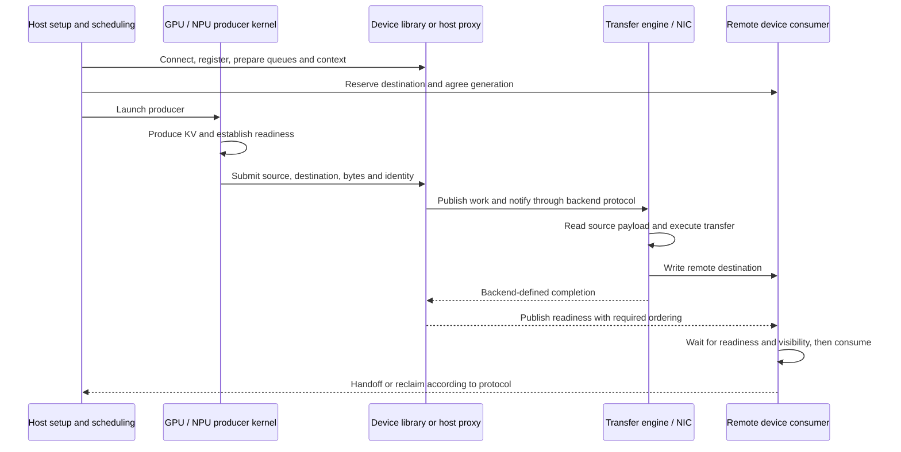

# 🚦 How an NPU or GPU drives copies and remote transfers

“The data lives on a device,” “the device initiates communication,” and “the NIC directly accesses device memory” describe different properties. Follow a kernel-produced KV block through request creation, submission, movement, and remote consumption. Read [WQE, SQE, CQE, and doorbells](work-queues.md) for queue terminology.

## 🧩 Three submission paths

| Mode | Who requests movement? | Who submits to the engine? | Can the payload use a direct device path? |
| --- | --- | --- | --- |
| Host-initiated | Framework/connector on CPU | CPU library, driver, or runtime | Yes, with supported registration and hardware |
| Device-initiated, host-proxied | GPU/NPU kernel publishes a request | CPU proxy reads and submits it | Yes; proxy control does not imply CPU payload copying |
| Direct device submission | Supported device kernel | Device communication library operates engine queues | Yes, subject to device/backend support |

- **Host-initiated:** the CPU submits control information while the NIC DMA-reads HBM; D2H staging is not required.

- **Device-initiated, host-proxied:** the request originates on the device, while a CPU proxy handles submission.

- **Direct device submission:** the per-operation control path is shorter; setup, registration, connection management, and recovery may still involve the host.

!!! note "Payload access and task submission are separate"

    **GPUDirect RDMA provides device-memory access, not automatically GPU control of NIC submission.**

    See [GPUDirect RDMA](https://docs.nvidia.com/cuda/gpudirect-rdma/) and the [NVSHMEM IBGDA mechanism](https://developer.nvidia.com/blog/improving-network-performance-of-hpc-systems-using-nvidia-magnum-io-nvshmem-and-gpudirect-async/).

## 🛠️ Initialize an environment that can accept work

1. Bind processes, devices, ranks, and NICs; discover peers and supported paths.

2. Allocate source/destination buffers and perform required mapping, registration, or symmetric allocation.

3. Establish endpoints, work/completion resources, and exchange address descriptions, permissions, bounds, and lifetimes.

4. For device initiation, prepare device-accessible context, queues, or proxy request storage, and start required progress workers.

5. Assign request, layer, block, generation, and completion identities; reserve bounded queue capacity.

This is a logical checklist, not a mandatory set of public objects. Use remote pointers through the library's addressing rules: a symmetric address commonly needs a target PE/rank as well. A local numeric pointer alone is not a valid remote address. See [memory and registration](memory-addressing.md) and [GVA](gva-unified-addressing.md).

## 🔄 Submission and execution after production



Notification is a logical responsibility: a put-with-signal operation can combine payload delivery and signaling, while another backend uses separate control messages. For host submission, replace the device request with a host call after the producer event. Every path needs three dependencies: **production before source reads, remote writes before consumption, and completion before reuse**.

Local `cudaMemcpyAsync` / `aclrtMemcpyAsync` calls do not provide arbitrary remote addressing or cross-server connections. Replacing a local destination with a pointer from another machine does not turn a local copy into a network operation. See [data movement](data-movement.md).

## 🟩 GPU example: NVSHMEM and IBGDA

NVSHMEM exposes communication inside GPU kernels. On a supported IBGDA path, SMs can create NIC WQEs, update queue records, and notify the NIC; the NIC fetches descriptors/payload and writes completion information back. A proxy path instead delegates device requests to CPU threads.

This mechanism follows [NVIDIA's IBGDA article](https://developer.nvidia.com/blog/improving-network-performance-of-hpc-systems-using-nvidia-magnum-io-nvshmem-and-gpudirect-async/). Check the [NVSHMEM prerequisites](https://docs.nvidia.com/nvshmem/api/latest/using.html) for actual devices, drivers, and transports rather than assuming every GPU/NIC pair supports it.

The following is protocol pseudocode, not a compilable program. Initialization, thread participation, synchronization scope, and error handling depend on the library:

```text
Sender:
  wait for block production and device-API visibility requirements
  put_with_signal_nbi(dst, src, bytes, remote_signal, generation, peer)
  wait for the required completion before reusing source storage

Receiver:
  use the library signal-wait operation for the expected generation
  read the destination under the library visibility contract
  return credit only after consumption if the destination will be reused
```

NVSHMEM put-with-signal associates payload delivery with the corresponding signal update; an unordered plain flag store is not equivalent. `fence` orders operations within its defined scope; `quiet` completes operations within its scope. Neither replaces unfinished production by arbitrary other threads. See [signaling](https://docs.nvidia.com/nvshmem/api/latest/gen/api/signal.html) and [memory ordering](https://docs.nvidia.com/nvshmem/api/latest/gen/api/ordering.html).

## 🟦 NPU example: operator access versus host transfer APIs

The MemFabric [feature documentation](https://github.com/Ascend/memfabric_hybrid/blob/master/doc/feature.md) distinguishes these entry points:

| Entry point | Documented responsibility | Submission interpretation |
| --- | --- | --- |
| BM | Pooled memory, unified addresses, and copies | A host C/Python API does not imply device initiation |
| TRANS | Register user HBM and perform cross-server reads/writes | Examples such as `smem_trans_write/read` are host interfaces |
| SHM | Shared space and fine-grained AI Core access | Describes intra-supernode MTE access and device copy APIs |

Trace `host TRANS call → backend submission → supported transport` separately from `host prepares shared space → launches operator → AI Core uses device APIs`. The [ShiftPutGet example](https://github.com/Ascend/memfabric_hybrid/blob/master/examples/hbm_share_memory/ShiftPutGet/README.md) provides a SHM entry point.

**AI Core access to GVA does not establish that MTE can submit arbitrary cross-server NIC RDMA.** Check the matching product, CANN release, communication library, device API, engine reach, and synchronization contract. MTE, SDMA, and RDMA describe different paths, and a host TRANS API cannot simply be invoked inside a device kernel.

## ✅ Couple completion with buffer ownership

| State | Meaning | Still unsafe |
| --- | --- | --- |
| Produced | Source is generated and visible to its reader | Overwrite before transfer completion |
| Submitted | Work is queued | Treat return as remote readiness |
| Source reusable | Backend no longer reads this source | Infer remote computation has finished |
| Remote ready | Receiver can safely read this generation | Overwrite a destination still being consumed |
| Consumed / credit returned | Protocol permits destination-slot reuse | Let a stale notification activate a new generation |

Use monotonic generations and explicit ownership/credits across repeated buffer use. Retries also need request identity and an idempotency policy. Timeout does not stop DMA automatically: drain or isolate outstanding work before reclamation. For per-layer KV movement, continue with [layerwise execution](../ml/llm/inference/layerwise-inference.md).

## 📊 Show whether device initiation helps

Measure production readiness, request publication, engine fetch, completion, remote visibility, and consumption. Hold payload size, path, batching, and concurrency constant across host, proxy, and direct-device comparisons. Include device polling, compute-core occupancy, and queue contention. Lower CPU use alone does not prove better TTFT or throughput.

Validate known data with generation markers before benchmarking fine-grained submission and bulk bandwidth. In inference, validate TP shards, layer identities, and KV layout as well as byte counts. See the [end-to-end application protocol](end-to-end-transfer.md).
