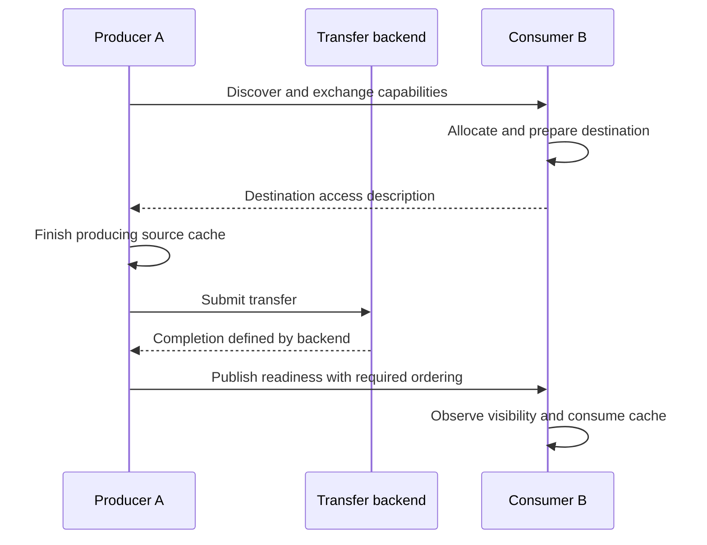

# 📦 Trace an end-to-end KV-cache transfer

Imagine a prefill worker on server A and a decode worker on server B. The cache currently lives in A's NPU HBM and must become usable in B's HBM. “Send the pointer” cannot achieve this: a pointer identifies memory in an address context, not portable tensor contents.

## ⚖️ Four stages with different failure modes

| Stage | Work | Evidence of success |
| --- | --- | --- |
| Initialize | Discover peers, agree capabilities, establish endpoints and queues | Correct rank/device/endpoint mapping and a usable connection |
| Prepare memory | Allocate, map, register, and exchange access descriptors | Valid length, permissions, memory type, and lifetime |
| Transfer | Submit supported read/write/send operations | Accepted work and progressing transfer state |
| Complete and consume | Observe required completion, communicate readiness, enforce visibility | Destination can safely read the intended generation of data |

The diagram is a logical protocol. Some backends provide receiver-side completion or integrated notification; others require an explicit readiness message. A local completion does not universally mean that remote application code has observed the data. Follow the API's ordering and visibility guarantees.

## ⚖️ Compare the physical paths

A host-staged route is `HBM A → DRAM A → network → DRAM B → HBM B`. It can reuse host networking but adds copies, buffers, and synchronization. A supported direct route is `HBM A → communication engine/NIC → network → HBM B`. Direct access depends on reachability, registration, permissions, and backend support; a configuration label alone is insufficient evidence.

For a 1 GB cache, sequential stages sustaining 20, 10, and 20 GB/s need at least $0.05+0.10+0.05=0.20$ s before fixed overheads. Chunked pipelining can overlap stages and approach the slowest stage's throughput, but the first and last chunks still pay startup and drain costs. This is a modeling example, not a hardware benchmark.

## 📌 Where MemFabric fits

Memory pools and handles provide resources; discovery and connection setup provide control; read/write operations perform movement; completion handling manages success, errors, and timeout. Actual module boundaries and APIs depend on the backend and release. Inspect the [MemFabric source](https://gitcode.com/Ascend/memfabric_hybrid) alongside its API documentation.

For a cache application, also validate token count, tensor layout, dtype, layer identity, and model revision. A byte-perfect transfer of an incompatible cache is still an application error.

## ⚠️ Debug in dependency order

Check identity mapping, then connection state, memory reachability and permissions, route health, submission progress, and completion visibility. Only then interpret performance. Preserve buffers and registration handles while work is outstanding; timeout does not necessarily cancel already submitted DMA.

A useful experiment transfers a small known pattern, validates the destination after completion, then scales size and concurrency separately. Report both successful completion and content integrity. Related: [addresses and registration](memory-addressing.md), [the full P/D serving flow](serving-frameworks.md), [network planes](network-planes.md), and [KV-cache size](../ml/llm/inference/kv-cache.md).
