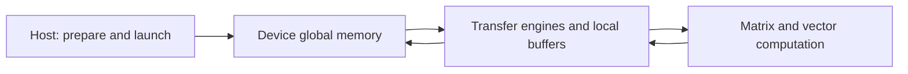

# 🖥️ Accelerator hardware: from silicon to a running kernel

CPU, GPU, and NPU are useful design categories. CPUs emphasize flexible control and low-latency execution; GPUs emphasize parallel throughput; NPUs specialize strongly in tensor and neural-network operations. Actual supported operations and performance depend on the architecture, software stack, datatype, and workload.

## 🧭 Do not collapse physical and logical boundaries

A die is a silicon unit, a package assembles one or more dies, and a card carries components. A runtime device is an enumerated object to which software submits work. A distributed rank is an identity within a communication group. There is no universal one-to-one mapping among them.

For troubleshooting, build a table containing `rank → process → host → runtime device → physical location → communication endpoint`. If a job renumbers visible devices, runtime device 0 need not be the physical device originally labeled 0.

## ⚙️ How an AI Core receives work

At a conceptual level, host software prepares memory and launches a kernel. Device execution coordinates movement and computation. Matrix/Cube units perform supported matrix operations; vector units perform vector and elementwise operations; scalar/control logic coordinates execution. AICPU is an auxiliary device-side processor, distinct from these compute units.

MTEs move tiles through supported memory levels and can perform certain layout conversions. HBM/global memory stores large tensors; on-chip buffers hold smaller working sets close to computation. Exact coupling between matrix and vector resources varies by generation. The [Ascend architecture documentation](https://www.hiascend.com/doc_center/source/en/canncommercial/800/opdevg/tbeaicpudevg/atlasopdev_10_0008.html) should be matched to the target product.

This diagram shows a dataflow, not a die floorplan. [The infrastructure overview](index.md) retains the original single-die and multi-die illustrations.

## 💡 Why tiling matters

For matrix multiplication $C=AB$, repeatedly fetching the same values from global memory wastes bandwidth. A tile loaded into local storage can be reused for several multiply-accumulate operations. Larger tiles may improve reuse but consume more local memory and can reduce concurrency. Efficient kernels balance reuse, occupancy, layout, and synchronization.

A rough roofline model is $P\le\min(P_{peak},B\times I)$, where $I$ is operations per byte moved from the measured memory level. If $B=1$ TB/s and $I=10$ FLOP/byte, that level permits at most 10 TFLOP/s even when compute peak is much higher. These are illustrative values, not Ascend specifications.

## 🔍 Inspect before generalizing

Record device model, driver/runtime, visible device count, PCIe or dedicated-interconnect topology, NUMA relation, and memory capacity. Product family names such as A2/A3/A5 are insufficient to infer die count, cache coherence, or supported communication protocols. A faster matrix unit will not fix a pipeline stalled on transfers or unsupported operator fallback.

Exercise: draw the path for one matrix tile from host allocation to device computation. Label which steps involve CPU, global memory, local buffers, and completion events. Then identify which steps a repeated inference request can reuse. Continue with [data movement](data-movement.md).
