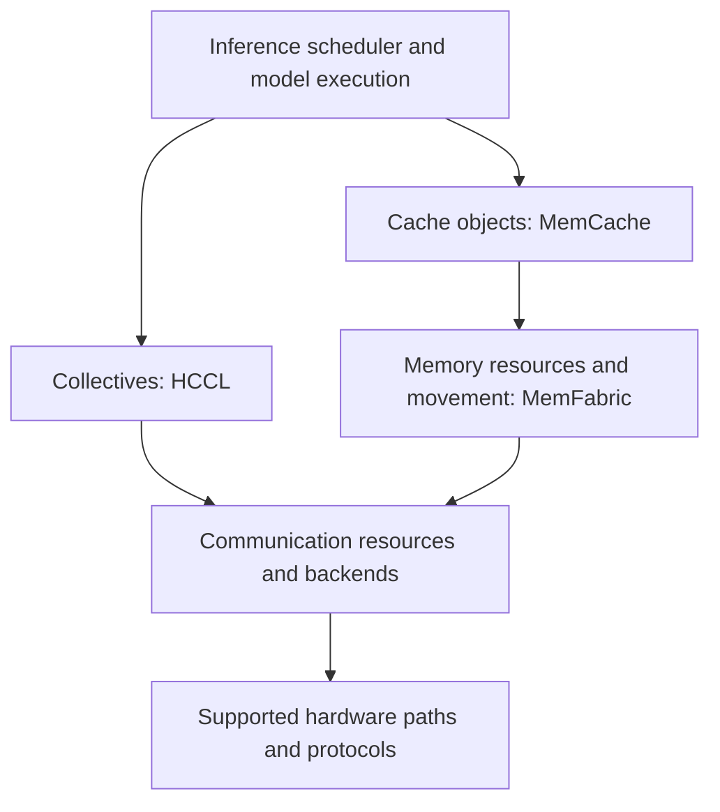

# Infrastructure: from an NPU to a distributed system

An accelerator does useful work only when the right data reaches the right memory at the right time. This guide connects Ascend NPU concepts with distributed inference, MemFabric, and KV-cache movement. A2, A3, and A5 names identify product contexts; they do not imply identical topology, memory mapping, or protocol support. Check the installed hardware and software together.

## A map of the layers

| Layer | Questions | Read next |
| --- | --- | --- |
| Hardware | Which unit computes? What is a die, package, device, or rank? | [Hardware](hardware.md) |
| Memory | Where are bytes stored? Which address space names them? | [Memory and addresses](memory-addressing.md) |
| Movement | Who copies the bytes, in which direction, and when are they ready? | [Data movement](data-movement.md) |
| Interconnect | Which path and transport can reach the destination? | [Interconnects](interconnects.md) |
| Organization | Which network carries which traffic? | [Network planes](network-planes.md) |
| Measurement | Is time spent on setup, movement, or waiting? | [Performance](performance-tools.md) |

CPU, GPU, and NPU describe processors with different design priorities, not mutually exclusive abilities. The CPU commonly orchestrates work; accelerators emphasize parallel tensor computation. HBM holds weights, activations, and KV caches, while smaller on-chip buffers feed compute units. Host DRAM and remote storage extend capacity at additional access cost.

## Physical identity is not software identity

A die is a piece of silicon. A package contains one or more dies and their connections. A card can contain packages and other components. A runtime device is a software-visible object; a rank is a participant in a communication group. These boundaries need not coincide.

These original diagrams illustrate single-die and multi-die packages, not a specification of any Ascend product. Trace the actual mapping before concluding that “cross-device” means “cross-card” or “cross-server.”

## Connect the software responsibilities

This is a responsibility map. It does not require every deployment to use every component or impose a fixed dependency chain. HCCL supplies collective communication such as AllReduce and AllGather. HCOMM exposes communication resources and operations in supported software stacks. MemFabric manages memory resources and transfers; a cache layer manages reusable objects and their lifetime. Backend selection determines the concrete path.

An endpoint identifies a communication participant. Initialization discovers peers and capabilities, prepares queues, and exchanges access descriptions. The data path then submits transfers and observes completion. Registering memory prepares access; it does not send the tensor.

## A running example: moving a KV cache

Suppose a prefill worker produces a cache needed by a decode worker. First calculate the cache size from layers, KV heads, head dimension, sequence length, and dtype. Then locate source and destination memory and determine whether the supported path is direct or host-staged. Finally establish completion and visibility before decoding consumes the result.

The same symptom, “decode is waiting,” can arise from an oversized cache, failed registration, wrong rank mapping, link congestion, or a missing notification. [The end-to-end walkthrough](end-to-end-transfer.md) separates these hypotheses.

## A learning sequence and self-check

1. Draw devices, dies, NUMA nodes, and interconnects.
2. Label H2D, D2H, and device transfers; add address spaces and registrations.
3. Separate traffic-purpose networks from control/data roles.
4. Trace initialization, submission, completion, and consumption.
5. Measure latency, bandwidth, concurrency, and overlap.

Can you explain why H2D is a direction, RDMA an access mechanism, and an external enclosure port a physical boundary? Can you explain why crossing a die need not cross a server? If so, use the [glossary](glossary.md) as a reference rather than a vocabulary list to memorize.

Sources: [Ascend documentation](https://www.hiascend.com/document), [Ascend C documentation](https://asc.gitcode.com/), and [MemFabric Hybrid implementation](https://gitcode.com/Ascend/memfabric_hybrid). Product-specific capabilities must be checked against the corresponding release.
