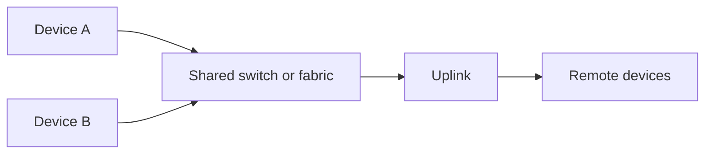

# Interconnects: links, memory access, and communication libraries

Two accelerators can exchange tensors only if a physical route, supported access mechanism, and software protocol agree. A list such as “PCIe, RDMA, HCCL” mixes three layers. Separating them helps explain why enabling a library option cannot create missing hardware reachability.

## Put each name at its layer

| Layer | Examples | Role |
| --- | --- | --- |
| Physical/system connectivity | PCIe, HCCS, Ethernet | Connect devices and carry traffic |
| Transport and memory access | RDMA, RoCE, UB/URMA-related mechanisms | Define how communication resources and remote memory are used |
| Communication software | HCCL, HCOMM, MemFabric backends | Expose operations and manage resources |
| Application operation | AllReduce, cache transfer, remote read | Express the useful work |

PCIe connects host and I/O devices, with root complexes and switches affecting route sharing. HCCS names an Ascend high-speed interconnect whose capabilities depend on the product. Ethernet supplies networking; RoCE carries RDMA over Ethernet. RDMA avoids CPU byte-by-byte copying on supported paths, but still requires setup, memory preparation, and completion handling.

Unified Bus (UB), URMA, and UBoE belong to another interconnect/access ecosystem. URMA provides remote-memory-access resources and operations; UBoE carries UB communication over Ethernet infrastructure. These labels do not imply compatibility between every engine, protocol, and memory type. “UB” here is unrelated to the AI Core Unified Buffer.

## Scale-up, scale-out, and topology

Scale-up emphasizes a tightly coupled communication domain; scale-out connects systems through a larger network. The domain may be larger than one server, so “inside a server” is not a universal definition. A full mesh directly connects every pair, requiring $n(n-1)/2$ undirected links for $n$ endpoints. Switched topologies reduce direct wiring but introduce shared links and routing constraints.

Even if A and B each have a fast local link, simultaneous remote transfers can share the uplink. Endpoint bandwidth is therefore insufficient to predict aggregate throughput.

## RDMA resources and completion

A remote operation needs an endpoint, prepared memory, access permissions, and an operation supported by the transport. Read pulls data from a remote region; write pushes data into one; send/receive semantics involve matching receive resources in many APIs. Memory keys or descriptors are not ordinary portable pointers.

Local completion, remote arrival, remote visibility, and application notification are distinct questions. Choose the documented synchronization primitive for the consumer. A correct transfer also requires a lifetime rule: deregistering or reusing memory while work remains outstanding can invalidate access.

RoCE deployments commonly combine congestion control with traffic-class and flow-control configuration. PFC pauses selected priorities; it is not a substitute for congestion control, nor a guarantee of good tail latency. Diagnose counters and topology before changing network settings.

## Software roles and a practical checklist

HCCL provides collective operations; HCOMM exposes supported communication primitives and resources; MemFabric organizes memory and movement. Their concrete relationships vary by backend. Compare implementations using the same payload, endpoints, completion guarantee, and warmup conditions.

For each path, record device generation, runtime/driver versions, endpoint placement, protocol, registered memory type, permissions, and completion mechanism. Current [Ascend communication-resource documentation](https://www.hiascend.com/doc_center/source/en/CANNCommunityEdition/910/commlib/hixlug/llmcrv2_42_25.html) explicitly distinguishes protocol and host/device placement. Its capability table is release-specific. Continue with [network planes](network-planes.md) and [end-to-end transfer](end-to-end-transfer.md).
