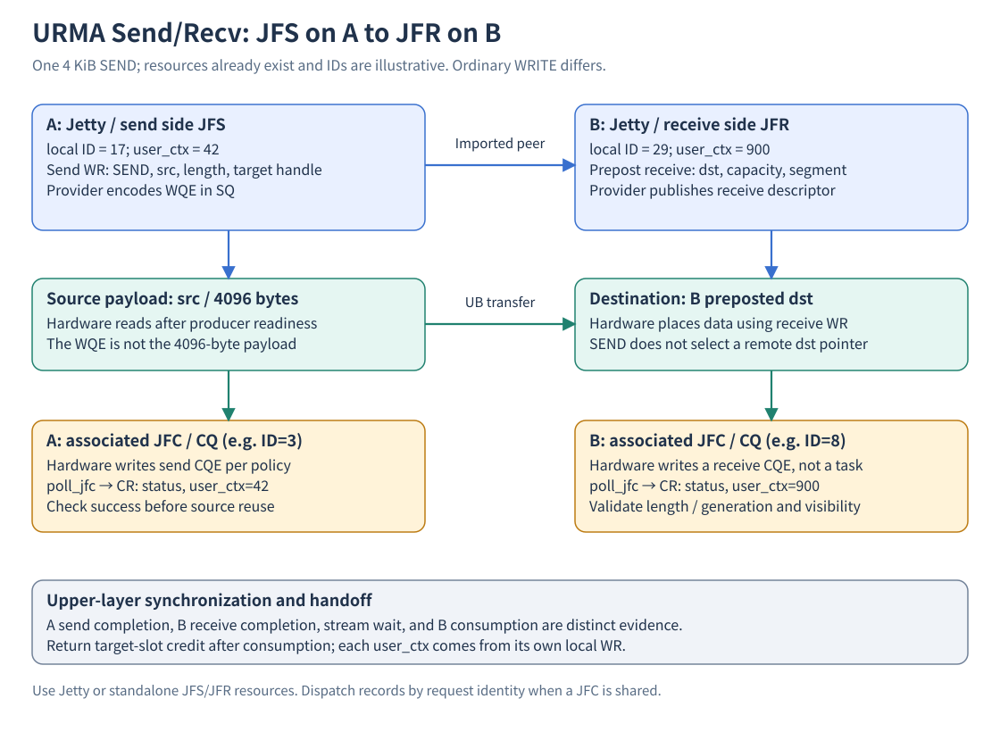
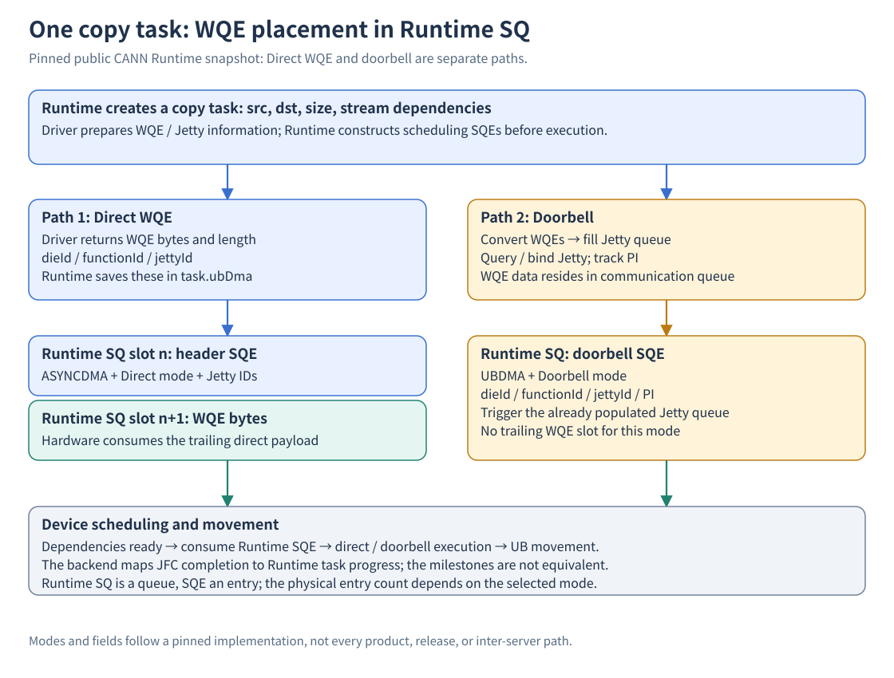
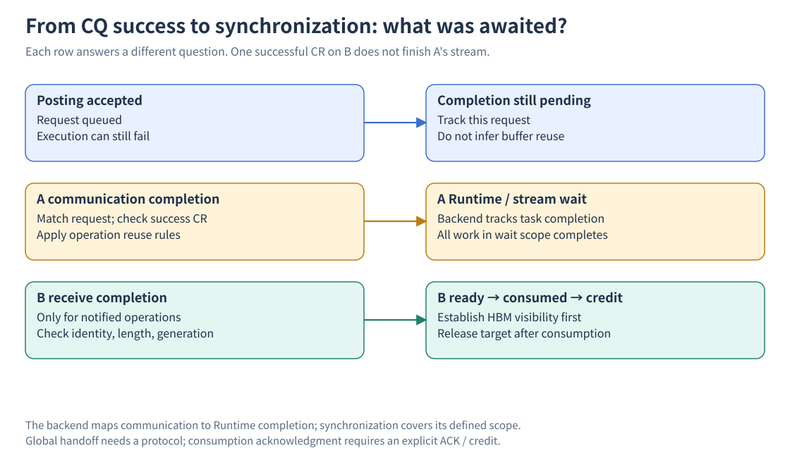

# 🛶 From Jetty to Runtime: queues and completion for one copy

A complete transfer diagram needs **communication resources on both ends, payload placement, Runtime scheduling descriptors, and the condition being awaited**. “A sends through JFS, B receives through JFR, and each side reports through JFC” describes **Send/Recv**. “Convert `src / dst / size` into WQEs and construct Runtime SQEs” describes a particular **UB asynchronous-copy implementation**. Keep the operation semantics explicit when connecting these layers.

Start with a two-sided message, then trace a copy task through public CANN Runtime source. For queue terminology and the verbs comparison, see [work queues and doorbells](work-queues.md).

## 🧩 Resources, queues, and descriptors

| Object | Responsibility | Use in a transaction |
| --- | --- | --- |
| Jetty | URMA endpoint organizing send configuration and associated receive resources | Use a combined Jetty or standalone JFS/JFR resources; do not recreate them for each copy |
| JFS | Jetty for Send | Associated with an SQ; initiates sends and one-sided reads/writes |
| JFR | Jetty for Receive | Associated with an RQ; supplies receive-buffer descriptions for messages |
| JFC | Jetty for Completion | Associated with a CQ; may be shared, requiring completion dispatch by identity |
| WR / WQE | Software request / hardware work description | Application or Runtime supplies parameters; provider/driver encodes device format |
| CQE / CR | Hardware completion entry / software URMA completion record | Hardware writes CQEs; `urma_poll_jfc` returns `urma_cr_t`; check status |
| Runtime Task / SQ / SQE | Software task / scheduling queue / queue entry | Task tracks addresses, stream, and backend state; Runtime constructs SQEs for device scheduling |

**A completion record enters a CQ, not the entire copy task.** Likewise, an SQE enters Runtime's SQ; a task does not enter a queue called “the Runtime SQE.” See the [pinned URMA types](https://github.com/openeuler-mirror/umdk/blob/ec61c9507624c5135a935f40abc242543784e790/src/urma/lib/urma/core/include/urma_types.h).

Some UB/device documentation also calls a **communication send-queue entry** an SQE. Here, “Runtime SQE” specifically denotes the scheduling descriptor; a shared abbreviation does not establish a shared layout.

### Jetty identity and request identity

- **Communication object:** `urma_jetty_id_t` contains `eid / uasid / id`; a bare integer ID is not a global address.
- **Local completion correlation:** WR `user_ctx` returns with local completion. A's send identifier does not automatically become B's receive identifier.
- **Runtime destination:** `dieId / functionId / jettyId` locate hardware submission resources; `stream_id / task_id` identify Runtime work.
- **Application generation:** layer, block, and generation belong to the application protocol. A Jetty ID does not distinguish successive uses of a target buffer.

## 📬 Figure 1: a 4 KiB Send/Recv, with progress on both ends

<figure class="model-figure" markdown="1">

[](../../assets/transfer-diagrams/en/jetty-send-recv.svg)

<figcaption markdown="span">Figure: resources and payload for a two-sided SEND. IDs are illustrative, and device queries are assumed to permit this message size. Each side handles its own completions.</figcaption>

</figure>

A transfers 4096 bytes from `src` to B. Both sides already have contexts, communication resources, and registered memory, plus peer import and any binding/connection required by their transport mode. The table uses standalone JFS/JFR API names; a combined Jetty uses the corresponding `urma_post_jetty_*_wr` APIs.

| Step | A: initiator | B: receiver |
| --- | --- | --- |
| 1. Reserve target | Wait for destination-slot permission | Reserve registered `dst` with sufficient capacity |
| 2. Publish receive | Do not send yet | Fill receive WR with `user_ctx=900`, call `urma_post_jfr_wr`; provider publishes receive WQE |
| 3. Prepare send | Wait for source production; fill SEND WR with source, length, imported peer, `user_ctx=42`, and completion policy | Keep receive resources and destination alive |
| 4. Submit | Call `urma_post_jfs_wr`; provider encodes WQE, publishes it, and notifies hardware | Wait for hardware reception; CPU need not copy every byte |
| 5. Move payload | Hardware reads source and transfers over the supported UB path | Hardware places bytes using the posted receive description |
| 6. Report completion | Hardware writes send CQE to associated JFC/CQ under its policy | Hardware writes receive CQE to associated JFC/CQ |
| 7. Check | Poll CR, match `user_ctx=42`, check success, and apply source-reuse rules | Poll CR, match `user_ctx=900`, direction, length, and application generation |
| 8. Consume/recycle | Await target-slot credit before overwriting that slot | Establish visibility/dependencies, consume, return credit, and replenish receives |

The receive WR describes B's buffer. In this API snapshot its SGL field is named `urma_jfr_wr_t.src`; the field name does not make it A's source address.

**A SEND request does not choose its destination by supplying B's `dst` pointer.** It selects peer communication resources; B's receive WR selects the buffer. Explicit remote destination addressing belongs to operations such as one-sided Write. The [URMA sample](https://github.com/openeuler-mirror/umdk/blob/ec61c9507624c5135a935f40abc242543784e790/src/urma/examples/urma_sample.c) demonstrates receive posting, sends, and CR checks.

### One-sided Write changes the receiving path

| Operation | How the destination is selected | Receive WR on B per operation? | Automatic receive completion on B? |
| --- | --- | --- | --- |
| Send/Recv | B's receive WR | Yes | Under message receive semantics |
| Ordinary Write | Remote address and registered segment in the request | No per-write Recv requirement | Normally no; define a readiness protocol |
| Ordinary Read | Initiator supplies local target and remote source segment | No per-read Recv requirement | Normally no target-application receive notification |
| Immediate/notify extensions | Operation-specific | Check API, provider, and release | Check that operation's notification/completion rules |

**Valid resources and addressing on both ends do not imply that every copy consumes a receive description on B and generates a receive CQE there.** The existence of a remote JFR/Jetty context inside the driver does not establish SEND semantics either.

Another API distinction: this URMA header uses 64-bit immediate/notify data in host byte order. The preceding ibverbs example uses 32-bit immediate in network byte order. Do not copy that field handling between APIs. See [URMA definitions](https://github.com/openeuler-mirror/umdk/blob/ec61c9507624c5135a935f40abc242543784e790/src/urma/lib/urma/core/include/urma_types.h) and the [user guide](https://docs.openeuler.org/zh/docs/24.03_LTS_SP3/unifiedbus/unifiedbus/urma/URMA%20User%20Guide.ch.html).

## 🏗️ Figure 2: what the real Runtime copy driver returns

This trace pins **public CANN Runtime mirror revision `8ff82a21f152`** and its UB asynchronous-copy branches. It is not a claim about every accelerator, CANN version, or inter-server path. Source/destination resources and addressing must already be valid for that backend; substituting an arbitrary remote pointer into a local memcpy does not create an inter-server transfer.

<figure class="model-figure" markdown="1">

[](../../assets/transfer-diagrams/en/runtime-ubdma-modes.svg)

<figcaption markdown="span">Figure: two representations of one logical copy task. Direct mode places WQE bytes in a trailing Runtime SQ slot; doorbell mode triggers an already populated Jetty queue.</figcaption>

</figure>

### 1. Runtime task creation, conversion, and submission precede execution

`ConvertAsyncDma` reads `src / destPtr / size`, along with `tsId / sqId / copyType`, from the task. Its ordinary branch calls `CreateAsyncDmaWqe`; bound/software-SQ branches use Jetty management. This occurs **before execution**, not after both ends report completion. See the [conversion entry](https://github.com/hicann/runtime/blob/8ff82a21f1527e56834ffa89117e6f7d21dc7b56/src/runtime/core/src/task/task_info/memory/memory_task_v200_base.cc#L1064).

`NpuDriver::CreateAsyncDmaWqe` constructs HAL parameters and calls `halAsyncDmaCreate`:

| Category | Fields | Meaning |
| --- | --- | --- |
| Input payload description | `src / dst / len` | Source, destination, and byte count |
| Input submission context | `tsId / sqId / type / async_dma_type` | Task kind and associated scheduling resources |
| Output hardware location | `dieId / functionId / jettyId` | Jetty addressing for later scheduling descriptors |
| Output work description | `wqe / size` | WQE byte pointer and descriptor length; output `size` is not payload size |
| Other HAL progress fields | `pi`, etc. | Used by specific branches; interpretation is mode-dependent |

**This interface does not return both a complete Runtime SQE and a WQE.** The driver supplies WQE/location information; Runtime stores it in `task.ubDma` and constructs scheduling SQEs. See the [driver wrapper](https://github.com/hicann/runtime/blob/8ff82a21f1527e56834ffa89117e6f7d21dc7b56/src/runtime/driver/npu_driver_standard_soc.cc#L66) and [HAL structures](https://github.com/hicann/runtime/blob/8ff82a21f1527e56834ffa89117e6f7d21dc7b56/pkg_inc/driver/ascend_hal_define.h#L1282).

### 2. Direct WQE: the header SQE really is followed by WQE bytes

`ConstructDavidAsyncDmaSqe` constructs an ASYNCDMA header SQE, sets Direct WQE mode and Jetty location, then copies the saved WQE bytes into `command + 1` or the equivalent next SQ slot.

```text
One Runtime copy task
  Runtime SQ slot n    : header SQE {Direct mode, die/function/jetty IDs, ...}
  Runtime SQ slot n + 1: WQE bytes {operation, addresses, lengths, device format}
```

Thus **SQE and WQE have different semantic roles, while this implementation physically places them consecutively in Runtime SQ**. Do not draw them as universally separate allocations, or generalize this layout to all WQEs. See the [Direct construction function](https://github.com/hicann/runtime/blob/8ff82a21f1527e56834ffa89117e6f7d21dc7b56/src/runtime/core/src/task/task_info/memory/memory_task_v200.cc#L131).

### 3. Doorbell: populate Jetty before publishing queue progress through SQE

The Jetty-management path calls `AsyncDmaWqeConvert`, fills WQEs into Jetty's work queue, binds/queries Jetty resources, and updates task location information. `ConstructDavidAsyncUbDbSqe` builds a UBDMA doorbell SQE carrying `jettyId / functionId / dieId / pi` and related fields.

```text
Jetty work queue : WQE[0], WQE[1], ...   <- prepare first
Runtime SQ       : doorbell SQE {Jetty location, PI, ...}
Device scheduler : execute notification after dependencies are ready
```

WQE data need not follow that header in the next slot. One task can reference several WQEs; PI is queue progress, not payload length. See [Jetty conversion, filling, and updates](https://github.com/hicann/runtime/blob/8ff82a21f1527e56834ffa89117e6f7d21dc7b56/src/runtime/feature/jetty/stream_jetty_handler.cc#L103) and [doorbell SQE construction](https://github.com/hicann/runtime/blob/8ff82a21f1527e56834ffa89117e6f7d21dc7b56/src/runtime/core/src/task/task_info/memory/memory_task_v200.cc#L173).

The driver snapshot also selects **Read or Write** according to address direction; D2D selection depends on which device executes relative to the destination. A higher-level “copy” can therefore pull or push, rather than always using SEND and posted JFR receives. See [driver opcode selection and WQE generation](https://github.com/hicann/driver/blob/b94e5d02eea5164f3f6894a8005fdef44b264042/src/ascend_hal/trs/core/urma/master/trs_master_async.c#L438).

## ✅ Figure 3: does a successful receive CQ mean synchronization succeeded?

<figure class="model-figure" markdown="1">

[](../../assets/transfer-diagrams/en/jetty-completion-scope.svg)

<figcaption markdown="span">Figure: define what the synchronization API awaits. A receive completion on B does not finish all stream work on A.</figcaption>

</figure>

**A successful receive is evidence for the wait only when the wait is defined as this receive, and request identity, generation, length, and required visibility all match.** An arbitrary successful entry in a CQ is insufficient.

| Observation | What it establishes | What it does not establish |
| --- | --- | --- |
| Successful posting API | Request accepted | Transfer completion or remote readability |
| Positive count from `urma_poll_jfc` | Some CRs were retrieved | All succeeded or belong to the awaited request |
| Matching successful send CR | This operation reached its defined sender completion point | B consumed it or released the target slot |
| Matching successful receive CR | This notified operation reached its receiver completion point | Arbitrary accelerator reads are ordered, or A's stream finished |
| Successful Runtime/stream wait | With correct backend completion/dependency integration, the wait's API scope is satisfied | All remote ranks finished computation/consumption |
| Post-consumption ACK/credit | Application-defined consumption or slot-release point | Other work outside the protocol's scope also finished |

On URMA, inspect `status`, direction, `user_ctx`, `local_id`, and operation-valid fields such as `completion_len`. Dispatch especially carefully with shared JFCs. Runtime task completion, scheduling CQEs, and error progress belong to another layer: **one JFC completion does not by itself establish Runtime task completion**. The actual backend defines how notifications, queues, and completion progress map between these layers.

The driver/device may process communication completion internally; an application need not poll every JFC itself. To establish that a particular `Synchronize` waits for this cross-end copy, trace how its actual backend connects communication completion, task progress, and errors to the wait condition. WQE/SQE construction alone does not prove the whole synchronization contract.

Connect these queues to production and layerwise consumption through [device initiation](device-initiated-transfer.md), [end-to-end KV handoff](end-to-end-transfer.md), and [layerwise inference and transfer](../ml/llm/inference/layerwise-inference.md).
