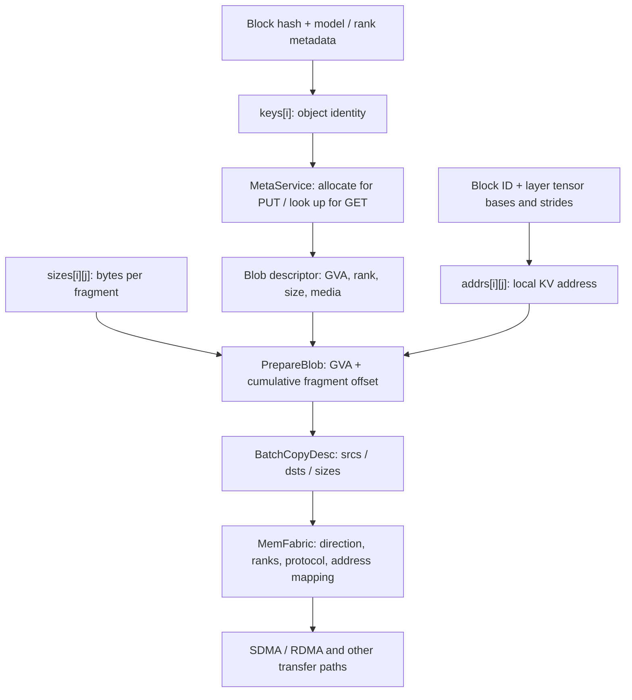

# 🗝️ vLLM Ascend KV pool: keys to MemFabric copy addresses

The central mechanism is: **a key resolves to a pooled blob's GVA, while vLLM computes local KV addresses from block IDs. These paths meet in `PrepareBlob()`, which expands them into `(src, dst, size)` entries for MemFabric.**

Think of luggage storage: the key is a claim ticket, MetaService tracks locker assignments, a GVA identifies a locker in the pool, `addrs` identifies where each bag currently sits, `PrepareBlob()` writes the moving instructions, and MemFabric executes them.

## 📌 Source revisions and scope

Verified on 2026-11-25. This walkthrough uses pinned commits; function names, key formats, and source locations refer to these revisions.

| Project | Pinned commit | Entry points followed here |
| --- | --- | --- |
| vLLM Ascend | [6e1ed5a][va-backend] | `MemcacheBackend.put()` / `get()` |
| MemCache | [54dbfe6][mc-store] | `batch_put_from_layers` / `batch_get_into_layers` |
| MemFabric Hybrid | [0491206][mf-bm] | `smem_bm_copy_batch` / `hybm_data_batch_copy` |

The main path reads and writes objects in HBM/DRAM. SSD, rewarming, and direct storage reads add branches. Here, an “IO address” means a source or destination endpoint passed to a copy interface. Further down the stack, distinguish GVA, DVA, HVA, and registered memory precisely.

## 🗺️ Where the two address paths meet



**A key identifies cached content; a block ID identifies a cache slot in the current process.** Loading the same key in another worker can use a different block ID and different local addresses.

## 📥 Arguments supplied by vLLM

`MemcacheBackend` explicitly selects device directions. These calls illustrate the interface and require a real initialized store with registered buffers.

```python
store.batch_put_from_layers(keys, addrs, sizes, 0)  # Local HBM → global pool
store.batch_get_into_layers(keys, addrs, sizes, 1)  # Global pool → local HBM
```

| Argument | Type and shape | Meaning |
| --- | --- | --- |
| `keys` | `list[str]`, length N | N objects, usually N logical KV blocks |
| `buffer_ptrs`, called `addrs` in vLLM | `list[list[int]]` | Local address of fragment j of object i; pointer values rather than Tensor contents |
| `sizes` | `list[list[int]]` | Byte length of the corresponding fragment |
| `direct` | `int` | PUT uses `0 = COPY_L2G`; GET uses `1 = COPY_G2L` |
| `replicateConfig` | Optional PUT argument | Replica count and preferred LocalServices; this vLLM call uses the default configuration, with one replica |

`L` denotes local device HBM, `H` local host memory, and `G` global pool space. The Python APIs default to host directions; vLLM overrides those defaults with 0/1. Pool configuration and allocation determine whether the global endpoint is in HBM or DRAM.

Keep the two dimensions separate:

```text
addrs = [
  [A_layer0_K, A_layer0_V, A_layer1_K, A_layer1_V, ...],  ← key A
  [B_layer0_K, B_layer0_V, B_layer1_K, B_layer1_V, ...],  ← key B
]
 ↑ Outer: objects       ↑ Inner: fragments of one object
```

The fragment count depends on the KV layout, including separate or combined K/V and MLA. MemCache treats each row as an ordered buffer list without interpreting model layers or K/V semantics. Objects may have different fragment counts, but every row must have matching address/length counts and positive lengths. See the [binding][mc-binding] and [argument validation and wrapping][mc-store].

## 🧠 Constructing keys and local addresses

At this revision, the non-layerwise path combines the `ChunkedTokenDatabase` prefix with a block hash:

```text
<model>@dcp:<dcp_rank>@head_or_tp_rank:<rank>@pp_rank:<pp_rank>@group:<group_id>@cache_role:kv@cache_family:default@<block_hash>
```

Fields such as `cache_role` and `cache_family` vary with the cache type. MemCache receives the resulting string as an object key; vLLM has already encoded model, parallel shard, and layout identity. See [`_get_key_prefix()` and the key iterators][va-metadata].

Local addresses come from `prepare_value()`. For a regular complete block, the calculation simplifies to:

```text
Local fragment address = tensor base + block_id × block_stride
```

Segmented or partial blocks also require the covered byte range:

```text
addr = base_addr + block_id × block_stride + byte_start
size = byte_end - byte_start
```

Thus `keys`, `addrs`, and `sizes` align through object index i but have distinct origins: content identity produces the key, and current cache allocation produces local addresses. See [`prepare_value()`][va-prepare] and the background on [memory and addresses](memory-addressing.md).

## 📦 PUT: allocate, transfer, then publish readability

```text
KVCacheStoreSendingThread
  → MemcacheBackend.put(keys, addrs, sizes)
  → DistributedObjectStore.batch_put_from_layers(...)
  → pybind: integer pointer values → void*
  → MmcacheStore::BatchPutFromLayers()
      → GetBufferArrays()
  → MmcClientDefault::BatchPut()
  → DoBatchPut()
      ├─ BatchAllocRequest → MetaService allocates blobs
      ├─ PutData2Blobs()
      │   → PrepareMultiBlobs() → PrepareBlob()
      │   → SubmitPutTask()
      │   → MmcBmProxy::BatchDataPut() → MemFabric
      └─ Synchronously update WRITE_OK / WRITE_FAIL
```

`GetBufferArrays()` constructs one `MmcBufferArray` per key, with fragments described by `{addr, type, offset=0, len}`. `TotalSize()` sums their lengths. Wrapping descriptors does not move payload bytes.

`DoBatchPut()` sends keys, total sizes, allocation options, and operation identity. On the server:

```text
MetaNetServer::HandleBatchAlloc()
  → MmcMetaMgrProxy::BatchAlloc()
  → MmcMetaManager::Alloc()
  → MmcGlobalAllocator::Alloc()
  → MmcBlobAllocator::Alloc()
```

A LocalService previously registered its pool's GVA base, capacity, and medium with MetaService. The allocator selects a pool according to policy and takes a free range:

```text
blob.gva = pool GVA base bmAddr_ + allocated targetOffset
```

`MmcMetaManager::Alloc()` then establishes `key → object metadata → blob`. Each returned `MmcMemBlobDesc` includes GVA, rank, size, medium, and state. Replication produces multiple blobs. Allocation produces the GVA; the key indexes that allocation. See [object allocation][mc-meta] and the [blob allocator][mc-allocator].

The client copies data using these descriptors, waits for the relevant tasks, and synchronously reports write results. `WRITE_OK` moves a successfully written object from `ALLOCATED` to `READABLE`. Allocation and readability are separate stages. See [`DoBatchPut()`][mc-client] and the [state machine][mc-state].

## 🧩 PrepareBlob: expanding one key into multiple IO entries

Let object i have GVA `Gi`, local fragment j have address `Aij`, and its length be `Sij`:

```text
Oij = sizes[i][0] + ... + sizes[i][j-1]

PUT: src = Aij,      dst = Gi + Oij, len = Sij
GET: src = Gi + Oij, dst = Aij,      len = Sij
```

`PrepareBlob()` tracks this cumulative offset in `shift`. PUT uses `blobIsSrc=false`, while GET uses `true`, exchanging the local and global endpoints. `PrepareMultiBlobs()` repeats the expansion for every write replica. See [`PrepareBlob()`][mc-prepare].

Consider two keys, each with fragments of 4 KiB and 2 KiB. These are teaching addresses chosen for readability, not real NPU addresses.

| Object / fragment | Local address | Allocated blob GVA | Fragment's pool address | Bytes |
| --- | --- | --- | --- | --- |
| A / fragment 0 | `0x100000` | `0x900000` | `0x900000` | `0x1000` |
| A / fragment 1 | `0x200000` | `0x900000` | `0x901000` | `0x0800` |
| B / fragment 0 | `0x101000` | `0xA00000` | `0xA00000` | `0x1000` |
| B / fragment 1 | `0x200800` | `0xA00000` | `0xA01000` | `0x0800` |

The PUT descriptors flatten to:

```text
srcs  = [0x100000, 0x200000, 0x101000, 0x200800]
dsts  = [0x900000, 0x901000, 0xA00000, 0xA01000]
sizes = [0x1000,   0x0800,   0x1000,   0x0800  ]
```

This executable example only models descriptor expansion; it does not access a device or initiate DMA:

```python
# runnable-example
addrs = [[0x100000, 0x200000], [0x101000, 0x200800]]
sizes = [[0x1000, 0x0800], [0x1000, 0x0800]]
gvas = [0x900000, 0xA00000]
copies = []
for local_parts, lengths, gva in zip(addrs, sizes, gvas):
    offset = 0
    for address, length in zip(local_parts, lengths):
        copies.append((address, gva + offset, length))
        offset += length
assert [dst for _, dst, _ in copies] == [0x900000, 0x901000, 0xA00000, 0xA01000]
assert len(copies) == 4
assert sum(length for _, _, length in copies) == 12 * 1024
for src, dst, length in copies:
    print(f"{src:#x} -> {dst:#x}: {length} bytes")
```

Two keys produce four copy entries. Writing two replicas of both keys would produce eight entries in this example. MemCache can aggregate or split submissions; lower layers may group by rank, merge adjacent ranges, or split further. Descriptor count therefore differs from hardware task count.

## 📤 GET: look up existing addresses and scatter into current buffers

```text
KVCacheStoreRecvingThread
  → MemcacheBackend.get()
  → batch_get_into_layers()
  → MmcacheStore::BatchGetIntoLayers()
  → MmcClientDefault::BatchGet()
      ├─ BatchGetRequest
      │   → MetaNetServer::HandleBatchGet()
      │   → MmcMetaMgrProxy::BatchGet()
      │   → MmcMetaManager::GetByRank()
      │   ← Return readable blob descriptors and attach a read lease
      └─ Use blobs[0] from the response
          → PrepareBlob(..., blobIsSrc=true)
          → SubmitGetTask()
          → MmcBmProxy::BatchDataGet() → MemFabric
```

In the example, GET reads pool locations such as `0x900000` and `0x901000`, but may target newly allocated buffers in another worker. The client checks that the local fragments' total size equals the blob size, reports `READ_FINISH` after reading, and checks the read lease deadline. See [`BatchGet()`][mc-get].

**A blob stores bytes concatenated in order; the GET buffer descriptions determine how they are scattered back.** The caller must preserve the corresponding fragment order and sizes. Equal total lengths alone cannot establish the correct layer or K/V interpretation.

The Python layers APIs return status lists aligned with keys; 0 means success. At this vLLM revision, the backend converts PUT results to a boolean list and keeps GET status codes. Result count follows object count rather than copy-entry count. See [MemcacheBackend][va-backend].

## 🚚 What MemFabric does next

`BatchDataPut()` / `BatchDataGet()` wrap `BatchCopyDesc` as `smem_batch_copy_params`:

| Field | Source |
| --- | --- |
| `sources` | `srcs` |
| `destinations` | `dsts` |
| `dataSizes` | `sizes` |
| `batchSize` | Number of copy entries in this submission |
| `stream` | Null by default on this MemCache path |

```text
MmcBmProxy::BatchDataPut / BatchDataGet
  → MFSmemApi::SmemBmCopyBatch(handle, params, direction, flags=0)
  → Dynamic library symbol smem_bm_copy_batch()
  → SmemBmEntry::DataCopyBatch()
  → hybm_data_batch_copy()
  → MemEntityDefault::BatchCopyData()
  → HostComposeDataOp::BatchDataCopy()
  → Protocol-specific BatchDataCopy()
```

MemFabric now receives addresses, lengths, direction, and a handle. Keys remain in MemCache's object and completion-state management. See the [MemCache BM proxy][mc-proxy], [MemFabric BM API][mf-bm], and [BM-to-HYBM dispatch][mf-entry].

`SmemBmEntry` refines the direction using the global endpoint's medium, for example local device to global host. `MemEntityDefault` locates source and destination ranks and builds groups. `HostComposeDataOp` selects available SDMA, Device RDMA, Host RDMA, or other implementations. See the [HYBM entity][mf-entity] and [protocol dispatch][mf-compose].

For `device_sdma`, a global endpoint's GVA is resolved to an address accessible by the device. The current code first tries the entity's imported-GVA resolver, then falls back to `HybmVaManager::TransformVa(GVA, GVA→DVA)`:

```text
Input GVA  = GVA_base + offset
                        ↓ Mapping lookup
Output DVA = DVA_base + offset
```

`BatchCopyG2G()` can merge ranges whose source and destination are both contiguous, then submit work and wait for completion. The regular internal-stream path constructs SDMA tasks; explicit streams and other configurations select their corresponding branches. Host RDMA uses the appropriate HVA/registered-memory and transport mechanisms. Keep GVA, DVA, HVA, and DMA IOVA meanings separate. See [VA translation][mf-va], the [SDMA implementation][mf-sdma], and [Host RDMA translation][mf-host-rdma]. For background, read [GVA unified addressing](gva-unified-addressing.md).

## 🪜 Layers APIs and layerwise execution

The `batch_*_layers` interface describes multiple buffers per key. `use_layerwise=True` describes execution and transfer scheduling granularity; trace these separately.

At the pinned vLLM revision, the MemCache layerwise GVA path prepares write GVAs through `batch_alloc`, prepares read GVAs through `batch_get_key_info` and `batch_add_lease`, computes per-layer offsets for `batch_copy`, and publishes writes with `batch_write_finish`. Allocation/lookup and per-layer payload movement are separated. See [GVA preparation][va-gva] and [layerwise transfer][va-layer-transfer].

Continue with [layerwise execution and buffer lifetimes](../ml/llm/inference/layerwise-inference.md) to connect address-list construction with when buffers may be transferred, consumed, and reused.

## 🔎 Debug along the source boundaries

| Symptom | Boundary to inspect first |
| --- | --- |
| Unexpected key hits or misses | Matching model, hash, parallel shard, group, role, and family |
| Total-size validation failure | Fragment counts, order, byte lengths, and KV layout for the same key |
| Missing GVA mapping | Live allocation descriptors, completed pool import/registration, and sufficient memory lifetime |
| Correct addresses and lengths but wrong layers | GET scatter order versus PUT concatenation order |
| Copy-entry count differs from task count | Replica expansion, MemCache aggregation, rank grouping, contiguous merging, and lower-level splitting |
| An immediate read cannot see a write | Both copy completion and `WRITE_OK` publication |

[va-backend]: https://github.com/vllm-project/vllm-ascend/blob/6e1ed5a76a01f110e4a0682ba93ddd3b1265e5cf/vllm_ascend/distributed/kv_transfer/kv_pool/ascend_store/backend/memcache_backend.py#L406
[va-metadata]: https://github.com/vllm-project/vllm-ascend/blob/6e1ed5a76a01f110e4a0682ba93ddd3b1265e5cf/vllm_ascend/distributed/kv_transfer/kv_pool/ascend_store/metadata.py#L371
[va-gva]: https://github.com/vllm-project/vllm-ascend/blob/6e1ed5a76a01f110e4a0682ba93ddd3b1265e5cf/vllm_ascend/distributed/kv_transfer/kv_pool/ascend_store/layerwise/planes/gva.py#L105
[va-layer-transfer]: https://github.com/vllm-project/vllm-ascend/blob/6e1ed5a76a01f110e4a0682ba93ddd3b1265e5cf/vllm_ascend/distributed/kv_transfer/kv_pool/ascend_store/layerwise/kv_transfer.py#L796
[mc-binding]: https://gitcode.com/Ascend/memcache/blob/54dbfe65435cbbe8e240ab5befe7a6682382e819/src/memcache/csrc/python_wrapper/pymmc.cpp#L865
[mc-store]: https://gitcode.com/Ascend/memcache/blob/54dbfe65435cbbe8e240ab5befe7a6682382e819/src/memcache/csrc/mmcache_store.cpp#L638
[mc-client]: https://gitcode.com/Ascend/memcache/blob/54dbfe65435cbbe8e240ab5befe7a6682382e819/src/memcache/csrc/client/mmc_client_default.cpp#L557
[mc-meta]: https://gitcode.com/Ascend/memcache/blob/54dbfe65435cbbe8e240ab5befe7a6682382e819/src/memcache/csrc/meta_service/mmc_meta_manager.cpp#L1539
[mc-allocator]: https://gitcode.com/Ascend/memcache/blob/54dbfe65435cbbe8e240ab5befe7a6682382e819/src/memcache/csrc/meta_service/mmc_blob_allocator.cpp#L46
[mc-state]: https://gitcode.com/Ascend/memcache/blob/54dbfe65435cbbe8e240ab5befe7a6682382e819/src/memcache/csrc/entities/mmc_blob_state.cpp#L57
[mc-proxy]: https://gitcode.com/Ascend/memcache/blob/54dbfe65435cbbe8e240ab5befe7a6682382e819/src/memcache/csrc/local_service/mmc_bm_proxy.cpp#L392
[mf-bm]: https://gitcode.com/Ascend/memfabric_hybrid/blob/049120611b5dcc96fa71afcaf758f11d4b15f07a/src/smem/csrc/smem_bm/smem_bm.cpp#L613
[mf-entry]: https://gitcode.com/Ascend/memfabric_hybrid/blob/049120611b5dcc96fa71afcaf758f11d4b15f07a/src/smem/csrc/smem_bm/smem_bm_entry.cpp#L616
[mf-entity]: https://gitcode.com/Ascend/memfabric_hybrid/blob/049120611b5dcc96fa71afcaf758f11d4b15f07a/src/hybm/csrc/entity/hybm_entity_default.cpp#L1343
[mf-compose]: https://gitcode.com/Ascend/memfabric_hybrid/blob/049120611b5dcc96fa71afcaf758f11d4b15f07a/src/hybm/csrc/data_operation/host/hybm_compose_data_op.cpp#L217
[mf-va]: https://gitcode.com/Ascend/memfabric_hybrid/blob/049120611b5dcc96fa71afcaf758f11d4b15f07a/src/hybm/csrc/mm/hybm_va_manager.cpp#L268
[mf-sdma]: https://gitcode.com/Ascend/memfabric_hybrid/blob/049120611b5dcc96fa71afcaf758f11d4b15f07a/src/hybm/csrc/data_operation/host/hybm_data_op_sdma.cpp#L531
[mf-host-rdma]: https://gitcode.com/Ascend/memfabric_hybrid/blob/049120611b5dcc96fa71afcaf758f11d4b15f07a/src/hybm/csrc/data_operation/host/hybm_data_op_host_rdma.cpp#L102
[va-prepare]: https://github.com/vllm-project/vllm-ascend/blob/6e1ed5a76a01f110e4a0682ba93ddd3b1265e5cf/vllm_ascend/distributed/kv_transfer/kv_pool/ascend_store/metadata.py#L493
[mc-prepare]: https://gitcode.com/Ascend/memcache/blob/54dbfe65435cbbe8e240ab5befe7a6682382e819/src/memcache/csrc/client/mmc_client_default.cpp#L1345
[mc-get]: https://gitcode.com/Ascend/memcache/blob/54dbfe65435cbbe8e240ab5befe7a6682382e819/src/memcache/csrc/client/mmc_client_default.cpp#L704
