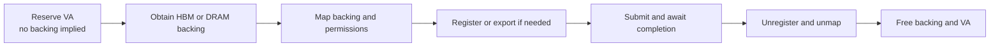

# 🧠 Memory and addresses: where bytes live and who can access them

A numerical address is meaningful only in an address space. Two processes can use the same virtual address for different storage, and a device may need a mapping or registration before accessing host memory. This is why copying a pointer value is not equivalent to sharing a buffer.

## 🧭 Capacity, locality, and persistence

| Storage | Typical role | Main question |
| --- | --- | --- |
| AI Core local buffers, L0/L1/UB | Tiles and intermediate computation | Does the working set fit the supported memory hierarchy? |
| Device global memory, often HBM | Weights, activations, KV cache | Is capacity or bandwidth the limiting resource? |
| Host DRAM | Input staging, offload, larger memory pools | Is placement local to the device's I/O path? |
| Remote memory | Shared or disaggregated capacity | What are access latency and failure semantics? |
| SSD/storage | Persistent data and checkpoints | Is the access pattern sequential, random, or cached? |

AI Core L1 is a hardware buffer. A software system's “L1 cache,” such as a hierarchical KV-cache tier, is a different abstraction. Likewise, local Unified Buffer and Unified Bus share an abbreviation but not a function.

## 🧠 One name, several address spaces

A CPU MMU translates a process virtual address (VA) to physical storage (PA), enforcing permissions. Devices may use I/O virtual addresses (IOVA) translated by an IOMMU. Shared Virtual Memory can simplify addressing on supported systems, but it does not eliminate migration, coherence, permission, or ordering requirements.

For a closer look at a CPU translation, continue with [Page tables, PTEs, huge pages, and address translation](page-tables-huge-pages.md): distinguish page tables from the TLB, split addresses into page numbers and offsets, and use complete 4KB, 2MB, and 1GB examples to understand huge-page performance benefits.

In a distributed memory manager, **unified addressing** means that a resource can have a stable identity in a shared *logical* address space. It does not make every machine's physical memory one coherent heap. In [MemFabric Hybrid's implementation](https://gitcode.com/Ascend/memfabric_hybrid), the important names are:

| Name | What it identifies | Who can use it directly? |
| --- | --- | --- |
| GVA (global virtual address) | A logical address or offset used to identify a managed slice across participants | The manager and its translation/transfer APIs; it is **not** a portable pointer to dereference |
| HVA (host virtual address) | An address in a particular process's CPU virtual address space | That process, if the region is mapped and accessible |
| DVA (device virtual address) | An address in a particular device context | The device/runtime when the backing and mapping are valid |

For example, a cache slice might be named by GVA `G+0x2000` while process A sees HVA `H_A+0x2000` and device B sees DVA `D_B+0x2000`. Their numerical values need not match. A lookup or mapping connects them; exporting the GVA alone does not grant access to the bytes. Different backends can represent these relationships differently, so inspect the API and memory type before assuming a conversion exists. In the MemFabric source, host-transfer and device-transfer paths explicitly translate GVA to HVA or DVA where needed.

## 📍 Allocation is a lifecycle, not one call

The word “allocate” often hides several independent steps. Keeping them separate explains why a large address range can be reserved even when the device has far less physical memory.

1. **Reserve a virtual range.** Choose a suitably sized, aligned region in an address space. This claims *addresses*, not necessarily HBM or DRAM pages. A failed reservation can mean address-space exhaustion, fragmentation, or alignment constraints.
2. **Create or obtain backing storage.** A runtime allocates physical device memory or host pages, or obtains a shareable allocation handle. The exact point where physical pages are committed depends on the allocator and backend; “reserve” alone is not proof of commitment.
3. **Map backing into the range.** Associate pages or a handle with the chosen DVA/HVA range, with a device/context and access permissions. A mapped address is meaningful only while this mapping and its backing remain alive.
4. **Register or export when another engine needs access.** DMA/RDMA or a peer device may require registration, pinning, import, or an access descriptor. Registration is an access preparation step, not a copy. A host allocation used for DMA may need different handling from an ordinary pageable `malloc` buffer.
5. **Use and synchronize.** Submit work, wait for the relevant completion, and establish required visibility before a different stream, device, or process consumes the bytes.
6. **Retire in reverse dependency order.** Stop new users; wait for in-flight work; release imported mappings/registrations; unmap; free backing; finally release reserved VA. The owner of each handle must be explicit.

This is a conceptual lifecycle, not a mandatory call order for every backend: some allocators combine steps, and some imports map memory that another participant allocated. The [MemFabric Hybrid API](https://gitcode.com/Ascend/memfabric_hybrid) exposes virtual-space reservation separately from slice allocation and GVA-to-VA conversion. Its internal VA manager records GVA, DVA, HVA, size, and memory type for a slice. That record is metadata; actual access still needs the corresponding mapping and permissions.

### A concrete reservation example

Suppose a service reserves a **64 GiB** device VA window for a cache pool, then backs only **8 GiB** with HBM. It can hand out logical locations within the backed portion, but accessing an unbacked address in the remaining 56 GiB is invalid. Later growth requires more backing and mappings, subject to free HBM and runtime limits. Releasing the 8 GiB backing does not automatically make the virtual window available to another allocator; the reservation must also be released. Conversely, freeing the reservation while DMA still refers to its mapped slices is unsafe. The numbers illustrate the distinction; they are not a recommendation for any device.

## 🚀 Translation and access preparation

When moving a slice to another process or device, exchange a supported descriptor that includes enough identity, size, type, and access information. The receiver imports it and establishes its *own* mapping. A GVA may help locate the slice, but does not substitute for the import or transfer protocol. For the communication sequence, see [the end-to-end transfer](end-to-end-transfer.md).

## 📍 NUMA makes placement observable

In a multi-socket system, a CPU can access local or remote DRAM with different cost. A device attached near NUMA node 0 may access node-0 buffers more efficiently than node-1 buffers. CPU affinity alone does not guarantee memory placement: allocation policy and first-touch behavior matter.

For a host-offload benchmark, record the submitting CPU, actual buffer placement, device PCIe location, and network adapter location. Compare otherwise identical local and remote placements. A bandwidth drop can come from a socket interconnect rather than the accelerator link.

## ⚠️ Diagnose an invalid address without guessing

For `TransformVa no mapping`, ask whether the expected mapping exists in the current context. For registration failure, check type, address, size, alignment, permissions, supported backend, and resource limits. For import failure, validate handle provenance, memory type, and exporter lifetime. A pointer inside a valid allocation can still fail if `offset + length` exceeds its bounds.

Ownership should specify who allocates, registers, submits, waits, and releases each resource. On timeout, determine whether work is cancelled or merely unobserved before freeing memory. Link this model to [asynchronous copies](data-movement.md) and [the transfer walkthrough](end-to-end-transfer.md).

Sources: [Linux DMA API guide](https://docs.kernel.org/core-api/dma-api-howto.html) and [MemFabric Hybrid](https://gitcode.com/Ascend/memfabric_hybrid). The Linux guide explains address categories; a device runtime may impose additional rules.
