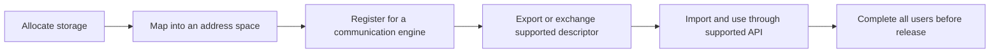

# Memory and addresses: where bytes live and who can access them

A numerical address is meaningful only in an address space. Two processes can use the same virtual address for different storage, and a device may need a mapping or registration before accessing host memory. This is why copying a pointer value is not equivalent to sharing a buffer.

## Capacity, locality, and persistence

| Storage | Typical role | Main question |
| --- | --- | --- |
| AI Core local buffers, L0/L1/UB | Tiles and intermediate computation | Does the working set fit the supported memory hierarchy? |
| Device global memory, often HBM | Weights, activations, KV cache | Is capacity or bandwidth the limiting resource? |
| Host DRAM | Input staging, offload, larger memory pools | Is placement local to the device's I/O path? |
| Remote memory | Shared or disaggregated capacity | What are access latency and failure semantics? |
| SSD/storage | Persistent data and checkpoints | Is the access pattern sequential, random, or cached? |

AI Core L1 is a hardware buffer. A software system's “L1 cache,” such as a hierarchical KV-cache tier, is a different abstraction. Likewise, local Unified Buffer and Unified Bus share an abbreviation but not a function.

## Translation and access preparation

A CPU MMU translates a process virtual address (VA) to physical storage (PA), enforcing permissions. Devices may use I/O virtual addresses (IOVA) translated by an IOMMU. Shared Virtual Memory can simplify addressing on supported systems, but it does not eliminate migration, coherence, permission, or ordering requirements. “GVA” is implementation-specific; inspect its definition before treating it as globally dereferenceable.

This is a conceptual lifecycle, not a mandatory call order for every backend. Allocation creates resources; mapping creates an address relationship; registration prepares access; export/import communicates an authorized handle. One operation does not automatically perform all others.

## NUMA makes placement observable

In a multi-socket system, a CPU can access local or remote DRAM with different cost. A device attached near NUMA node 0 may access node-0 buffers more efficiently than node-1 buffers. CPU affinity alone does not guarantee memory placement: allocation policy and first-touch behavior matter.

For a host-offload benchmark, record the submitting CPU, actual buffer placement, device PCIe location, and network adapter location. Compare otherwise identical local and remote placements. A bandwidth drop can come from a socket interconnect rather than the accelerator link.

## Diagnose an invalid address without guessing

For `TransformVa no mapping`, ask whether the expected mapping exists in the current context. For registration failure, check type, address, size, alignment, permissions, supported backend, and resource limits. For import failure, validate handle provenance, memory type, and exporter lifetime. A pointer inside a valid allocation can still fail if `offset + length` exceeds its bounds.

Ownership should specify who allocates, registers, submits, waits, and releases each resource. On timeout, determine whether work is cancelled or merely unobserved before freeing memory. Link this model to [asynchronous copies](data-movement.md) and [the transfer walkthrough](end-to-end-transfer.md).

Sources: [Linux DMA API guide](https://docs.kernel.org/core-api/dma-api-howto.html) and [MemFabric Hybrid](https://gitcode.com/Ascend/memfabric_hybrid). The Linux guide explains address categories; a device runtime may impose additional rules.
