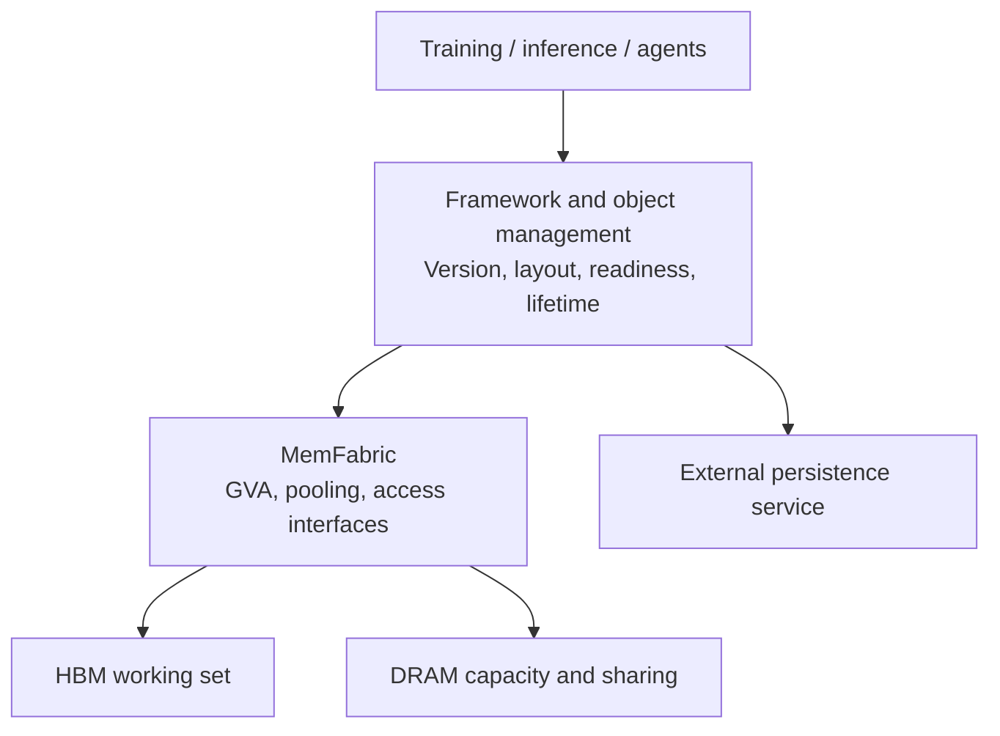

# 🧵 Memory fabrics: five patterns and model state

After [GVA unified addressing](gva-unified-addressing.md), follow one piece of model data:
who produces it, where does it live, who consumes it, and when can it be reclaimed?
These questions connect addressing and transport to application scheduling.

This chapter uses MemFabric as an implementation reference and develops five composable patterns.
Existing integrations and design examples are distinguished; unified addresses alone do not create an object service.

## 🧠 Identify the data

| Object | Production and use | Optimization to investigate |
| --- | --- | --- |
| Parameter | Updated by a learner; read during training and inference | Version publication and shard transfer |
| Activation | Produced in forward; used later in backward | Offload, prefetch, or recomputation |
| Optimizer state | Updated by the optimizer | Sharded residency and read/write scheduling |
| KV cache | Produced by prefill/decode; reused by attention | Prefix reuse, handoff, and tiered fetch |
| Trajectory | Produced by actors; consumed by learners | Producer/consumer separation and policy versions |
| Feature | Produced by an encoder; consumed downstream | Execution decoupling and compatible feature reuse |

HBM holds the active compute working set, host DRAM supplies capacity and sharing, and external storage provides
durability. Placement depends on size, access frequency, reuse, and time until the next use, not just the object name.

## 🏗️ Separate three responsibilities



An object ID names application identity, such as shard 3 of model version V10. A GVA describes a pool access location.
Migration may update that association; whether an old GVA remains valid depends on the implementation.
Object management can use existing framework directories, queues, or block tables rather than a centralized service.

| Interface | Starting point | Main use |
| --- | --- | --- |
| BM | Create pooled memory and obtain a GVA | Multi-node DRAM/HBM space and access |
| TRANS | Register existing application memory | Cross-node reads/writes and asynchronous batches |
| SHM | Shared space and device access context | Custom communication kernels and fine-grained access |
| Acc Offload | Local or shared DRAM pools | Batched sparse copies, KV offload, shared weights |

See the [MemFabric project][mf] and [SHM interface][shm]. Supported combinations depend on hardware, memory type,
backend, and software version.

## 1. Global data sharing

Organize data needed by several processes as shared objects, then read through the supported addresses and interfaces.
Read-only weights and compatible prefixes offer clear sharing boundaries. Mutable data also needs ownership and
versions.

The [Engram example][engram] describes cross-instance host-weight sharing and unequal capacity contributions by ranks.
This demonstrates a particular shared-access deployment, not arbitrary reuse of every tensor across instances.

Measure duplicated resident bytes and avoided recomputation, while including local compute caches and staging buffers.

## 2. Producer/consumer decoupling

A producer writes blocks and publishes readiness; consumers read them and return references or capacity when done.
Prefill/decode, actor/learner, and encoder/backbone fit this structure but have different data semantics.

Publishing an address, submitting a transfer, completing it, and admitting application consumption are separate events.
If consumers fall behind, backpressure or capacity limits prevent unconsumed objects from filling the pool.

[FlowTrain][flowtrain] coordinates encoder/backbone producer-consumer execution through a unified memory pool,
alongside heterogeneous parallel allocation and dynamic packing. Its reported performance belongs to the full framework.

## 3. Heterogeneous pooling and tiering

Keep complete data or colder state in DRAM and move the required layer, tile, or block into HBM.
Choose prefetch and eviction by comparing capacity gains with additional access cost.

Activation offload uses the interval between forward production and backward consumption; KV offload uses layer/block
access patterns. They can share movement primitives without sharing the complete lifetime and scheduling policy.
See [Acc Offload examples][offload] and [serving frameworks](serving-frameworks.md).

DRAM staging must pass through an independent persistence operation before it becomes a durable checkpoint.

## 4. State migration and remapping

When workers, parallel layouts, or expert locations change, update object/shard placement and access descriptions.
Determine target shards, transfer ranges, the publication boundary, and when the old resources may be reclaimed.

[TensorRTL][trtl] provides tensor layout and redistribution facilities with RL and EPLB adaptation examples.
Resharding changes shard layout; BM join/leave changes pool membership. Neither alone implements agent recovery,
transactional weight-version switching, or arbitrary application-object migration.

Follow a shard-intersection example in [actor/learner dataflow](../ml/llm/alignment/actor-learner-dataflow.md).

## 5. Pool-driven communication/computation pipelines

Schedule selection, address calculation, movement, compute, and synchronization around shared data.
Examples include fetching the next KV block during current-block attention or transferring tokens into expert windows.
The targets are intermediate buffers, repeated reads/writes, and whole-batch waiting.

[ZBAL][zbal] provides MoE dispatch/combine operations; [pooled-HBM MoE research][moe] examines destination-expert-window
access. Analyze expert-weight management and token dispatch/combine as separate data paths.

The patterns compose: shared KV uses pattern 1, P/D handoff uses pattern 2, DRAM/HBM placement uses pattern 3,
worker takeover involves pattern 4, and attention prefetch pipelines use pattern 5.
Each combination still needs compatible algorithms, synchronization, and supported hardware paths.

## 🧮 Work through an ideal pipeline

Assume four blocks, 2 ms transfer and 3 ms compute per block, independent stage resources, double buffering,
and no synchronization overhead.

$$
T_{serial}=N(t_m+t_c),\qquad
T_{pipe}=t_m+t_c+(N-1)\max(t_m,t_c).
$$

```python
# runnable-example
blocks, move_ms, compute_ms = 4, 2, 3
serial_ms = blocks * (move_ms + compute_ms)
pipeline_ms = move_ms + compute_ms + (blocks - 1) * max(move_ms, compute_ms)
assert serial_ms == 20
assert pipeline_ms == 14
```

The bytes moved are unchanged, but ideal elapsed time falls from 20 ms to 14 ms because compute covers some movement.
Real pipelines also depend on shared bandwidth, buffer count, synchronization, scheduling, and kernel contention.
An asynchronous call does not establish hardware overlap.

## 🚦 Publication and reclamation are part of the data path

```text
Allocate -> writing -> required transfer complete and visible -> READY -> consume -> eligible for reclamation
```

READY is an illustrative application-protocol state, not a universal MemFabric API name.
Associate it with an object version and this write generation; readers must satisfy the required visibility conditions.
Leases or reference counts protect in-use data. A timeout alone does not establish that an in-flight access has stopped.
See the [end-to-end transfer boundaries](end-to-end-transfer.md).

## 📊 Connect memory metrics to application outcomes

| Intended change | Data-path observation | Application observation |
| --- | --- | --- |
| Store less | Authoritative copies, duplicate bytes, peak memory | Supported concurrency and context |
| Handoff less | Payload bytes, buffer hold time, serialization | Refit pause and visibility delay |
| Hide waiting | Timelines, compute/transfer overlap, ready queues | Step time, TTFT, TPOT |
| Reduce reordering | Relay/reorder bytes and kernel time | Throughput and tail latency |

Hold model, device budget, workload distribution, and SLO fixed. Goodput counts work meeting the stated constraints;
MFU measures model compute utilization under an explicit accounting convention. Neither follows directly from link
bandwidth.
See [performance tools](performance-tools.md).

**Exercise.** After moving KV from HBM to remote DRAM, how much memory is saved once local caching is included?
How many bytes must each decode step fetch, and can the path sustain it?
Continue with [shared inference state pools](../ml/llm/inference/shared-state-pools.md).

## 📚 Implementation references

Implementation entry points were checked on 2026-11-28. Compositions and generic design examples do not claim that every
application is already integrated.

[mf]: https://gitcode.com/Ascend/memfabric_hybrid
[shm]: https://gitcode.com/Ascend/memfabric_hybrid/blob/master/src/smem/include/host/smem_shm.h
[engram]: https://gitcode.com/Ascend/memfabric_hybrid/tree/master/docs/zh/wiki/user_guide/examples/engram-offload
[offload]: https://gitcode.com/Ascend/memfabric_hybrid/tree/master/examples/kv_offload
[trtl]: https://gitcode.com/Ascend/memfabric_hybrid/tree/master/app/tensorRTL
[zbal]: https://gitcode.com/Ascend/memfabric_hybrid/tree/master/app/zbal
[flowtrain]: https://aclanthology.org/2026.emnlp-industry.101/
[moe]: https://arxiv.org/abs/2605.06055
