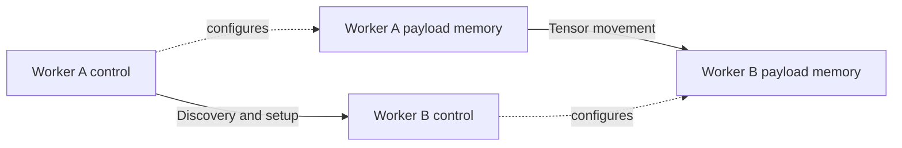

# 🌐 Network planes: traffic purpose versus implementation role

“Plane” has several meanings in infrastructure discussions. A parameter network describes what traffic is carried; a control plane describes what the software is doing. These categories overlap rather than forming one flat list.

## 🏗️ Classify networks by purpose

| Network purpose | Typical traffic | Questions for deployment |
| --- | --- | --- |
| Parameter/AI communication | Gradients, model-parallel activations, collective traffic | What bandwidth, latency, and congestion behavior are required? |
| Storage/sample | Datasets, weights, checkpoints, results | Does loading compete with training or inference? |
| Business/management | Job submission, deployment, monitoring, service access | Which services and failure domains share this network? |
| Out-of-band management | BMC and hardware maintenance | Can hardware still be managed when the host OS is unavailable? |

Names differ across deployments. A KV-cache transfer may use the high-performance AI network, a dedicated network, or a shared route. Discover the actual placement rather than infer it from “data network.”

## 🧩 Classify software by responsibility

The control plane discovers peers, exchanges endpoints, prepares resources, and manages state. The data plane carries payloads and handles frequent transfer operations. These roles may use different physical networks, or share one network with different protocols and traffic classes.

Successful discovery proves only that the control path works. It does not establish that payload endpoints are reachable, memory is registered, or transfer completion is processed. Conversely, an established data path can fail later if a control lease or resource lifetime expires.

## 📌 What is an external enclosure port?

The Chinese term “出框口” usually denotes a physical port connecting beyond a specified enclosure boundary. Clarify whether the enclosure is a chassis, server, rack, or another product domain. It is not a protocol name, and crossing an enclosure does not universally mean crossing a server.

A topology drawing should label internal links, external ports, switches, uplinks, and shared bandwidth. Distinguish nominal port speed, negotiated link speed, payload throughput, and aggregate bidirectional bandwidth. Two fast endpoint ports can still contend on a slower shared uplink.

## ⚠️ A concrete failure investigation

Suppose SSH and peer discovery work but cache transfer times out. Record control and payload endpoint addresses separately. Verify the intended interface, route, MTU and protocol configuration where applicable, then inspect permissions, memory registration, queue progress, completion handling, and physical counters. Do not conclude “the network is fine” from SSH, or “the network is broken” from a registration error.

Exercise: annotate a deployment diagram twice—first by traffic purpose, then by control/data responsibility. Any link whose role remains ambiguous deserves a configuration check. Continue with [interconnects](interconnects.md) and [performance tools](performance-tools.md).
