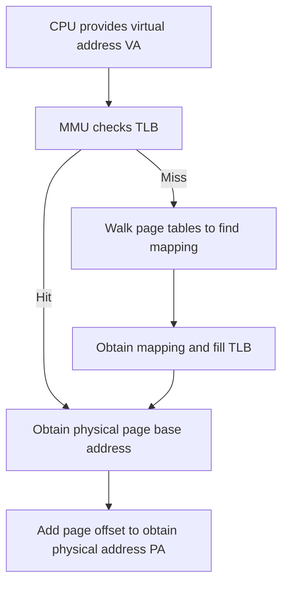

# 🗂️ Page tables, PTEs, huge pages, and address translation

Programs use virtual addresses, while bytes in memory have physical addresses. To understand a memory access, first identify who records mappings and who performs translation. Then split an address into a page number and an offset, and examine how page size changes mapping counts and TLB coverage.

This chapter follows [Memory and addresses](memory-addressing.md) and compares 4KB ordinary pages, 2MB huge pages, and 1GB huge pages. To retain familiar page-size notation, KB, MB, and GB mean binary capacities throughout, corresponding to KiB, MiB, and GiB: $1\text{KB}=2^{10}$ bytes, $1\text{MB}=2^{20}$ bytes, and $1\text{GB}=2^{30}$ bytes. Supported page sizes depend on the processor and operating system.

TB likewise means the binary capacity TiB here, with $1\text{TB}=2^{40}$ bytes. The detailed multilevel examples use **typical x86-64 four-level paging**: first divide the address, then follow how entries at each level complete the mapping.

## 1. What is a page table?

A program uses a **virtual address (VA)**. To access physical memory, the CPU needs to translate it into a **physical address (PA)**. Four concepts have distinct responsibilities:

| Concept | Responsibility | How to think about it |
| --- | --- | --- |
| Page table | Records virtual-to-physical address mappings | A mapping table, usually organized into multiple levels |
| PTE (Page Table Entry) | A record in a page table; a final mapping entry describes the physical page, permissions, and other information | An entry in the table, separate from the data page it maps |
| MMU (Memory Management Unit) | Performs virtual-to-physical translation and checks access permissions | The hardware that executes translation |
| TLB (Translation Lookaside Buffer) | Caches address mappings to avoid repeated page-table lookups | A cache of recently used translation results |

The following flow assumes a valid mapping and permitted access, using a common system with hardware page-table walks as its example:



**A TLB miss is not a page fault.** A miss means that the cache lacks the translation; the page table may still hold a valid mapping. A page fault involves conditions such as an absent mapping, a nonresident page, or access permissions. See the [Linux page-table documentation](https://docs.kernel.org/mm/page_tables.html) for page-table levels, permissions, and translation caches.

## 2. Ordinary pages versus huge pages

The key difference is **the memory range covered by one mapping**. Dividing the same amount of memory into larger pages requires fewer pages and final mapping entries.

| Comparison | 4KB ordinary page | 2MB huge page | 1GB huge page |
| --- | --- | --- | --- |
| Range covered by one mapping | 4KB | 2MB | 1GB |
| Pages needed to map 1GB | 262144 | 512 | 1 |
| Page offset | 12 bits | 21 bits | 30 bits |
| Page size in hexadecimal | `0x1000` | `0x200000` | `0x40000000` |

Calculate the page count directly. Assume that the 1GB region satisfies the relevant page alignment and is mapped entirely with the same page size:

```text
4KB pages: 1GB / 4KB = 2^30 / 2^12 = 2^18 = 262144 pages
2MB pages: 1GB / 2MB = 2^30 / 2^21 = 2^9  = 512 pages
1GB pages: 1GB / 1GB = 2^30 / 2^30 = 1 page
```

These are counts of data pages, and therefore **final mapping entries**. They do not include upper-level directory entries in a multilevel page table.

**The PTE itself has not become 1GB; the range covered by one mapping has changed.** An entry holds mapping information, while data lives in the mapped physical page. In a multilevel page table, some entries refer to another table and others complete the mapping as leaf entries. Huge pages may be mapped directly by higher-level entries, ending the walk before the lowest level. When reading implementations, distinguish the general term “page-table entry” from PTE as a name specifically for the lowest-level entry; see the [Linux page-table hierarchy](https://docs.kernel.org/mm/page_tables.html).

## 3. How is a virtual address divided?

Assume a **48-bit virtual address**. This means 48 effective address bits participate in translation; processors do not all use the same address width.

### 3.1. Start with a virtual page number and offset

| Page size | Virtual page number (VPN) | Page offset |
| --- | --- | --- |
| 4KB | 36 bits | 12 bits |
| 2MB | 27 bits | 21 bits |
| 1GB | 18 bits | 30 bits |

Every row satisfies “VPN bits + offset bits = 48”:

```text
4KB page: [             VPN: 36 bits             ][Offset: 12 bits]
2MB page: [          VPN: 27 bits          ][    Offset: 21 bits    ]
1GB page: [       VPN: 18 bits       ][          Offset: 30 bits          ]
```

The translation can be written as:

```text
Virtual address = virtual page number + page offset

Virtual page number -> page-table lookup -> physical frame number

Physical address = physical page base address + page offset
```

The first “+” means **concatenation of bit fields**. Do not numerically add an unshifted VPN to the offset. For page size $S=2^n$ bytes, the numerical relationships are:

$$
\mathrm{VA}=\mathrm{VPN}\times S+\mathrm{Offset}
$$

$$
\mathrm{PA}=\mathrm{PFN}\times S+\mathrm{Offset}
$$

Here, PFN is the physical frame number **in units of this mapping's page size $S$**, so $\mathrm{PFN}\times S$ is the physical page base address. Operating-system interfaces may instead express PFNs in base-page units; check the unit when reading code. Multilevel page tables further divide the VPN into indices for individual levels rather than requiring one flat table indexed by the entire VPN.

In this paging model, translation changes the page's location while **preserving the page offset**. A larger page uses more offset bits and fewer VPN bits.

### 3.2. How 48 address bits relate to four-level paging

With typical **x86-64 four-level paging**, 48 effective virtual address bits represent $2^{48}$ byte positions: **256TB (256TiB) of virtual address space**. This is virtual address capacity, not installed physical memory, and it does not imply that all addresses are mapped. See the [Linux four-level and five-level paging explanation](https://docs.kernel.org/arch/x86/x86_64/5level-paging.html).

For ordinary 4KB pages, the 36-bit VPN splits into four 9-bit indices:

```text
48-bit virtual address
┌────────┬────────┬────────┬────────┬──────────┐
│  PGD   │  PUD   │  PMD   │  PTE   │  Offset  │
│ 9 bits │ 9 bits │ 9 bits │ 9 bits │ 12 bits  │
└────────┴────────┴────────┴────────┴──────────┘

Bits:    [47:39]  [38:30]  [29:21]  [20:12]   [11:0]
```

- **PGD, PUD, PMD, and PTE indices:** each selects an entry at a different table level. Nine bits is the index width, not the size of an entire entry.
- **Page offset:** selects a particular byte in the physical page. A 4KB page has $2^{12}$ byte positions and therefore needs 12 offset bits.
- **All 48 bits belong to the virtual address; none are a physical address field.** The physical page location comes from the selected page-table entry, and physical address width need not match virtual address width.

**Level names:** this chapter uses Linux's PGD, PUD, PMD, and PTE terminology. In four-level paging, these correspond to the hardware's PML4, PDPT, PD, and PT. The diagram's “PTE” field contains address bits indexing the bottom-level PT, rather than the entry's contents. Linux's generic interfaces also include P4D, which is folded in four-level paging and adds no separate lookup. See the [Linux page-table documentation](https://docs.kernel.org/mm/page_tables.html) for levels and folding.

**How can 48 effective bits coexist with a 64-bit pointer?** In the conventional x86-64 four-level canonical address form, the high 16 bits of a 64-bit address replicate bit 47. Valid addresses occupy a low 128TiB region and a high 128TiB region, totaling 256TiB, with a noncanonical hole between them. This is not one contiguous 256TiB range starting at zero, nor does it mean a user process can freely use all that capacity. See the [Linux x86-64 virtual memory layout](https://docs.kernel.org/arch/x86/x86_64/mm.html).

## 4. How large is one page table? {#page-table-size}

In this x86-64 paging scheme:

- Each level's index uses **9 bits**, selecting among $2^9=512$ entries.
- Each page-table entry occupies **8 bytes (64 bits)**.
- Therefore, **one table occupies $512\times8=4096$ bytes, or 4KB**.

```text
One index: 9 bits → 512 possible values → select one entry in the current table
One entry: 8 bytes → next-table address or physical page mapping, plus flags
One table: 512 entries × 8 bytes = 4096 bytes = 4KB
```

**The size of a table and the memory range mapped by an entry are different concepts.** A 4KB table does not imply that every entry can map only 4KB; an entry mapping 1GB does not occupy 1GB. A process may use many such tables, so its entire multilevel structure is not limited to 4KB. These sizes apply to this x86-64 example, rather than every architecture. Compare the entry types, 512-entry table sizes, and PMD/PUD range definitions in the [Linux x86-64 page-table definitions](https://github.com/torvalds/linux/blob/master/arch/x86/include/asm/pgtable_64_types.h).

## 5. How do multilevel tables map ordinary and huge pages? {#leaf-levels}

A **leaf page-table entry** completes a physical memory mapping instead of pointing to another table. “Leaf” means this mapping ends here; it need not be at the bottom PTE level.

In this four-level example, the three paths are:

```text
4KB ordinary page:
PGD → PUD → PMD → PTE → 4KB physical page

2MB huge page:
PGD → PUD → PMD ──────→ 2MB physical page

1GB huge page:
PGD → PUD ────────────→ 1GB physical page
```

Compare the leaf level, offset width, and number of leaf mappings needed for 1GB:

| Page size | Mapping completes at | Page offset | Leaf mappings needed for 1GB | Table levels visited |
| --- | --- | --- | --- | --- |
| 4KB | PTE | 12 bits | 262144 | 4 |
| 2MB | PMD | 21 bits | 512 | 3 |
| 1GB | PUD | 30 bits | 1 | 2 |

For a 2MB page, the PMD entry completes the mapping without continuing to a PTE table. For a 1GB page, the PUD entry completes it without continuing to PMD or PTE tables. These are logical walk paths. Actual latency depends on the TLB, page-walk caches, and ordinary caches; the number of levels is not a count of actual DRAM accesses.

## 6. Why does a 1GB page shorten the walk? {#huge-page-offset-bits}

Compare the address fields to see where the bits go when a mapping ends earlier.

For a 4KB page:

```text
PGD(9) + PUD(9) + PMD(9) + PTE(9) + Offset(12) = 48 bits
```

For a 2MB page:

```text
PGD(9) + PUD(9) + PMD(9) + Offset(21) = 48 bits
21 bits = 9 bits + 12 bits
```

For a 1GB page:

```text
PGD(9) + PUD(9) + Offset(30) = 48 bits
30 bits = 9 bits + 9 bits + 12 bits
```

The **18 bits previously used as PMD and PTE indices** become part of the offset in a 1GB mapping. Likewise, a 2MB mapping combines the former 9-bit PTE index with the offset to obtain 21 offset bits.

Thus **a 1GB page does not delete 18 bits or change the virtual address width; the mapping ends earlier, at the PUD level**. This example still has a 48-bit effective virtual address. What changes is which bits select table entries and which locate a byte within the physical page.

## 7. Why can huge pages improve performance? {#4-why-can-huge-pages-improve-performance}

The mapping counts and walk paths explain three main benefits:

1. **Fewer mapping entries reduce page-table memory overhead.** Mapping 1GB needs 262144 leaf entries with 4KB pages, 512 with 2MB pages, or 1 with a 1GB page. Lower-level tables for that region may also become unnecessary. However, “one leaf entry” does not mean the entire structure occupies only 8 bytes; upper-level tables still exist or are reused.
2. **Fewer table levels are visited.** In this example, 1GB translation completes at PUD, while 2MB translation completes at PMD.
3. **Fewer TLB misses and less TLB pressure.** Each TLB mapping covers a larger virtual range, allowing a suitable working set to fit in fewer entries.

**Accessing one 4KB page does not sequentially inspect 262144 PTEs.** Each level's index selects the required entry directly, and the TLB caches translation results. The number 262144 describes how many leaf mappings cover the entire 1GB region, not how many entries a single translation checks in sequence.

Assume a TLB holds **64 mappings**. For this comparison, separately assume that all 64 entries can serve the page size under discussion:

- **4KB pages:** coverage is $64\times4\text{KB}=256\text{KB}$.
- **1GB pages:** coverage is $64\times1\text{GB}=64\text{GB}$.

This is a theoretical example. Actual TLB capacity varies with hardware and page size; it does not imply that a real processor offers equal entry counts for every page size.

**Huge pages do not make the TLB store more entries; each entry covers more addresses.** For a suitable working set and access pattern, the same data needs fewer mappings, which can reduce TLB misses and page-table walk overhead. Higher-level leaf entries can also end walks earlier.

Allocation costs matter too: huge pages require appropriate contiguous physical memory and alignment, and using only a small portion can waste capacity. They do not guarantee that every program runs faster. See the [Linux HugeTLB documentation](https://docs.kernel.org/admin-guide/mm/hugetlbpage.html) for supported sizes and allocation constraints.

## 8. Why express page sizes in hexadecimal? {#5-why-express-page-sizes-in-hexadecimal}

Because:

$$
16=2^4
$$

Thus **one hexadecimal digit represents 4 bits**. Hexadecimal makes binary address boundaries easier to inspect. It changes the representation, not the actual page size.

For example, the following values are in bytes, and `0x` denotes hexadecimal:

```text
0x10        = 2^4    = 16B
0x100       = 2^8    = 256B
0x1000      = 2^12   = 4KB
0x200000    = 2^21   = 2MB
0x40000000  = 2^30   = 1GB
```

`0x1000` is 1 shifted left by 12 bits; `0x200000` is $2\times16^5=2^{21}$; and `0x40000000` is $4\times16^7=2^{30}$. Hexadecimal can therefore represent 2MB and 1GB clearly even though their offset widths are not multiples of four.

## 9. Why can the physical page base address differ? {#6-why-can-the-physical-page-base-address-differ}

**Different page sizes define different memory boundaries.** The same physical address belongs to pages with different starting points when memory is grouped by different page sizes. This compares two partitioning schemes, rather than assigning two page sizes to a single translation.

Consider the same physical address, `0x40001234`:

| Comparison | 4KB page | 1GB page |
| --- | --- | --- |
| Page base address | `0x40001000` | `0x40000000` |
| Page offset | `0x234` | `0x1234` |
| Final address | `0x40001234` | `0x40001234` |

The formulas are:

$$
\text{Page base}=\left\lfloor\frac{\text{Address}}{\text{Page size}}\right\rfloor\times\text{Page size}
$$

$$
\text{Page offset}=\text{Address}\bmod\text{Page size}
$$

Substitution verifies both cases:

```text
Using 4KB pages:
Page size     = 0x1000
Page base     = floor(0x40001234 / 0x1000) × 0x1000 = 0x40001000
Page offset   = 0x40001234 mod 0x1000 = 0x234
Final address = 0x40001000 + 0x234 = 0x40001234

Using 1GB pages:
Page size     = 0x40000000
Page base     = floor(0x40001234 / 0x40000000) × 0x40000000 = 0x40000000
Page offset   = 0x40001234 mod 0x40000000 = 0x1234
Final address = 0x40000000 + 0x1234 = 0x40001234
```

A page base must be a multiple of the page size. A 4KB base has 12 low zero bits; a 1GB base has 30 low zero bits. Although the base and offset differ, their sum reconstructs the same physical address.

## 10. Page size and offset width {#7-page-size-and-offset-width}

**A page of $2^n$ bytes needs $n$ offset bits.** It contains $2^n$ byte positions, numbered from 0 through $2^n-1$.

| Page size | Offset bits | Maximum offset |
| --- | --- | --- |
| 4KB | 12 bits | `0xFFF` |
| 2MB | 21 bits | `0x1FFFFF` |
| 1GB | 30 bits | `0x3FFFFFFF` |

For a 1GB page:

- **Page size:** `0x40000000` (4 followed by seven zeros).
- **Maximum offset:** `0x3FFFFFFF`, the page size minus 1.
- **Offset range:** 0 through 1GB−1 bytes, or 0 through 1,073,741,823.

Do not confuse the page size with the offset of its last byte. An offset of `0x40000000` has already reached the beginning of the next 1GB page.

## 11. What does configuring 1GB pages actually change? {#huge-page-configuration}

In this x86-64 four-level example, assume the processor supports 1GB pages, memory meets the corresponding alignment and contiguity requirements, and the operating system **actually establishes a 1GB mapping for the region**:

**Configuring and using a 1GB page means the operating system uses a PUD-level leaf entry to map a 1GB virtual address range directly to a 1GB physical address range.**

It changes neither this example's 48-bit effective virtual address width nor the system's basic page-table structure. It changes **the mapping granularity and walk depth for regions using huge pages**. Different regions can use 4KB, 2MB, and 1GB pages simultaneously; one 1GB mapping does not reduce the entire system to two-level tables. Requesting huge pages is also distinct from confirming the mapping granularity actually established.

The core effects are **fewer page-table mapping entries, less TLB pressure, and lower address-translation overhead**.

Connect the ideas in one sentence: **The CPU uses a virtual address, finds the corresponding physical page through the TLB or page tables, and combines it with the page offset to obtain a physical address; the central advantage of huge pages is that each mapping covers more memory, reducing mapping counts and TLB pressure.**

Continue with [How GVA unified addressing works](gva-unified-addressing.md) to connect page-table translation within one address space with resource addressing across processes, devices, and nodes.

Return to [Memory and addresses](memory-addressing.md) to connect a single translation with virtual-range reservation, physical allocation, mapping, and registration.
