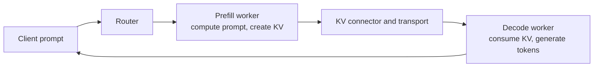

# 🚀 Inference frameworks: vLLM, SGLang, and the memory behind serving

An inference framework turns incoming requests into model execution. Its scheduler decides which tokens run together; its memory manager keeps weights and KV cache available; its transfer connector moves cache state if prefill and decode run on different workers. Understanding these responsibilities is more useful than memorizing one deployment command. Here **HBM** means accelerator memory (the same reasoning applies to a supported GPU/NPU device-memory tier), and **DRAM** means host memory.

## 💡 Why prefill and decode behave differently

**Prefill** processes the prompt, often many tokens in parallel, and produces the first response token plus a KV cache for the input. It tends to demand compute and temporary activation memory. **Decode** appends tokens one or a few at a time, repeatedly reading weights and earlier KV state; cache capacity and memory bandwidth become prominent. Mixing long prefill batches with latency-sensitive decode steps can cause interference. Separating the phases lets operators scale and tune them independently, but it adds KV transfer, coordination, and failure handling. The split is useful only when those costs are outweighed by the scheduling benefits. See the [vLLM disaggregated-prefill guide](https://docs.vllm.ai/en/latest/features/disagg_prefill/) and [SGLang PD guide](https://docs.sglang.ai/backend/pd_disaggregation.html).

## 🧠 What occupies HBM and DRAM?

| Resource | Typical home | Why it matters |
| --- | --- | --- |
| Model weights | Device memory; optional configured host offload | Every worker serving that model needs access to the appropriate weights or shards. P/D separation does not remove this cost. |
| Activations and graph/workspace buffers | Device memory, especially during prefill | Reserve headroom beyond weights and KV; peak usage can trigger OOM even when average use is low. |
| Active KV cache | Device memory for fast attention | Grows with retained context and concurrent sequences; a block/page allocator reuses capacity. |
| Scheduler metadata, input tokens, transfer descriptors | Host DRAM | These objects coordinate execution, but are not a second copy of every KV block by default. |
| Optional KV offload or transfer staging | Host DRAM or external storage, if configured/supported | Extends capacity or bridges a transfer path at the cost of copy latency, bandwidth, and extra failure states. |

In **vLLM**, `gpu_memory_utilization` budgets device memory for the model executor; `kv_cache_memory_bytes` can explicitly set a KV capacity, and `cpu_offload_gb` is a separate *weight* offload setting. KV offload is another separately configured feature. Do not infer “KV automatically spills to DRAM” from a CPU offload option. See [vLLM engine arguments](https://docs.vllm.ai/en/stable/api/vllm/) and [KV offloading](https://docs.vllm.ai/en/latest/features/kv_offloading_usage/).

In **SGLang**, `--mem-fraction-static` controls the static device-memory portion used for weights and the KV pool; dynamic activations need room outside it. SGLang's RadixAttention reuses common-prefix KV in that pool. With **HiCache enabled**, it can extend KV caching into host memory and optional storage; those are distinct tiers with movement costs, not one uniformly fast address space. See [SGLang tuning](https://github.com/sgl-project/sglang/blob/main/docs/docs/advanced_features/hyperparameter_tuning.mdx), [HiCache](https://github.com/sgl-project/sglang/blob/main/docs/docs/advanced_features/hicache.mdx), and the [PD guide](https://docs.sglang.ai/backend/pd_disaggregation.html). Flags and supported backends change by release and hardware.

### Estimate a cache before sizing a pool

For an ordinary full-attention layout, one sequence's KV payload is approximately:

$$B_{KV}=L\times 2\times H_{KV}\times D_{head}\times T\times b$$

Here $L$ is layer count, $H_{KV}$ KV heads, $D_{head}$ head dimension, $T$ retained tokens, and $b$ bytes per element. With 32 layers, 8 KV heads, dimension 128, 2,048 tokens, and BF16 (2 bytes), the result is **268,435,456 bytes = 256 MiB**. If an illustrative 80 GiB device has 30 GiB available for KV after weights and other reserves, division suggests **120** such sequences at most. Actual concurrency is lower or differently shaped because block rounding, output growth, fragmentation, activation peaks, parallel sharding, and cache reuse all matter. Sliding-window, MLA, or quantized KV layouts require a different formula. Work through [KV-cache fundamentals](../ml/llm/inference/kv-cache.md) before applying this estimate to a real model.

## 📌 A complete P/D request: a shared system prompt

Assume two requests share a system prompt, then diverge. Both P and D have compatible model weights/tokenizer and an agreed KV layout; the router knows where each request will run. The following is a logical sequence—vLLM's KV connectors and SGLang's Mooncake/NIXL/Ascend transfer backends implement details differently.

1. **Route and admit.** The router chooses a prefill worker and a decode worker. Admission checks expected prompt length, available KV capacity, and transfer health. A cache hit may reduce how much prefill computation is required.
2. **Prepare destination.** D reserves free KV blocks/pages for the incoming prompt and supplies the connector with destination identifiers or access information. A reservation promises space; the bytes are not valid yet. If D cannot reserve enough, the request must wait, be redirected, or fail according to policy.
3. **Compute on P.** P tokenizes consistently, runs prefill, and writes the KV payload into its HBM blocks. Its computation must finish and become visible to the transfer engine before the blocks are read. P also produces the handoff information needed to continue generation.
4. **Transfer the cache.** A connector coordinates control messages and moves the necessary KV bytes along a supported path: device-to-device where available, or through host staging. It tracks request identity, blocks/layers, length, layout, errors, and timeout. [This transfer walkthrough](end-to-end-transfer.md) expands the transport boundary.
5. **Commit the handoff.** D waits for the backend-defined completion and visibility, then binds the received blocks to the sequence. Only now may its attention kernels read them. P releases its temporary blocks after the protocol says the receiver has what it needs; a timeout alone is not proof that in-flight DMA stopped.
6. **Decode and retire.** D schedules iterative token generation and streams output. Each new token grows the active KV state. When the request finishes, unreferenced blocks return to the pool; reusable prefix blocks may remain cached until eviction. Failure cleanup must release both workers' reservations and transfer handles without racing outstanding operations.

vLLM's [Ascend P/D design](https://docs.vllm.ai/projects/ascend/en/main/developer_guide/Design_Documents/disaggregated_prefill.html) gives a concrete connector walkthrough: D allocates blocks, the cache is transferred, then D continues generation. SGLang's [PD documentation](https://docs.sglang.ai/backend/pd_disaggregation.html) shows separate prefill/decode server roles and selectable transfer backends, including an Ascend path. Neither framework implies that every deployment uses MemFabric; the configured connector/backend determines the actual path.

## 📍 Reuse is a placement and identity problem

If the second request has exactly the same tokenized prefix and compatible model/cache settings, it may reuse completed prefix KV instead of recomputing it. **vLLM** hashes full cache blocks from their tokens and preceding prefix, with additional identity inputs such as adapter or cache salt; its manager tracks references and evicts blocks when space is needed. **SGLang** uses a radix-tree-based prefix cache to find shared paths; HiCache can place colder reusable data in DRAM or storage. A hit is beneficial only after accounting for retrieval/transfer cost. [vLLM's prefix-cache design](https://docs.vllm.ai/en/latest/design/prefix_caching/) explains block identity and eviction; [SGLang HiCache](https://github.com/sgl-project/sglang/blob/main/docs/docs/advanced_features/hicache.mdx) explains the tiers.

Do not reuse cache across incompatible model revisions, tokenizer outputs, positional settings, KV dtypes/layouts, adapters, or isolation domains. Prefix matching is about *token IDs and execution context*, not merely similar-looking text. In P/D deployments, a useful prefix on one P worker may be absent on the chosen D worker; placement, cache-aware routing, and transfer decide whether reuse actually saves work.

## 📊 Measure the whole request

Track **TTFT** (time to first token), **ITL** (time between generated tokens), request throughput, cache-hit rate, device-memory headroom, KV transfer bytes/time, wait time for free blocks, and failures. For a slow request, separate queueing, prefill compute, KV transfer, decode scheduling, and token generation. A faster P worker alone will not help when D is waiting on a saturated link or has no free KV blocks. Connect this view to [memory addressing](memory-addressing.md), [data movement](data-movement.md), and [performance tools](performance-tools.md).
