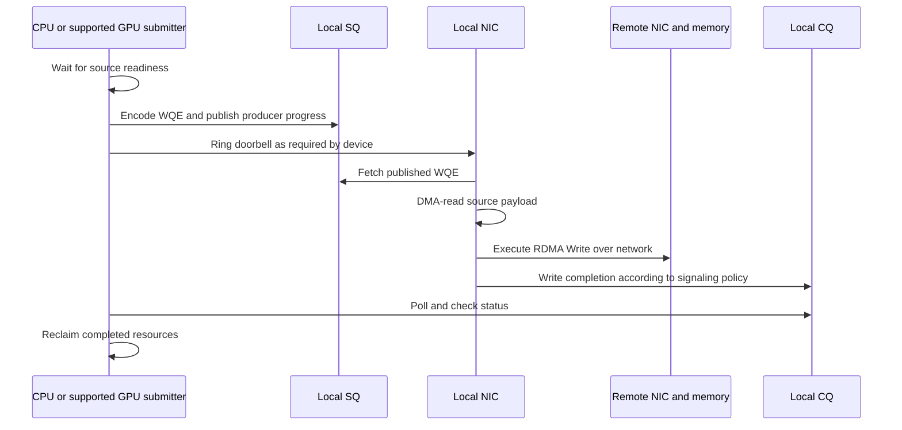

# 📬 WQE, SQE, CQE, and doorbells: handing work to hardware

A transfer involves three different objects: **a descriptor explaining the work, a doorbell telling hardware to fetch it, and a completion record reporting the result**. Descriptors usually occupy a small number of bytes; the engine reads the tensor payload separately. Publishing a descriptor does not send the tensor to its destination.

## 🧩 Identify the queue first

| Term | Meaning in RDMA or device execution | Important boundary |
| --- | --- | --- |
| WR, Work Request | Software request submitted by an application through verbs | Not the hardware descriptor format |
| WQE, Work Queue Element | Descriptor consumed from a hardware work queue | Can describe sends, receives, RDMA reads/writes, and other operations; format is device-specific |
| SQ | Usually Send Queue in RDMA; holds locally initiated operations | RDMA Read is also initiated on the local SQ |
| RQ | Receive Queue; supplies receive buffers | Conventional Send/Recv requires receiver resources in advance |
| QP | Queue Pair; associates work queues with transport state | A pair of SQ/RQ in the basic RC model; SRQs and other facilities change the organization |
| CQ / CQE | Completion Queue / Completion Queue Entry | Multiple QPs may use a CQ; an entry can report failure |
| WC, Work Completion | Software result returned by `ibv_poll_cq` | Not the binary layout of a particular NIC's CQE |
| SQE | Submission Queue Entry, or an entry in a Send Queue in some documentation | Identify the subsystem: accelerator scheduling, NIC queues, and io_uring have different formats |
| Doorbell / DBR | Notification to hardware / Doorbell Record | A DBR is a memory record in some implementations, not the MMIO doorbell register |

`ibv_post_send` submits software WRs to a QP's SQ; the userspace provider encodes device work items. `ibv_poll_cq` returns WCs. Applications normally use the library rather than implementing these steps themselves. The rdma-core [submission](https://github.com/linux-rdma/rdma-core/blob/master/libibverbs/man/ibv_post_send.3) and [completion](https://github.com/linux-rdma/rdma-core/blob/master/libibverbs/man/ibv_poll_cq.3) interfaces define these boundaries.

For an SQE in an Ascend log, determine whether it belongs to runtime task scheduling or a communication engine. The HCCL [retry description](https://www.hiascend.com/document/detail/en/CANNCommunityEdition/910/commlib/hcclug/docs/en/user_guide/hccl_env/HCCL_OP_RETRY_ENABLE.md) mentions redispatching SQEs and WQEs separately. Their fields and mappings require the matching implementation. A logical stream is not automatically one hardware SQ or RDMA QP.

## 🔄 Follow a locally initiated RDMA Write

Assume an ordinary, non-inline RC RDMA Write. Initialization is complete, both memory regions are registered, and the destination address and access credentials have been exchanged.

Conceptual WQE fields include the opcode, local SGEs (address, length, `lkey`), remote address, `rkey`, and completion policy. SGEs can describe noncontiguous local segments. Inline operations can include small payloads in the WQE. `wr_id` correlates a request with its WC; it need not appear unchanged in every hardware format. The [verbs specification](https://github.com/linux-rdma/rdma-core/blob/master/libibverbs/man/ibv_post_send.3) also documents the inline exception to source-buffer lifetime rules.

## 🔔 Why doorbells need ordering

A typical publication sequence is `write descriptors → establish platform-required visibility → update required records/indices → notify hardware`. If the notification becomes visible before the descriptor, hardware could consume incomplete work. CPU/GPU barriers, cache operations, and MMIO ordering are platform/library contracts; C/C++ `volatile` cannot replace them. The [DOCA DPA guide](https://docs.nvidia.com/doca/archive/doca-v2.2.1/dpa-subsystem-programming-guide/index.html) gives concrete WQE/DBR/doorbell ordering examples.

A doorbell commonly identifies a queue and its new producer position. The engine fetches the payload afterward. Some implementations also push descriptor or inline bytes through MMIO, so “every doorbell writes one fixed integer” is not a portable ABI. Batching can amortize a notification across multiple items, subject to the provider's submission protocol.

## ✅ Completion and remote consumption

| Observation | What it establishes | What remains |
| --- | --- | --- |
| Successful posting | Request accepted by software/queue | Execution and transfer completion |
| Successful local WC | The operation reached its verbs-defined completion point | Remote application observation and model consumption |
| Ordinary RDMA Write reaches memory | A one-sided write path | Normally no automatic remote receive WC for the application |
| Receive completion for Send or Write with Immediate | A protocol can notify the receiver | Receive resources, status checks, and device visibility |
| Application ACK | The protocol's agreed handoff point | An ACK for receipt need not mean inference has finished |

Conventional Send/Recv and Write with Immediate require attention to receive resources; ordinary RDMA Write does not consume one remote RQ entry per write. With [GPUDirect RDMA](https://docs.nvidia.com/cuda/gpudirect-rdma/), obey GPU memory ordering as well: a host notification alone does not authorize an arbitrary running GPU kernel to read incoming bytes without synchronization. See the [RDMA programming interfaces](https://docs.nvidia.com/networking/display/rdmaawareprogrammingv17/rdma+verbs+api) for operation semantics.

Not every WQE produces an individual successful CQE. Selective signaling reduces CQ pressure; where the same SQ's operation-ordering and completion guarantees permit it, a later successful signaled completion can retire an earlier batch. Do not extend this inference across QPs or ignore error handling.

CQ event notifications wake software; software must still retrieve and check WCs. Polling consumes a completion, and [CQ overrun makes the CQ unusable](https://github.com/linux-rdma/rdma-core/blob/master/libibverbs/man/ibv_poll_cq.3).

## 🧮 Depth, wraparound, and backpressure

Suppose software tracks 64 submission slots, 60 are occupied, and the next batch needs 8. Wait or split the batch rather than overwriting outstanding work. Real devices can account capacity in WQE building blocks rather than requests; one request need not occupy one fixed-size slot.

Rings wrap around. Implementations may use monotonic counters or owner/phase bits to distinguish new entries from old contents; these are device-specific conventions. Threads or GPU warps sharing an SQ must coordinate reservation, publication, and doorbell updates. Insufficient concurrency limits throughput, while excessive concurrency increases CQ pressure, memory use, and tail latency.

## 🔎 Debug along the queue

Check producer progress, descriptor visibility, doorbell publication, engine consumption, successful/error completion, completion retrieval, and remote readiness in that order. Log request ID, rank, queue/QP, generation, producer/consumer progress, and error status.

If the local CQ reports success but the peer waits, inspect notification and device visibility. If the SQ is full and no one polls the CQ, inspect completion reclamation. Decode raw error values using the matching vendor/release rather than another device's numeric table. Continue with [device-initiated transfer](device-initiated-transfer.md) and [the end-to-end protocol](end-to-end-transfer.md).
