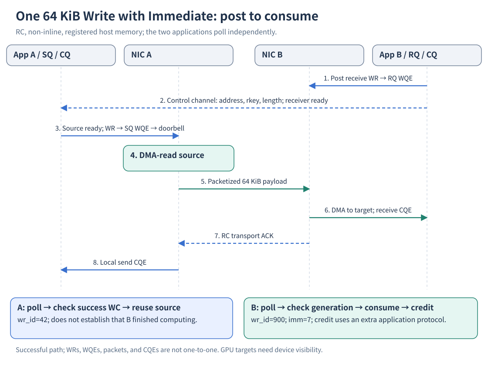
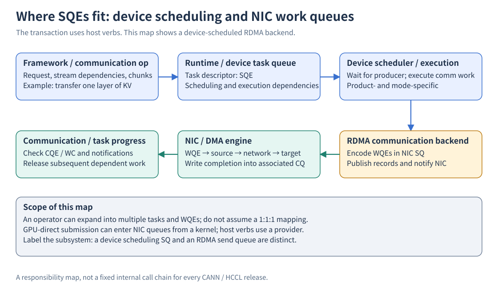

# 📬 WQE, SQE, CQE, and doorbells: handing work to hardware

**A writes 64 KiB to B: B supplies destination memory and receive resources; A encodes a WQE and notifies its NIC; the NICs read, transmit, and place the payload; each application checks its own completion.** Source reuse, destination readability, and completed consumption are separate milestones.

Follow one **RC RDMA Write with Immediate** from preparation through reclamation, then compare ordinary Write, Send/Recv, GPU, and NPU paths. Every queue term has a place in this transaction.

For **Jetty, JFS, JFR, and JFC** in Ascend UB logs, see [Jetty and Runtime copy](jetty-runtime-copy.md). It maps both endpoints, Direct WQE's header/trailing data slots, and doorbell mode separately; do not substitute ibverbs objects and fields directly.

<figure class="model-figure" markdown="1">

[](../../assets/transfer-diagrams/en/write-with-immediate.svg)

<figcaption markdown="span">Figure: applications poll independently. A transport ACK does not mean B finished computing. Dashed arrows show metadata exchange or transport acknowledgment. Click to enlarge.</figcaption>

</figure>

## 🧩 Identify the queue first

| Term | Meaning in RDMA or device execution | Important boundary |
| --- | --- | --- |
| WR, Work Request | Software request submitted by an application through verbs | Not the hardware descriptor format |
| WQE, Work Queue Element | Descriptor consumed from a hardware work queue | Can describe sends, receives, RDMA reads/writes, and other operations; format is device-specific |
| SQ | Usually Send Queue in RDMA; holds locally initiated operations | RDMA Read is also initiated on the local SQ |
| RQ | Receive Queue; supplies receive buffers | Conventional Send/Recv requires receiver resources in advance |
| QP | Queue Pair; associates work queues with transport state | A pair of SQ/RQ in the basic RC model; SRQs and other facilities change the organization |
| CQ / CQE | Completion Queue / Completion Queue Entry | Multiple QPs may use a CQ; an entry can report failure |
| WC, Work Completion | Software result returned by `ibv_poll_cq` | Not the binary layout of a particular NIC's CQE |
| SQE | Submission Queue Entry, or an entry in a Send Queue in some documentation | Identify the subsystem: accelerator scheduling, NIC queues, and io_uring have different formats |
| Doorbell / DBR | Notification to hardware / Doorbell Record | A DBR is a memory record in some implementations, not the MMIO doorbell register |

`ibv_post_send` submits software WRs to a QP's SQ; the userspace provider encodes device work items. `ibv_poll_cq` returns WCs. Applications normally use the library rather than implementing these steps themselves. The rdma-core [submission](https://github.com/linux-rdma/rdma-core/blob/master/libibverbs/man/ibv_post_send.3) and [completion](https://github.com/linux-rdma/rdma-core/blob/master/libibverbs/man/ibv_poll_cq.3) interfaces define these boundaries.

For an SQE in an Ascend log, determine whether it belongs to runtime task scheduling or a communication engine. The HCCL [retry description](https://www.hiascend.com/document/detail/en/CANNCommunityEdition/910/commlib/hcclug/docs/en/user_guide/hccl_env/HCCL_OP_RETRY_ENABLE.md) mentions redispatching SQEs and WQEs separately. Their fields and mappings require the matching implementation. A logical stream is not automatically one hardware SQ or RDMA QP.

## 🔄 Follow one complete 64 KiB Write with Immediate

Start with **registered host memory**, an established RC QP connection, a non-inline write, and separate send/receive CQs on each side. Introduce HBM afterward so device visibility does not obscure the queue mechanics. This is a teaching example, not a hardware measurement.

| Object | Value in this transaction | Purpose |
| --- | --- | --- |
| A's source | `src`, `65536` bytes, `src_mr->lkey` | Registered memory read by NIC A |
| B's destination | `dst_addr`, capacity at least `65536`, `dst_rkey` | Remote-write-enabled memory; address follows B's MR addressing convention |
| A's send WR | `wr_id=42` | Correlates A's send WC with its request |
| B's receive WR | `wr_id=900` | Correlates B's receive WC with its receive resource |
| Generation | `7` | Sent in the 32-bit immediate; real protocols must handle wraparound and stale notifications |

### 1. Connect and register: prepare a path without sending payload

Select NICs/ports, create PDs, CQs, and QPs, configure the RC connection, and make the sending side ready to send. A registers the source MR; B registers a remote-write-enabled destination MR. Exchange connection and memory access descriptions.

These resources are normally reused. Each transfer must still have a valid destination-slot grant, sufficient capacity, and live handles. Registration establishes access conditions; **it does not transfer source bytes**. See the [MR registration interface](https://github.com/linux-rdma/rdma-core/blob/master/libibverbs/man/ibv_reg_mr.3).

### 2. B posts receive resources before granting permission to send

B calls `ibv_post_recv`; its provider publishes receive resources to B's RQ. A **zero-SGE receive WR** is sufficient here: Write with Immediate uses it for notification. The 64 KiB payload goes to `dst_addr`, not to an SGE in that receive WR.

Using an existing control channel, B then grants the destination slot and confirms receive resources are posted. Missing RQ resources can cause an RC Write with Immediate to encounter RNR and retry, potentially exhausting its retry limit. See the [receive interface](https://github.com/linux-rdma/rdma-core/blob/master/libibverbs/man/ibv_post_recv.3), [operation semantics](https://networking-docs.nvidia.com/doca/archive/3-5-0/rdma-aware-networks-programming-guide), and [Write with Immediate receive resources](https://docs.nvidia.com/doca/archive/doca-v2.2.1/rdma-programming-guide/index.html).

### 3. A produces the source, then submits a software WR

After producing `src`, A fills these fields and calls `ibv_post_send`:

| Field | Value | Purpose |
| --- | --- | --- |
| `opcode` | `IBV_WR_RDMA_WRITE_WITH_IMM` | Write remote memory and generate receive notification |
| Local SGE | `src`, `65536`, `src_mr->lkey` | Source, byte count, and local access key |
| `wr.rdma.remote_addr / rkey` | `dst_addr / dst_rkey` | Destination and remote access key |
| `send_flags` | `IBV_SEND_SIGNALED` | Request successful send completion; this example uses `sq_sig_all=0` |
| `wr_id / imm_data` | `42 / htonl(7)` | Local bookkeeping / remote generation notification |

A return value of `0` means the request was accepted, **not that remote delivery finished**. This example submits one WR; with a WR chain, earlier requests may already be accepted when a later one fails. Software WR/SGE structures may leave scope after the call returns; the non-inline source payload must remain valid until its completion condition is met.

### 4. The provider writes a WQE, publishes progress, and rings the doorbell

The provider checks SQ capacity, encodes the NIC's WQE format, saves request/completion bookkeeping, and publishes descriptors, required DBR/index updates, and notification according to the device protocol.

For example, mlx5's `post_send_db` shows **descriptor writes → `udma_to_device_barrier()` → send DBR update → MMIO/BlueFlame write → MMIO flush**. Some descriptors can be pushed through MMIO; this is one implementation, not a universal ABI. See the [provider source](https://github.com/linux-rdma/rdma-core/blob/master/providers/mlx5/qp.c).

The hardware WQE differs from the software WR; `wr_id` need not appear unchanged in it. **Ringing the doorbell does not mean the CPU writes the entire 64 KiB tensor into NIC registers.**

### 5. NIC A DMA-reads and packetizes; NIC B DMA-writes the destination

NIC A obtains the work description, reads `src` using the SGE and local registration context, and sends packets according to connection/path parameters. NIC B validates the connection, address, length, and remote access permissions, then places payload in destination memory.

One WR may produce many network packets. Dividing 64 KiB into 4096-byte payload segments gives 16 segments; actual transport also includes headers, acknowledgment, and possible retries. **A network packet is not a CQE.** The `lkey` serves local access checks; the remote access description uses an `rkey`.

### 6. B gets receive completion; A reaches RC send completion

At this operation's receive completion point, B consumes one posted receive resource and writes a CQE to the associated receive CQ. Immediate is a 32-bit notification value, not four bytes appended to `dst`.

NICs handle RC acknowledgment and necessary retransmission. Once this signaled write reaches its send completion point, NIC A also writes a result to A's send CQ. **A transport ACK is not B's application ACK**: it does not establish that B polled, started decoding, or released the destination slot. The two applications have no global order for observing their own CQs.

### 7. Each side polls: decode CQE to WC and decide what may be reused

| Side | Successful WC in this example | What may happen next |
| --- | --- | --- |
| A | `wr_id=42`, `IBV_WC_RDMA_WRITE` | Reuse the source under the non-inline write completion rules |
| B | `wr_id=900`, `IBV_WC_RECV_RDMA_WITH_IMM`, `IBV_WC_WITH_IMM`, `ntohl(imm_data)==7` | Consume the matching destination under this host-memory setup |

**A's `42` does not become B's `wr_id`.** B's `900` comes from its own receive WR. The generation communicated between machines is `7` in immediate data.

`ibv_poll_cq` returning `0` means no completion is currently available; a negative value means the poll call failed. Check WC `status` first. On an error WC, only `wr_id`, `status`, `qp_num`, and `vendor_err` are guaranteed valid. See the [WC interface](https://github.com/linux-rdma/rdma-core/blob/master/libibverbs/man/ibv_poll_cq.3).

### 8. B returns credit after consumption, allowing destination reuse

After finishing its read/computation, B returns destination-slot credit through an additional application protocol. Only then may A overwrite that slot. Credit can use a control channel or another communication operation; A's send WC cannot substitute for it.

B also needs to replenish receives for future Write with Immediate operations. **Reposting an RQ resource and releasing a destination slot manage different resources.** Available notification capacity does not release a target still being read by computation.

## 💻 Match the transaction to verbs code

These are **core fragments on an established RC connection**, not a standalone runnable program. The context supplies valid QPs, CQs, MRs, remote descriptions, and slot grants. `check`, `require`, and `fail_wc` are application error handlers. Only one write is outstanding; production code also needs deadlines, shared-CQ dispatch, and cleanup.

### B: post a receive before granting the destination

```c
struct ibv_recv_wr recv = {
    .wr_id = 900,
    .sg_list = NULL,
    .num_sge = 0,  // Write-with-imm: payload goes to dst_addr
};
struct ibv_recv_wr *bad_recv = NULL;
check(ibv_post_recv(qp_b, &recv, &bad_recv));
// Now tell A: dst_addr/dst_rkey and receive resources are ready.
```

### A: submit this 64 KiB write after production

```c
// src is ready; B granted the destination slot.
struct ibv_sge sge = {
    .addr = (uintptr_t)src,
    .length = 65536,
    .lkey = src_mr->lkey,
};
struct ibv_send_wr send = {
    .wr_id = 42,
    .sg_list = &sge,
    .num_sge = 1,
    .opcode = IBV_WR_RDMA_WRITE_WITH_IMM,
    .send_flags = IBV_SEND_SIGNALED,
    .imm_data = htonl(7),
};
send.wr.rdma.remote_addr = dst_addr;
send.wr.rdma.rkey = dst_rkey;
struct ibv_send_wr *bad_send = NULL;
check(ibv_post_send(qp_a, &send, &bad_send));
// Keep src valid and unchanged until its successful send WC.
```

### A and B: check completion on their own machines

```c
struct ibv_wc poll_one_checked(struct ibv_cq *cq) {
    struct ibv_wc wc;
    int n;
    do {
        n = ibv_poll_cq(cq, 1, &wc);  // Production: deadline / progress handling
    } while (n == 0);
    require(n == 1);
    if (wc.status != IBV_WC_SUCCESS) fail_wc(&wc);  // Must stop success path
    return wc;
}

// On A:
struct ibv_wc sent = poll_one_checked(send_cq_a);
require(sent.wr_id == 42 && sent.opcode == IBV_WC_RDMA_WRITE);
// Source reusable. Wait for B's credit before overwriting B's slot.

// On B, independently:
struct ibv_wc received = poll_one_checked(recv_cq_b);
require(received.wr_id == 900);
require(received.opcode == IBV_WC_RECV_RDMA_WITH_IMM);
require(received.wc_flags & IBV_WC_WITH_IMM);
require(ntohl(received.imm_data) == 7);
// Consume registered host dst; then return destination-slot credit.
// Repost receive resources before allowing the next notification.
```

## ⚖️ What changes for other operations

| Operation | Payload destination | Remote receive WR per operation? | Completion/notification |
| --- | --- | --- | --- |
| Ordinary RDMA Write | Request's remote address | No | Initiator completes under signaling policy; no automatic remote receive WC, so use a readiness protocol |
| Write with Immediate | Request's remote address | Yes, for notification | Initiator send completion; remote receive completion carries immediate |
| Send/Recv | Buffer described by receive WR SGEs | Yes, with enough capacity | Sender completes under policy; receiver gets receive WC |
| RDMA Read | Initiator's local SGEs | No | Also submitted on the local SQ; no automatic remote application receive WC |

Do not impose a payload-bearing Recv on ordinary Write, or omit receive-resource preparation for Write with Immediate. The [operation semantics](https://networking-docs.nvidia.com/doca/archive/3-5-0/rdma-aware-networks-programming-guide) determine the difference.

## 🪜 Where SQEs fit, and what changes on GPU/NPU

<figure class="model-figure" markdown="1">

[](../../assets/transfer-diagrams/en/sqe-to-wqe.svg)

<figcaption markdown="span">Figure: for a device-scheduled RDMA backend, trace the scheduling and NIC layers separately. One task may expand into multiple WQEs.</figcaption>

</figure>

Ascend's [HCCL execution overview](https://www.hiascend.com/doc_center/source/zh/canncommercial/81RC1/developmentguide/hccl/hcclug/hcclug_000001.html) describes Runtime dispatching communication orchestration and memory-access tasks to device scheduling. Its [retry description](https://www.hiascend.com/doc_center/source/zh/CANNCommunityEdition/910beta1/API/hcclug/hcclenvref_07_0034.html) mentions SQEs and WQEs separately. This is a responsibility map inferred from those descriptions, not a fixed internal call chain for every release.

| Path | Who requests the transfer | Who submits to the NIC | Change to the main example |
| --- | --- | --- | --- |
| Host verbs | CPU application/framework | Userspace provider | The main example; steady-state submission need not enter the kernel each time |
| Device request + host proxy | GPU/NPU kernel | CPU proxy and communication library | Add request publication and proxy retrieval before WQE submission |
| Supported GPU-direct submission | GPU kernel | Device communication library | Move WQE publication, queue synchronization, and notification to the device; NIC still moves payload |
| NPU scheduling + RDMA backend | Framework or supported device tasks | Depends on product, CANN, execution mode, and backend | Trace Runtime SQE → scheduling → communication WQE → completion/dependency progress |

**Host verbs do not require an NPU Runtime SQE first.** Label each SQ by subsystem. Do not count `1 SQE = 1 WQE = 1 CQE`, or draw all local SDMA/MTE copies as RDMA.

Different roles do not imply universally separate physical allocations. One CANN Runtime Direct WQE implementation places a scheduling header and WQE bytes consecutively in Runtime SQ; another fills Jetty first and submits a doorbell SQE. See the [UB copy mode comparison](jetty-runtime-copy.md).

With direct device-memory access, payload may follow `HBM A → NIC A → network → NIC B → HBM B` while the CPU still submits work. **Bypassing CPU memory does not establish that the GPU/NPU rang the doorbell.** See [NVSHMEM IBGDA](https://developer.nvidia.com/blog/improving-network-performance-of-hpc-systems-using-nvidia-magnum-io-nvshmem-and-gpudirect-async/) for a concrete GPU-direct submission mechanism.

HBM also needs two device dependencies:

1. Complete source production and make its output visible to the NIC before the NIC reads it.
2. Establish the backend's destination visibility and execution dependencies after delivery/notification, before the consumer kernel reads it.

A host CQE alone does not order reads in an arbitrary running GPU kernel. Follow [GPUDirect RDMA synchronization rules](https://docs.nvidia.com/cuda/gpudirect-rdma/#synchronization-and-memory-ordering); use the matching backend's synchronization APIs on NPU. Continue with [device-initiated transfer](device-initiated-transfer.md) and [layerwise KV transfer](../ml/llm/inference/layerwise-inference.md).

## 🔔 Why doorbells need ordering

A typical publication sequence is `write descriptors → establish platform-required visibility → update required records/indices → notify hardware`. If the notification becomes visible before the descriptor, hardware could consume incomplete work. CPU/GPU barriers, cache operations, and MMIO ordering are platform/library contracts; C/C++ `volatile` cannot replace them. The [DOCA DPA guide](https://docs.nvidia.com/doca/archive/doca-v2.2.1/dpa-subsystem-programming-guide/index.html) gives concrete WQE/DBR/doorbell ordering examples.

A doorbell commonly identifies a queue and its new producer position. The engine fetches the payload afterward. Some implementations also push descriptor or inline bytes through MMIO, so “every doorbell writes one fixed integer” is not a portable ABI. Batching can amortize a notification across multiple items, subject to the provider's submission protocol.

## ✅ Completion and remote consumption

| Observation | What it establishes | What remains |
| --- | --- | --- |
| Successful posting | Request accepted by software/queue | Execution and transfer completion |
| Successful local WC | The operation reached its verbs-defined completion point | Remote application observation and model consumption |
| Ordinary RDMA Write reaches memory | A one-sided write path | Normally no automatic remote receive WC for the application |
| Receive completion for Send or Write with Immediate | A protocol can notify the receiver | Receive resources, status checks, and device visibility |
| Application ACK | The protocol's agreed handoff point | An ACK for receipt need not mean inference has finished |

Conventional Send/Recv and Write with Immediate require attention to receive resources; ordinary RDMA Write does not consume one remote RQ entry per write. With [GPUDirect RDMA](https://docs.nvidia.com/cuda/gpudirect-rdma/), obey GPU memory ordering as well: a host notification alone does not authorize an arbitrary running GPU kernel to read incoming bytes without synchronization. See the [RDMA programming interfaces](https://docs.nvidia.com/networking/display/rdmaawareprogrammingv17/rdma+verbs+api) for operation semantics.

Not every WQE produces an individual successful CQE. Selective signaling reduces CQ pressure; where the same SQ's operation-ordering and completion guarantees permit it, a later successful signaled completion can retire an earlier batch. Do not extend this inference across QPs or ignore error handling.

CQ event notifications wake software; software must still retrieve and check WCs. Polling consumes a completion, and [CQ overrun makes the CQ unusable](https://github.com/linux-rdma/rdma-core/blob/master/libibverbs/man/ibv_poll_cq.3).

## 🧮 Depth, wraparound, and backpressure

Suppose software tracks 64 submission slots, 60 are occupied, and the next batch needs 8. Wait or split the batch rather than overwriting outstanding work. Real devices can account capacity in WQE building blocks rather than requests; one request need not occupy one fixed-size slot.

Rings wrap around. Implementations may use monotonic counters or owner/phase bits to distinguish new entries from old contents; these are device-specific conventions. Threads or GPU warps sharing an SQ must coordinate reservation, publication, and doorbell updates. Insufficient concurrency limits throughput, while excessive concurrency increases CQ pressure, memory use, and tail latency.

## 🔎 Debug along the queue

Check producer progress, descriptor visibility, doorbell publication, engine consumption, successful/error completion, completion retrieval, and remote readiness in that order. Log request ID, rank, queue/QP, generation, producer/consumer progress, and error status.

If the local CQ reports success but the peer waits, inspect notification and device visibility. If the SQ is full and no one polls the CQ, inspect completion reclamation. Decode raw error values using the matching vendor/release rather than another device's numeric table. Continue with [device-initiated transfer](device-initiated-transfer.md) and [the end-to-end protocol](end-to-end-transfer.md).
