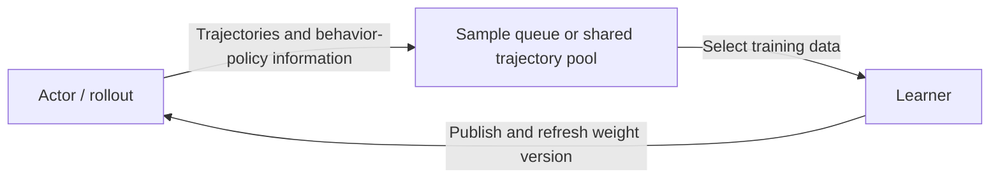

# 🔁 Actor/learner dataflow: trajectories, refit, and resharding

[RLHF](rlhf.md), [PPO](ppo.md), and [GRPO](grpo.md) explain optimization objectives.
This chapter follows a disaggregated system: how do actors generating samples exchange data with learners updating
weights
on different compute resources? Separate the two directions before designing pools and shard mappings.

## 🧭 Two flows in opposite directions



| Direction | Main data | Questions |
| --- | --- | --- |
| Actor to learner | Tokens, masks, logprobs, rewards, metadata | Producer, age, policy identity, completed consumers |
| Learner to actor | Weight shards, versions, layouts | Target shards, refresh boundary, consistency, reclamation |

Algorithms need different fields: value, advantage, or reward may be computed by different pipeline roles.
Associate trajectories with the behavior policy used for sampling and required probability information,
not merely the model considered latest when the sample is consumed.

## 📦 How might a shared experience pool work?

Consider a design: an actor allocates a trajectory block, writes tokens and logprobs, waits for required transfers,
and publishes a descriptor. A learner selects objects by length, priority, and version, reads them, and returns
references
or capacity when finished.

Control messages carry object identity, addresses/handles, sizes, and state. Bulk tensors follow supported data paths.
This can reduce bulk forwarding through a controller, but consumers must still reach the actual bytes.
A shared address alone does not implement serialization removal, scheduling, or reclamation.

| Stage | Required protocol |
| --- | --- |
| Produce | Ownership, field layout, behavior-policy version |
| Publish | Completion and visibility, READY generation |
| Sample | Freshness, repeat sampling, sample weights, algorithm constraints |
| Consume | Remaining readers and capacity-return boundary |
| Backpressure | Wait, rate-limit, or discard according to policy when full |

Asynchrony creates policy lag. Faster access can shorten handoff, but it cannot replace an algorithm's treatment of
stale
samples. [Importance sampling](importance-sampling.md) explains changed probability distributions; acceptable lag
remains
algorithm- and implementation-dependent.

## 🧩 Refit versus resharding

Refit refreshes inference weights. Resharding transforms the source partitioning into the target partitioning.
Different TP, PP, EP, or replica layouts can make one refresh require redistribution of many tensors.
See [inference parallelism](../inference/parallelism.md) for the partitioning concepts.

Start with a one-dimensional example without replication, quantization conversion, or transposition:

```text
Sources: L0=[0,4)  L1=[4,8)  L2=[8,12)
Targets: A0=[0,6)  A1=[6,12)

A0 needs [0,4) from L0 and [4,6) from L1.
A1 needs [6,8) from L1 and [8,12) from L2.
```

Intersect each target interval with the source intervals to obtain transfer ranges.
This example checks that the twelve elements are covered exactly once; intervals are half-open.

```python
# runnable-example
sources = [(0, 4), (4, 8), (8, 12)]
targets = [(0, 6), (6, 12)]
pieces = []
for dst, (d0, d1) in enumerate(targets):
    for src, (s0, s1) in enumerate(sources):
        lo, hi = max(d0, s0), min(d1, s1)
        if lo < hi:
            pieces.append((src, dst, lo, hi))
assert pieces == [(0, 0, 0, 4), (1, 0, 4, 6), (1, 1, 6, 8), (2, 1, 8, 12)]
assert sorted(i for _, _, lo, hi in pieces for i in range(lo, hi)) == list(range(12))
```

Real models can also have replicas, fused tensors, quantization scales, parameter-name mappings, and different
shard axes.
Reducing full-tensor intermediates does not remove necessary redistribution. This interval example is not a complete
model-weight conversion implementation.

## 🚦 Define a version-switch boundary

One possible protocol publishes V+1 layouts and shards, lets actors receive and verify their required data, then
switches
at an agreed boundary. Old weights remain protected until existing generation work releases them.
If switching per request or batch, retain the policy version associated with every trajectory.

GVA locates data; atomic version publication, cache invalidation, and generation switching remain framework
responsibilities.
See [memory-fabric patterns](../../../infra/memory-fabric-patterns.md) for object identity versus address.

## 🛠️ Implementation entry points and extensions

[TensorRTL][trtl] includes tensor redistribution and a [VeRL adaptation example][verl]. Check framework versions,
patches,
backends, and hardware before applying it to a target model. The [NVIDIA Reshard Collective description][reshard]
supplies
another layout-conversion design reference; its measurements belong to that implementation and platform.

The experience pool above is an application design, not a complete RL sample service supplied by BM or TRANS.
Analyze other training states with the same questions but distinct protocols:

| State | Production and consumption | Additional mechanism |
| --- | --- | --- |
| Activation | Forward produces; backward consumes later | Compute graph, prefetch, offload/recompute choice |
| Optimizer state | Updated within a step; retained across steps | Shard residency, read/write order, consistency |
| Checkpoint | Training writes; recovery reads | Consistent snapshot, manifest, persistence, topology mapping |
| Multimodal feature | Encoder produces; backbone consumes | Module parallelism, microbatch assembly, backpressure |

[FlowTrain][flowtrain] provides a published encoder/backbone training design using a unified memory pool.
Treat DRAM staging completion and checkpoint durability as separate boundaries.

## 📊 Evaluate the optimization

For trajectories, record production/consumption throughput, visibility delay, policy lag, backlog, and discarded
samples.
For weights, record payload bytes, refit time, actor pauses, switch failures, and version verification.
Then compare useful training throughput or cost at the required quality; faster movement can be offset by staler
samples.

**Exercise.** If actors produce twice as fast while learner consumption is unchanged, when does the pool fill?
Can a learner handle behavior-policy differences correctly if a quickly retrieved sample has no version information?

[trtl]: https://gitcode.com/Ascend/memfabric_hybrid/tree/master/app/tensorRTL
[verl]: https://gitcode.com/Ascend/memfabric_hybrid/tree/master/app/tensorRTL/examples/verl
[reshard]:
  https://developer.nvidia.com/blog/accelerating-reinforcement-learning-weight-refit-with-the-reshard-collective
[flowtrain]: https://aclanthology.org/2026.emnlp-industry.101/
