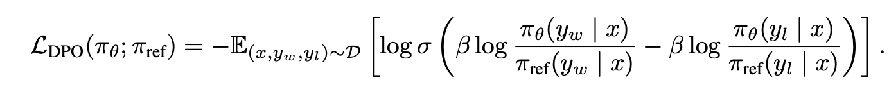
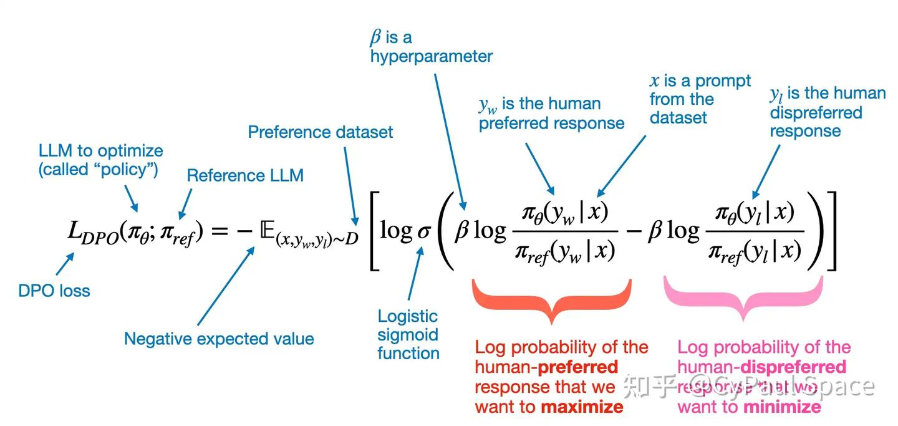
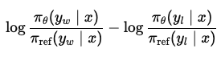
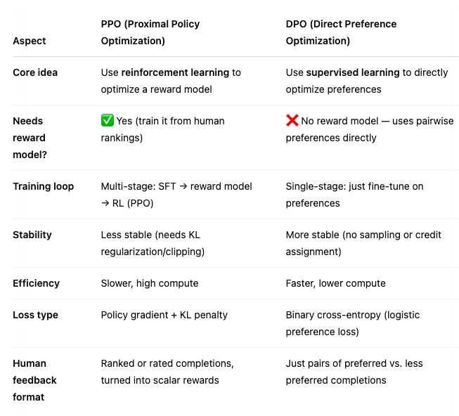

# Direct Preference Optimization

DPO trains a language model directly from chosen/rejected response pairs using a reference policy. It avoids the explicit reward-model training and online policy-rollout loop of a classic PPO-based RLHF pipeline. It still depends on the quality and coverage of preference data.

## The preference logit

For prompt x, preferred response $y_w$, rejected response $y_l$, and reference $\pi_{ref}$:

$$
\Delta=\log\frac{\pi_\theta(y_w\mid x)}{\pi_{ref}(y_w\mid x)}
-\log\frac{\pi_\theta(y_l\mid x)}{\pi_{ref}(y_l\mid x)},
$$

$$
L_{DPO}=-\log\sigma(\beta\Delta).
$$

Sequence log probabilities sum eligible response-token log probabilities. The reference-relative difference matters: DPO asks how the current policy's preference between the pair has changed relative to the baseline. The derivation connects a KL-regularized reward objective and a preference model under specific assumptions; it does not establish that every dataset perfectly follows those assumptions.

## Work through one pair

Suppose the current chosen/rejected log-probability gap is -2 and the reference gap is -4. Then $\Delta=2$: the current model has improved its relative preference for the chosen answer, even though that answer still has lower absolute sequence probability. With $\beta=0.5$, the modeled preference is $\sigma(1)\approx0.731$ and loss is about 0.313.

The compact formula compares how the current policy changes the preferred and rejected responses relative to a fixed reference policy. The sigmoid turns that margin into a pairwise logistic objective.

The annotated version labels the prompt, chosen response, rejected response, and $\beta$. Read both log-ratios together: raising the chosen probability alone is not the whole objective.

This difference of log policy-to-reference ratios is the preference margin. A larger positive value favors the chosen response relative to the rejected one, after accounting for the reference.

The comparison table summarizes a common RLHF pipeline, not universal properties of PPO or DPO. PPO can use reward signals without a separately learned reward model; DPO does not guarantee stability, quality, or lower compute in every setting.

*The original figures connect implicit reward, reference-relative probability ratios, and the simpler pairwise training path. The sigmoid maps the preference logit, not a raw answer-quality score.*

## Important limitations

Increasing the chosen/rejected probability ratio does not guarantee that the chosen answer's absolute probability rises; both can fall. Response length, token masks, chat templates, and data distribution affect training. Some recipes add chosen-response NLL regularization or use objective variants; distinguish them from original DPO.

Offline preference pairs may not cover the outputs the evolving policy produces. Evaluate held-out preferences, task correctness, length/style shifts, and retention of general capabilities. A larger beta has effects tied to the objective's parameterization; do not describe it as a universal “more alignment” knob.

**Exercise.** Can DPO be used with LoRA? Yes. DPO specifies an objective, while LoRA specifies which weight updates are trainable.

Reference: [Direct Preference Optimization](https://arxiv.org/abs/2305.18290). Compare [PPO](ppo.md).
