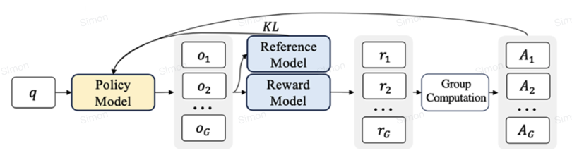
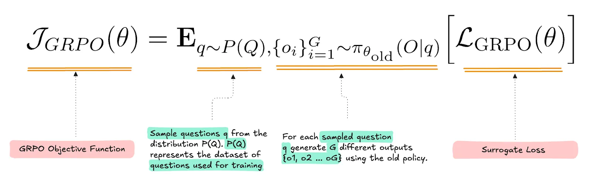
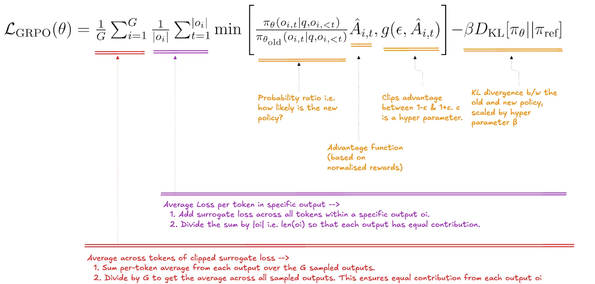
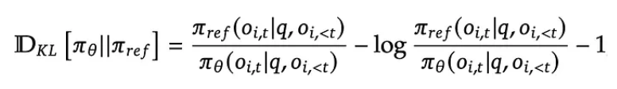

# 👥 GRPO: compare responses within a prompt group

Group Relative Policy Optimization estimates advantages from several responses to the same prompt instead of fitting a separate value model. The approach was introduced in DeepSeekMath and later used in DeepSeek reasoning training. Removing the critic reduces one source of training cost, but does not remove rollout or reward-evaluation cost.

## 🧭 Group-relative advantage

For G responses with rewards $r_i$, an outcome-supervised version uses

$$
\hat A_i=\frac{r_i-\operatorname{mean}(r)}{\operatorname{std}(r)+\epsilon}.
$$

For rewards `[8,6]`, the population mean is 7 and population standard deviation is 1, giving advantages `[1,-1]` before epsilon effects. If all rewards are equal, there is no within-group preference signal. Reward scaling and zero-variance handling must be explicit.

A token-level policy ratio compares current and rollout-policy probabilities. A clipped surrogate resembling PPO is averaged over tokens and responses, often with a reference-policy KL penalty. In the original sequence-normalized formulation, each response contributes an average over its tokens; later variants change normalization to address different biases.

The group diagram shows multiple responses to one prompt, their rewards, and normalization into relative advantages. The reference model supplies a regularization target; it is not the critic removed by GRPO.

The expectation diagram distinguishes sampling prompts from generating a group with the old policy. The group is a local comparison set, not an absolute measure of answer quality.

The annotated surrogate averages token contributions within each response and then across the group. Clipping restrains each sampled probability-ratio term; it is not a global guarantee that the entire policy stays near its predecessor.

The last expression is a sampled estimator involving a reference-to-current probability ratio, not the full KL divergence for one token. Its expectation has a KL-related interpretation under the stated sampling distribution; keep old-policy and reference-policy roles distinct.

*The diagrams contrast a learned value baseline with group reward statistics, then show the clipped objective and a sampled KL estimator. Keep the reference and old policies distinct.*

## ⚖️ Outcome versus process supervision

Outcome supervision assigns a score to the completed response and can use the same normalized outcome advantage for its tokens. Process supervision scores intermediate steps and defines token advantages from appropriate future step rewards. It requires a credible step evaluator; plausible wording is not proof of a valid step.

For verifiable math or code, rule-based checks can provide rewards. Format rewards check presentation separately from correctness. An automated verifier can still be incomplete or exploitable, so inspect high-reward failures.

## 📌 Avoid misleading analogies

PPO does not force all responses into one solution pattern, and GRPO does not inherently remove bias or guarantee diversity. Group size, sampling, rewards, KL strength, and optimization determine behavior. “No critic” means no learned value baseline in this formulation, not “no model-based judgments.”

Iterative reward-model retraining is one possible pipeline choice; replay percentages are not intrinsic to GRPO. R1-Zero's rule-based rewards are also a specific recipe, not a requirement of the algorithm.

**Exercise.** If every response is wrong and receives zero reward, can relative normalization identify the best one? No. The group has no differentiated signal; improve sampling, tasks, or feedback.

Reference: [DeepSeekMath](https://arxiv.org/abs/2402.03300). Continue with [DeepSeek-R1](../models/deepseek-r1.md).
