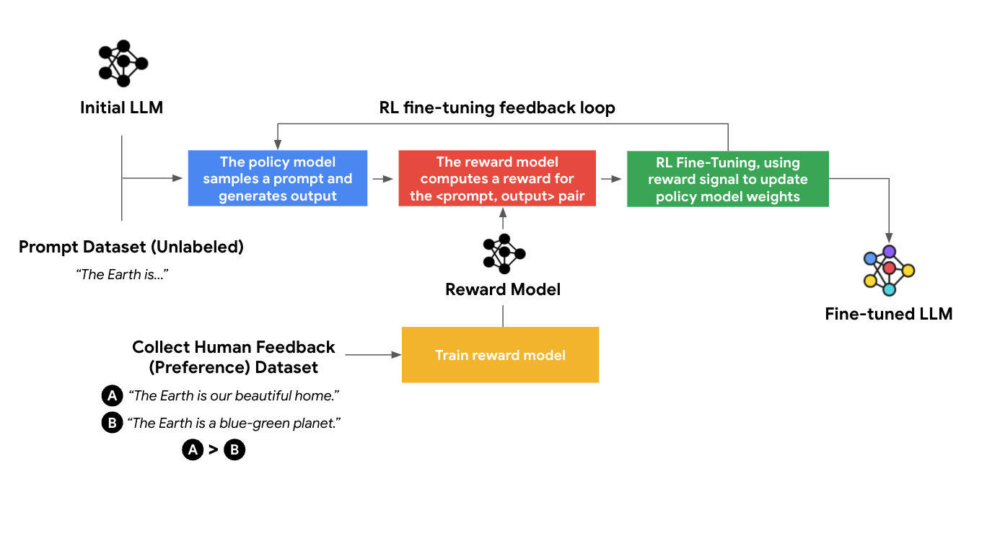

# RLHF: learn from preferences, then optimize a policy

Reinforcement learning from human feedback uses human judgments to shape model behavior. A classic language-model pipeline starts with supervised fine-tuning, learns a reward model from preferences, and then optimizes a policy against that reward with a constraint on drift.

## Name the components precisely

| Component | Role |
| --- | --- |
| Actor/policy | Distribution over next tokens given the conversation prefix |
| Reward model | Scores a completed response according to learned preferences |
| Critic/value model | Estimates future return from a prefix in actor–critic methods |
| Reference policy | Fixed or separately managed comparison policy for regularization |
| Old policy | Policy that generated the current training batch |

The reference policy and old policy need not be the same. A critic estimates expected return, not whether an answer is objectively true. GRPO can omit a learned critic; it does not follow that every RLHF method requires all four models.

## Learn a preference score

For prompt x, chosen answer $y_c$, and rejected answer $y_r$, a Bradley–Terry-style loss is

$$
L_{RM}=-\log\sigma(r_\phi(x,y_c)-r_\phi(x,y_r)).
$$

If scores differ by 2, the modeled preference probability is about 0.881. It is a probability under the preference model, not a guarantee that the chosen answer is correct. Rankings can generate multiple pairs, but those pairs are correlated and may reflect annotator disagreement.

*The original pipeline separates demonstration learning, comparison-based reward learning, and policy optimization. Each stage has its own data and failure modes.*

## Optimize without losing the starting behavior

A common objective rewards high-scoring responses while penalizing KL divergence from a reference policy. The policy may otherwise exploit reward-model shortcuts, such as verbosity or superficial style. PPO adds a separate mechanism to moderate updates relative to the data-collecting policy.

For a dialogue, each generated token is an action. Rewards may arrive at the end or at intermediate steps. The critic's value depends on the current prefix, and advantages compare observed/estimated return with a baseline. Return discounting and advantage estimation must be specified.

## What to evaluate

Hold out preference data, inspect reward hacking, and test task correctness, calibration, verbosity, and regressions. Human preference is useful supervision but is neither perfectly consistent nor identical to truth. A higher reward score alone is insufficient evidence of improvement.

**Exercise.** Why keep an independent evaluation set when the reward model already scores outputs? Optimization can exploit the scorer's errors. Independent evaluation measures whether the intended behavior improved.

Reference: [InstructGPT](https://arxiv.org/abs/2203.02155). Continue with [PPO](ppo.md), [DPO](dpo.md), and [GRPO](grpo.md).
