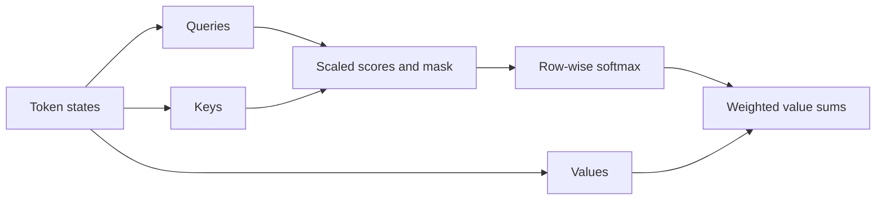

# Attention: a learned weighted lookup

A fixed vector cannot conveniently preserve every detail in a long sentence. Attention lets each output position retrieve different information from the input. In translation, generating a person's name should emphasize the corresponding source words; generating a verb may need other positions.

## Queries, keys, and values

A query describes what a position needs. Keys are descriptors used to match that query. Values contain information to aggregate. These are learned projections, not literal database fields:

$$
Q=XW_Q,\quad K=XW_K,\quad V=XW_V,\qquad
O=\operatorname{softmax}\left(\frac{QK^\top}{\sqrt{d_k}}+M\right)V.
$$

For one head, $Q$ has shape $n_q\times d_k$, $K$ has shape $n_k\times d_k$, and $V$ has shape $n_k\times d_v$. The score matrix is $n_q\times n_k$; softmax runs over keys, so each query receives weights summing to one. Scaling controls score variance as the dot-product dimension grows. $M$ is an additive [mask](attention-masks.md).

If the scores for two keys are $[0,\log 3]$, their weights are $[0.25,0.75]$. Values $[2,10]$ produce output $8$. The output is a mixture of values, not the largest score or a selected token ID.

```python
# runnable-example
import math
scores = [0.0, math.log(3.0)]
weights = [math.exp(s) / sum(math.exp(t) for t in scores) for s in scores]
output = sum(w * v for w, v in zip(weights, [2.0, 10.0]))
assert abs(output - 8.0) < 1e-12
```

## Self-attention, cross-attention, and heads

Self-attention obtains Q, K, and V from the same sequence. Cross-attention obtains queries from the receiving sequence and keys/values from another source. A text decoder can therefore query image features or encoder states. Multiple heads learn separate projections, concatenate their outputs, and use an output projection to mix them. They are not guaranteed to specialize into human-readable linguistic roles.



## Beyond the first implementation

Dense attention has quadratic score size in sequence length. [FlashAttention](attention-variants.md) changes memory traffic without approximating the mathematical attention operation. [KV caching](../inference/kv-cache.md) reuses past keys and values during generation. Neither removes the need for correct positions and masks.

Attention alone does not encode word order. [Position information](position.md) is essential. Attention weights also do not by themselves establish causal explanations of a prediction: values, residual connections, and later layers matter.

**Check your understanding.** If query length is 4 and source length is 7, what is the score shape? It is $4\times7$ per head, regardless of value-vector width.

Read next: [the complete Transformer path](../word2vec-to-transformer.md). Primary reference: [Attention Is All You Need](https://arxiv.org/abs/1706.03762).
