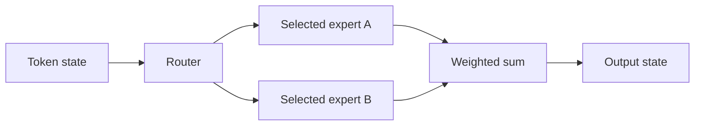

# Mixture of Experts: more capacity with sparse computation

A sparse MoE replaces some dense feed-forward layers with multiple expert networks. A router selects a small subset for each token. The model can store many parameters while activating only part of them on a forward pass. It still needs memory for the experts that are resident across the serving system.

## Follow one token

For token state $x$, a router computes scores, selects a set $S(x)$ of $k$ experts, and combines their outputs:

$$
y=\sum_{i\in S(x)}g_i(x)E_i(x).
$$

The normalization of selected weights is architecture-specific. For example, weights 0.7 and 0.3 combine two expert outputs as $0.7E_1(x)+0.3E_2(x)$. Experts need not correspond to clean concepts such as “math expert” or “French expert”; specialization emerges from training and requires measurement.

## Why balancing matters

If nearly all tokens select one expert, that expert becomes a communication/computation bottleneck while others receive little training. Importance measures sum soft routing probabilities; load measures actual assignment counts. These differ: many tiny probabilities and a few large probabilities can have the same sum but very different top-k traffic.

A common auxiliary objective uses the product of assignment fraction and average router probability for each expert. Other formulations penalize variation of importance/load. Router z-loss penalizes the squared log-sum-exp of logits to control numerical scale; it is not simply a penalty on probabilities.

For $T$ tokens, $E$ experts, and top-$k$ routing, mean assignments per expert are $kT/E$. A capacity factor reserves room above this mean. Depending on the system, overflow tokens may be dropped, rerouted, or handled with dynamic capacity. These choices affect both quality and latency.

## DeepSeek-style design choices

Fine-grained experts use narrower expert FFNs and more selectable combinations. Shared experts process every token to capture common features. DeepSeek's later auxiliary-loss-free balancing adjusts expert-selection biases based on load; those biases need not enter the combination weights. “Loss-free” should not be read as “no training losses anywhere”: the full architecture can retain other regularizers, including sequence-level balancing.

## Original visual notes

Use the figures to distinguish the expert layer, router distribution, balancing objectives, z-loss, and capacity limit. These are separate mechanisms, not interchangeable names for one regularizer.

## Systems consequences and a check

Expert parallelism sends tokens to the devices hosting selected experts, often requiring all-to-all communication. Total parameter count, active parameter count, activation memory, and communication volume answer different cost questions. Small batches can underutilize experts even when arithmetic per token looks attractive.

**Exercise.** With 8 experts, top-2 routing, and 64 tokens, how many assignments occur and what is the average load? There are 128 assignments and 16 per expert; actual loads can be uneven.

References: [Switch Transformers](https://arxiv.org/abs/2101.03961), [DeepSeekMoE](https://arxiv.org/abs/2401.06066), [DeepSeek-V3](../models/deepseek-v3.md).
