# Position information: sinusoidal encodings and RoPE

Without positional signals, self-attention cannot generally distinguish a permutation of tokens in the way language requires. “Dog bites person” and “Person bites dog” contain the same words but different relationships.

## Absolute positions

Learned position embeddings attach a vector to each position index. The index is a lookup key; a larger index does **not** imply larger embedding weights. A fixed lookup table has a maximum supported position unless extended or adapted.

The original Transformer instead adds sinusoidal features:

$$
PE(p,2i)=\sin\left(p/10000^{2i/d}\right),\quad
PE(p,2i+1)=\cos\left(p/10000^{2i/d}\right).
$$

Each dimension pair has an angular frequency. As $i$ increases, frequency decreases and wavelength increases. Multiple scales encode both nearby and more distant changes. Being able to evaluate the formula at any integer does not guarantee that a trained model extrapolates reliably to arbitrary lengths.

## Rotary position embeddings

RoPE rotates pairs of query/key coordinates. For one pair and angle $p\theta$:

$$
R(p\theta)=\begin{bmatrix}\cos(p\theta)&-\sin(p\theta)\\
\sin(p\theta)&\cos(p\theta)\end{bmatrix},\qquad
q'_p=R(p\theta)q_p,\quad k'_s=R(s\theta)k_s.
$$

Because rotations preserve lengths and compose by angle addition,

$$
(q'_p)^\top k'_s=q_p^\top R((s-p)\theta)k_s.
$$

The score therefore depends on relative displacement through the rotation, while still depending on token content. Different coordinate pairs use different frequencies. Standard RoPE applies to queries and keys, not usually values.

```python
# runnable-example
import math
def rotate(x, angle):
    a, b = x
    return (a * math.cos(angle) - b * math.sin(angle),
            a * math.sin(angle) + b * math.cos(angle))
q, k = (1.0, 2.0), (3.0, -1.0)
dot = lambda a, b: sum(x * y for x, y in zip(a, b))
assert abs(dot(rotate(q, 0.7), rotate(k, 1.2)) - dot(q, rotate(k, 0.5))) < 1e-12
```

## Read the original diagrams

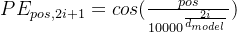

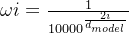

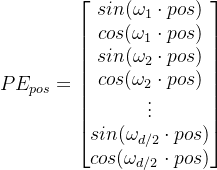

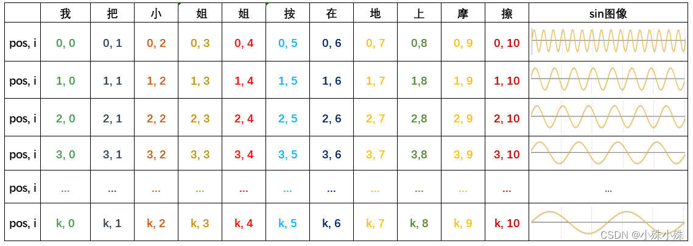

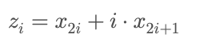

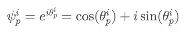

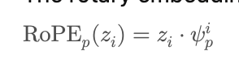

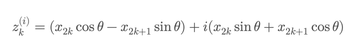

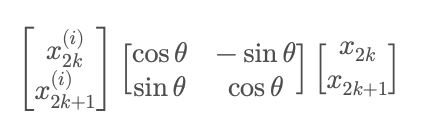

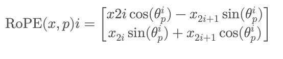

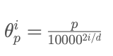

**Figure guide.** Figures 1–4 build sinusoidal absolute position vectors from frequencies; their waves vary with coordinate pair and position. Figures 5–11 restate rotary embedding as complex multiplication and as a real two-dimensional rotation. In both forms, each pair rotates by a position-dependent angle, and the resulting query–key dot product depends on relative displacement. The frequency index and sequence-position index are different quantities; treating them as interchangeable obscures the derivation.

Follow the progression from adding sinusoidal vectors to rotating 2-D coordinate pairs, then to the relative-position dot-product identity. Keep the position index separate from the frequency-pair index when reading the equations.

## Long-context implications

RoPE scaling schemes adjust position/frequency relationships to extend usable context. They require model-specific choices and evaluation; extending a configuration limit alone does not establish long-context quality. When using a KV cache, preserve consistent absolute positions even if only one new token is processed. A cache with incorrect position offsets may have valid shapes and silently wrong predictions.

**Exercise.** If both positions increase by 10, does the rotary factor in their dot product change? No: their relative displacement stays the same, assuming the same frequency schedule.

Reference: [RoFormer](https://arxiv.org/abs/2104.09864). Continue with [attention masks](attention-masks.md).
