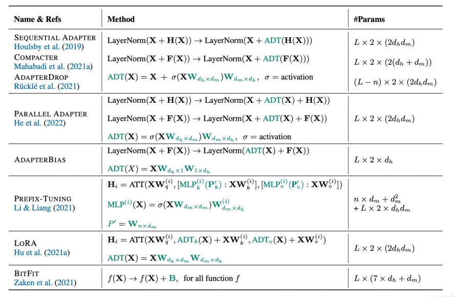
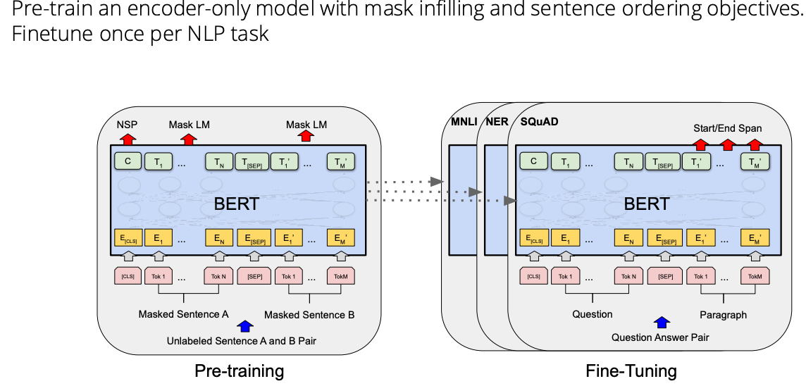
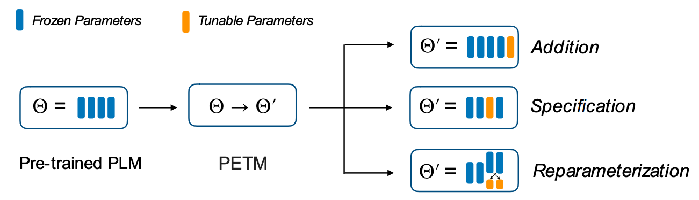
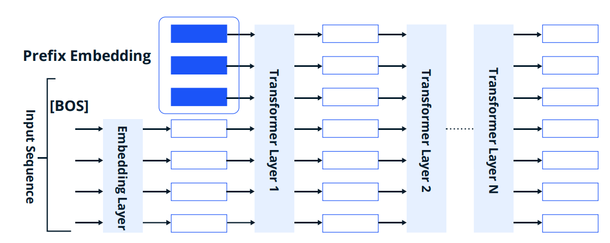
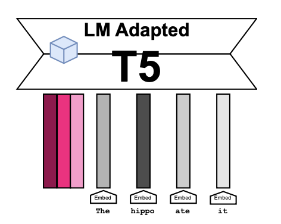
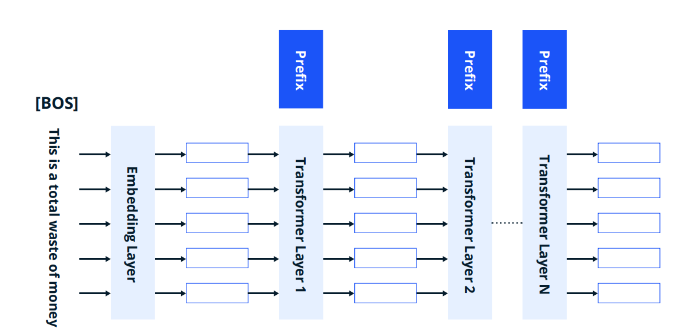
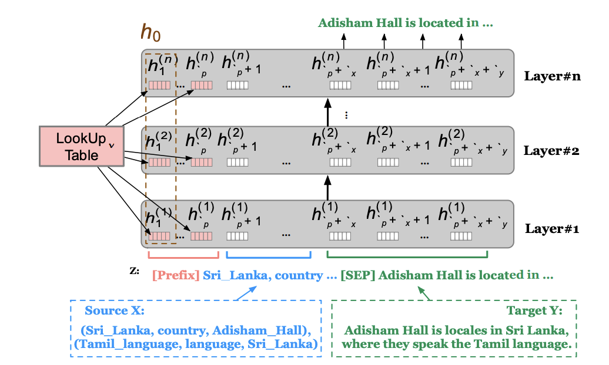
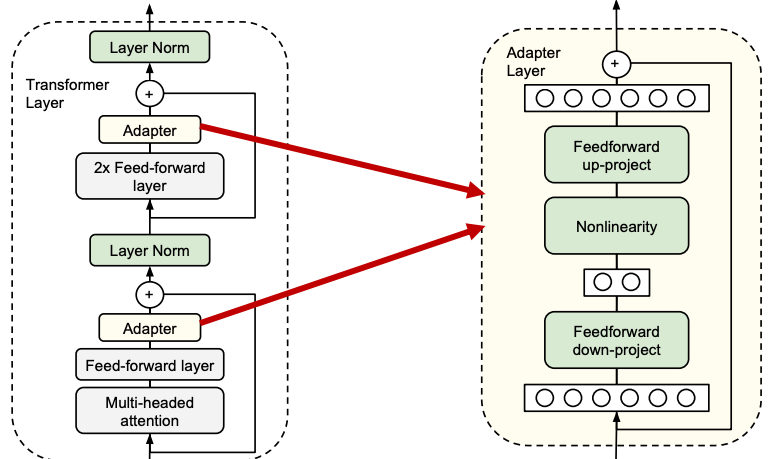
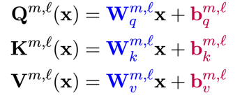
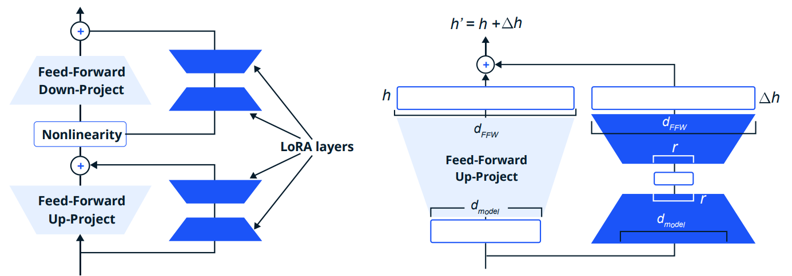

# 🛠️ Fine-tuning methods: choose what is allowed to change

Fine-tuning adapts a pretrained model using task data. Separate the training objective from the parameterization: SFT or DPO defines what to optimize; full tuning, LoRA, adapters, or prompts define which degrees of freedom can change.

## 🧭 A map of adaptation

*The overview contrasts adding parameters, selecting existing parameters, and reparameterizing updates. The BERT example adds a task-specific readout to a pretrained encoder.*

A hard prompt is discrete text. A template wraps an input into a task format; a **verbalizer maps class labels to output words/tokens**. These terms are related but not interchangeable. For sentiment, the template might be `Review: ... Sentiment:` and the verbalizer might map labels to `positive` and `negative`.

## 🧩 Prompt and prefix tuning

*Input soft prompts learn embedding vectors. Prefix tuning injects learned context into internal layer states. Frozen backbone weights still participate in computation and gradient propagation to the trainable inputs.*

See [prompt methods](../../adaptation/prompt-tuning.md) for counts and deployment implications. More injection points can increase expressiveness but do not guarantee better optimization.

## 📌 Adapters, sparse choices, and low-rank updates

*The adapter's down projection, nonlinearity, up projection, and residual route form a small trainable module.*

*BitFit selects bias parameters rather than adding a bottleneck network. A task head may also be trained; bias-free architectures limit where this strategy applies.*

DiffPruning learns sparse parameter deltas using a sparsity-inducing objective/relaxation. The storage advantage depends on how sparse updates are represented and executed. LoRA factorizes an update as BA. IA³ instead learns vectors that rescale selected internal activations, including attention and FFN pathways.

*Low-rank branches add a learned update while retaining the frozen main matrix. The low rank constrains the update, not the total adapted matrix.*

## ⚖️ Design a useful comparison

Use one fixed train/validation/test split and compare task quality, trainable parameters, peak memory, training time, checkpoint size, and inference latency. Tune learning rates per method fairly. Small trainable parameter count does not imply proportional speedup because the frozen backbone still executes.

**Exercise.** Can two methods with the same trainable parameter count have different serving costs? Yes. Added nonlinear modules, virtual tokens, and mergeable weight updates have different execution paths.

References: [BitFit](https://arxiv.org/abs/2106.10199), [DiffPruning](https://arxiv.org/abs/2012.07463), [IA³](https://arxiv.org/abs/2205.05638). Continue with [SFT](../../adaptation/sft.md) and [LoRA](../../adaptation/lora.md).
