# LLM course introduction: probabilities, representations, and generation

This chapter follows a token from text input to a generated output. The key is to distinguish the distribution a model defines, the vectors used to compute it, the loss used for learning, and the rule used for decoding.

## Conditional and unconditional modeling

An unconditional sequence model defines $p(y)=\prod_t p(y_t\mid y_{<t})$. “Unconditional” means no additional external input x; it still conditions each token on preceding tokens. Conditional generation defines $p(y\mid x)=\prod_t p(y_t\mid x,y_{<t})$, as in translation or summarization.

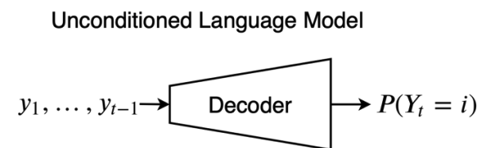
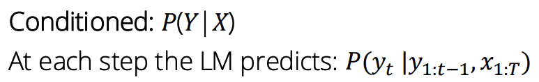
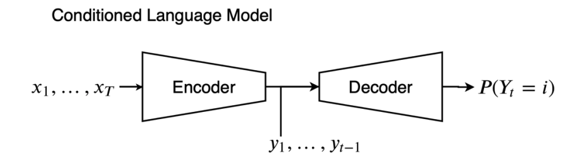

*The encoder–decoder diagram is one way to implement conditional generation. A decoder-only model can also condition on a prompt prefix.*

## IDs become hidden states, then logits

A tokenizer maps text to IDs from a fixed vocabulary. Embedding lookup selects vectors, and an encoder or decoder transforms them into contextual hidden states.

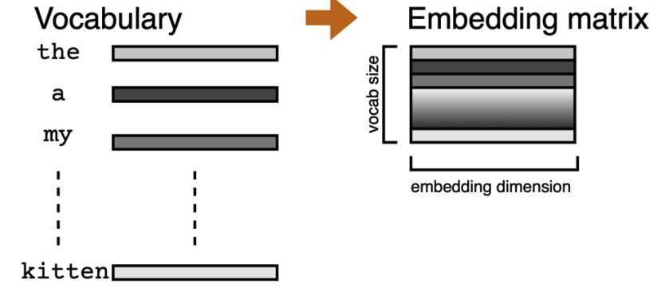
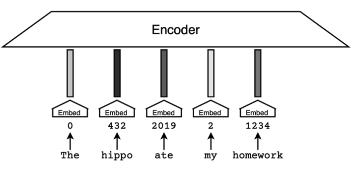
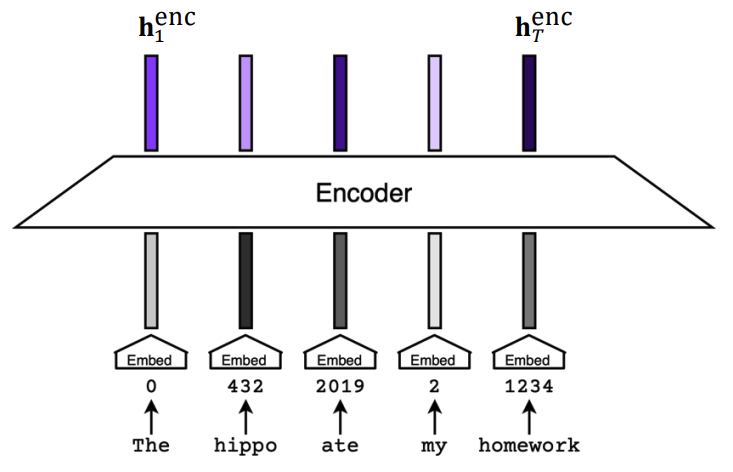
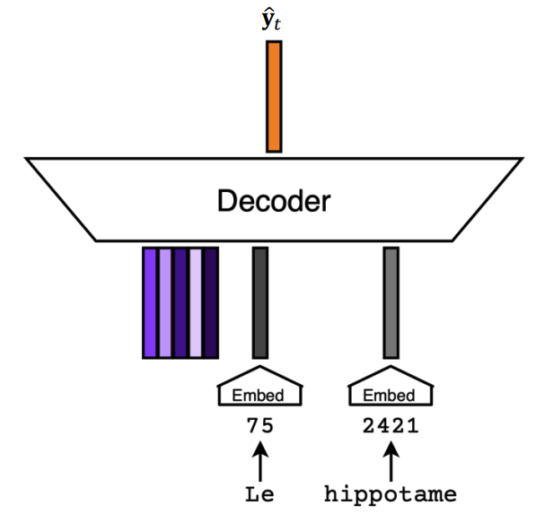
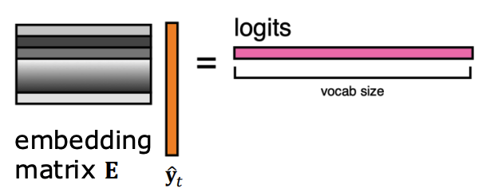

*The vocabulary projection maps a hidden vector to one score per token. Weight tying may reuse an embedding matrix, but the training objective does not generally minimize Euclidean distance to the next token's embedding.*

For hidden state h, logits are $z=W_{vocab}h+b$. Softmax gives probabilities, and the loss at a target token y is $-\log\operatorname{softmax}(z)_y$. A probability of 0.5 gives loss about 0.693 nats; 0.1 gives about 2.303 nats.

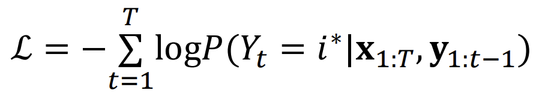
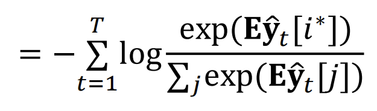

*The two equations express the same negative-log-likelihood objective before and after expanding softmax. Padding and other excluded positions require loss masks.*

## Generation is a separate decision

Greedy selection, random sampling, temperature, top-k, top-p, and beam search operate on the predicted distribution. Top-p retains the smallest sorted candidate set reaching **at least** p cumulative probability, not a set constrained to remain below p. See the worked example in [decoding](../../inference/decoding.md).

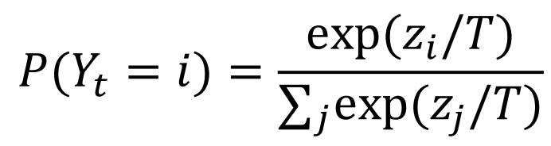
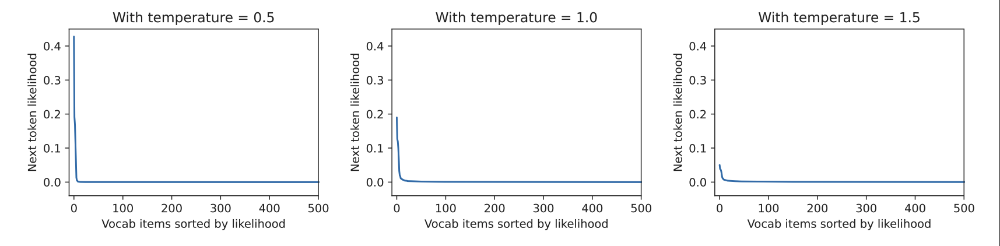
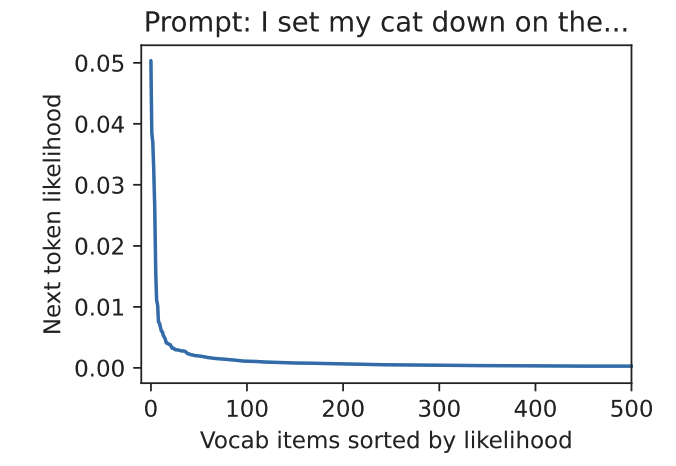
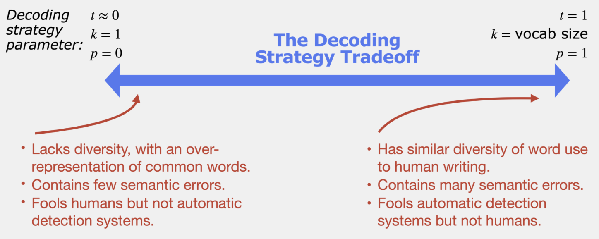

*The plots show concentration versus diversity. The slide's statements about semantic errors or detectability are illustrative, not universal guarantees. Temperature zero is normally implemented as a greedy special case, not division by zero in softmax.*

Frequency penalties depend on counts; presence penalties depend on whether a token has appeared. Exact formulas vary by API. Stop tokens and maximum output length affect completion quality and should be recorded in experiments.

## Historical recurrent computation

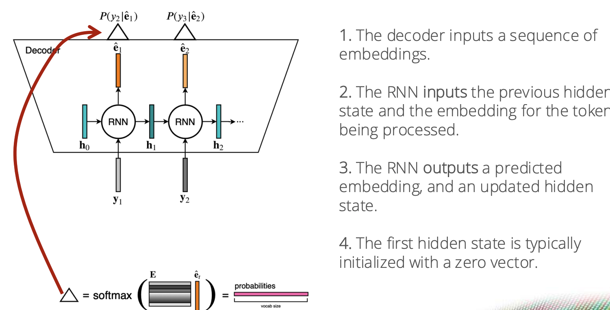
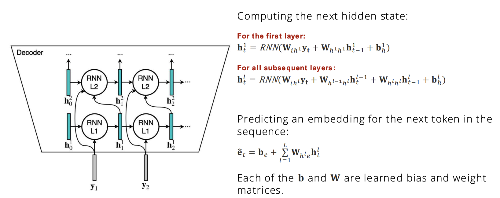

*RNN diagrams show a state passed through time and layers. This sequential dependency motivated attention-based alternatives; recurrence is still useful in some streaming settings.*

**Exercise.** If vocabulary size is 50,000 and hidden width is 768, how many next-token logits are produced per position? 50,000, regardless of the hidden width.

Continue with [architectures](architectures.md). Course resource: [CMU LLM course](https://cmu-llms.org/schedule/); the live schedule can change independently of these archived notes.
