# Retrieval-augmented language models: a research map and lab

Retrieval can enter a language system at the input, hidden-state, output-distribution, or training-objective level. This chapter organizes the original research slides by that design choice. Begin with the [practical RAG pipeline](../../rag.md) if retrieval is new to you.

## The common pattern and REALM

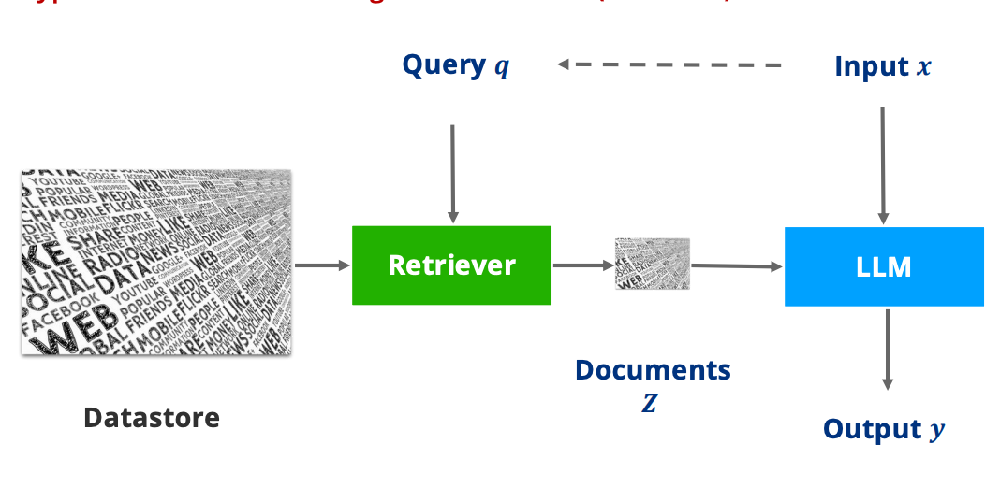

*A query selects external evidence, which influences the prediction. The location of that influence differs among methods.*

[REALM](https://arxiv.org/abs/2002.08909) learns a latent document retriever using a masked-language-modeling signal. The model benefits when retrieved passages help reconstruct missing information; retrieval is part of pretraining rather than only an inference-time prompt addition.

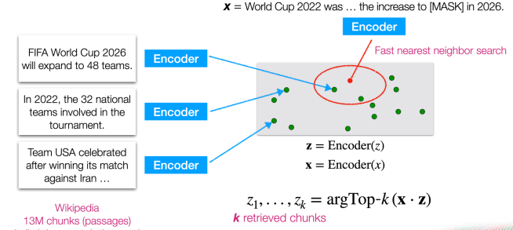

*The nearest-neighbor diagram shows candidate selection in embedding space. Retrieval quality is meaningful only relative to the prediction task and corpus.*

## RETRO: retrieved context inside the network

[RETRO](https://arxiv.org/abs/2112.04426) retrieves neighbors for text chunks, encodes them, and uses chunked cross-attention to condition a decoder. Causal alignment matters: retrieval based on a completed chunk must not expose future target information to earlier positions.

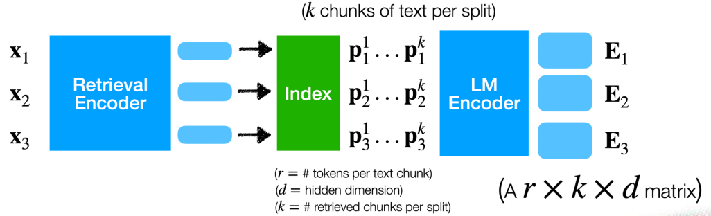
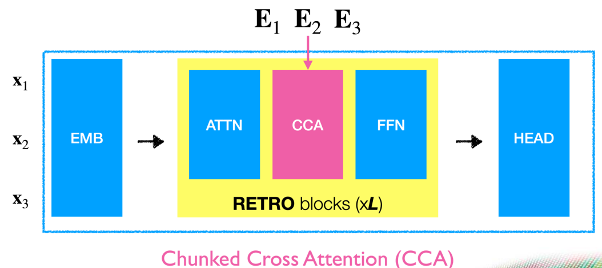
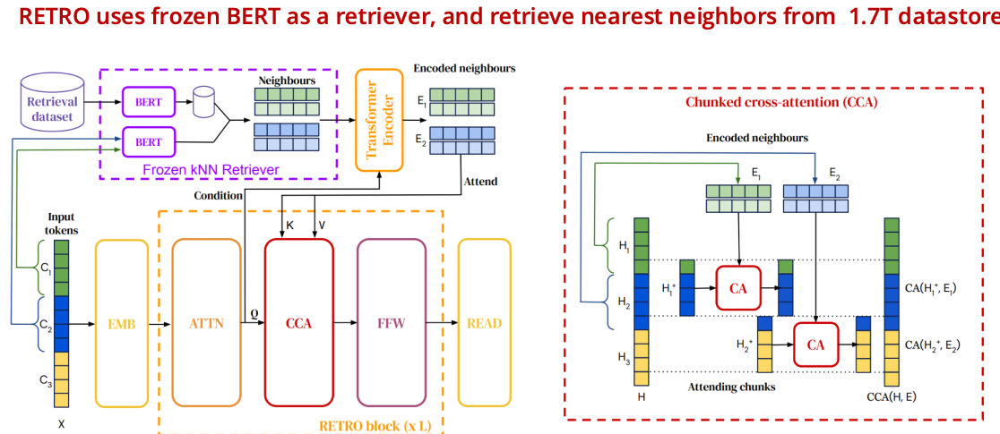

*The first group separates retrieval embeddings, encoded neighbor tokens, and decoder blocks. A retrieval encoder and a neighbor encoder serve different roles.*

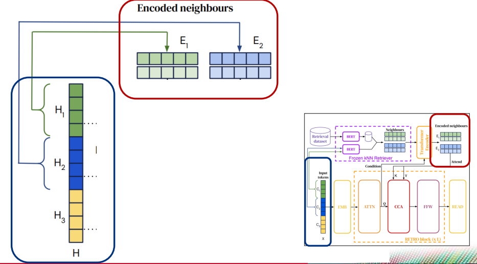
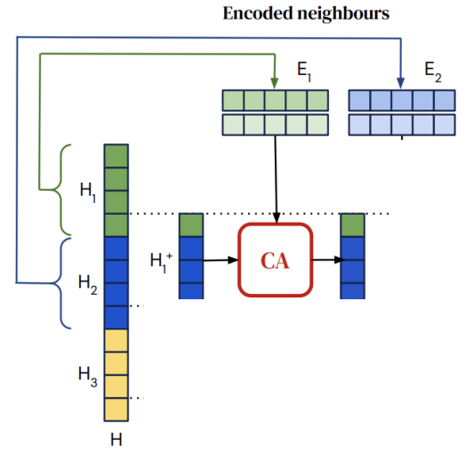
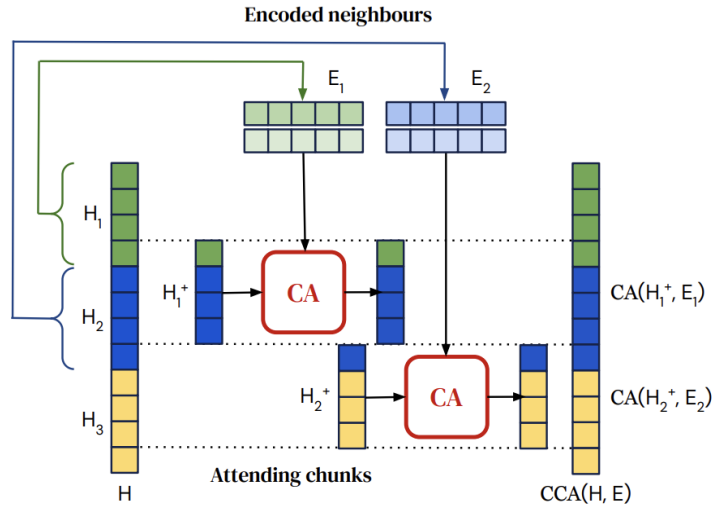

*These diagrams expand chunked cross-attention. Reassembled outputs retain the decoder sequence's shape even though each chunk reads additional neighbor tokens.*

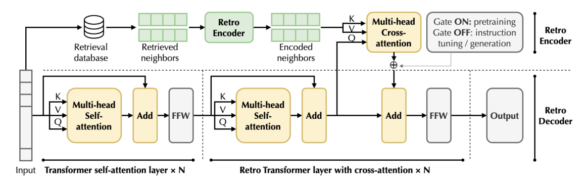

*The gated architecture slide illustrates a retrieval-enhanced variant. Its training/inference gating policy is a model-specific choice, not a universal rule for all RETRO-style systems.*

## kNN-LM and TRIME: memory at prediction time and during training

[kNN-LM](https://arxiv.org/abs/1911.00172) stores context representations with their next-token targets. Neighbors vote for a nonparametric token distribution, which is interpolated with the model distribution:

$$
p(y\mid x)=(1-\lambda)p_{LM}(y\mid x)+\lambda p_{kNN}(y\mid x).
$$

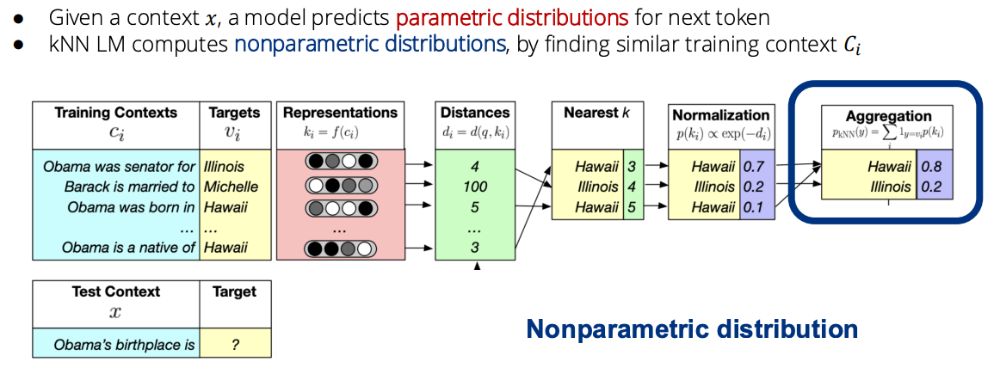
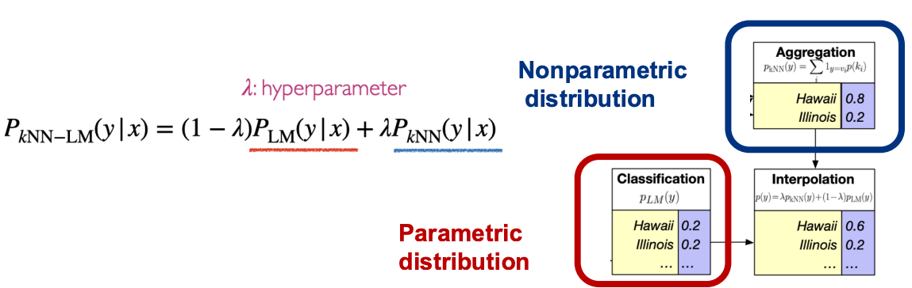

*Neighbor distances become weights, weights for identical target tokens are combined, and the resulting distribution is mixed with the LM prediction.*

[TRIME](https://arxiv.org/abs/2205.12674) brings memory augmentation into training using in-batch memories. This addresses the mismatch between learning without memory and deploying with it.

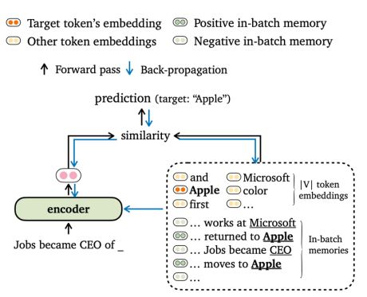

*The target token can receive support from its embedding and contextual memories. Positive/negative memory construction is part of the objective.*

## Teach the generator to use evidence

[SAIL](https://arxiv.org/abs/2305.15225) augments instruction data with search results and trains the model to use relevant evidence amid distracting material.

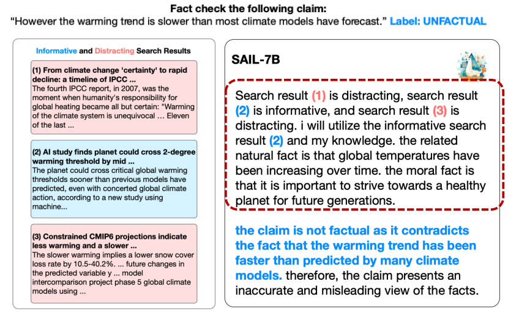

*The example distinguishes informative and distracting results. Its generated assessment is an illustration of the method, not an independent authoritative fact-check.*

[Self-RAG](https://arxiv.org/abs/2310.11511) trains retrieval and reflection behavior using special tokens. It can decide when to retrieve and evaluate relevance, support, and usefulness. Learned self-assessment still needs independent validation.

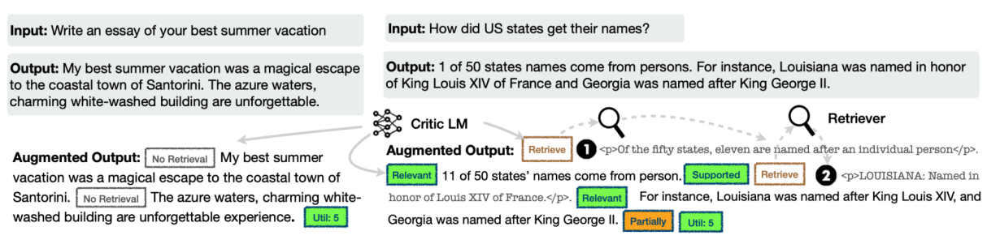
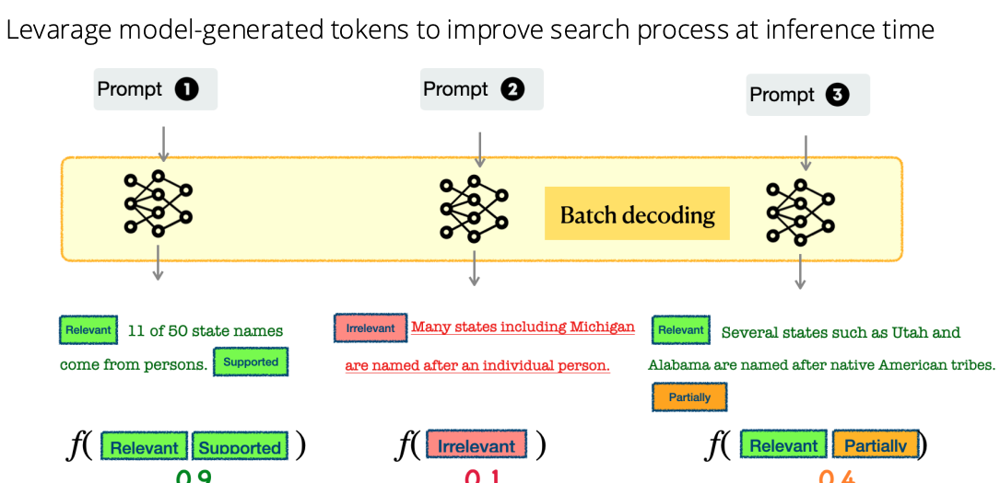

*Reflection scores guide candidate selection. A “supported” token is a model judgment, not proof that the citation entails the claim.*

## Improve the retriever and evidence interface

[REPLUG](https://arxiv.org/abs/2301.12652) can adapt a retriever using feedback from a black-box language model while leaving the generator unchanged. [RA-DIT](https://arxiv.org/abs/2310.01352) tunes both retrieval and generation to improve their compatibility.

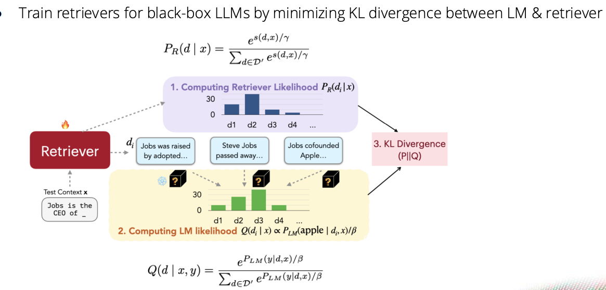
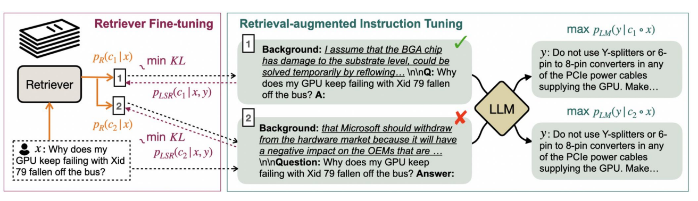

*The distribution-matching paths use the generator's usefulness signal to train retrieval. This differs from training solely on generic semantic similarity.*

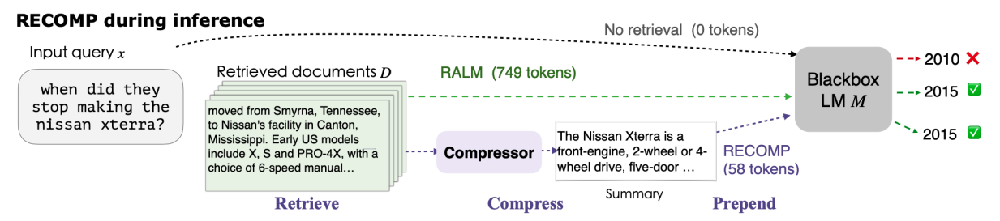

*The RECOMP slide adds a compression step before generation. Compression saves context tokens but must preserve decisive evidence, including exceptions and numbers.*

[DSPy](https://arxiv.org/abs/2310.03714) treats language-model pipelines as programs whose prompts/demonstrations can be optimized against a metric. Optimization requires training/development examples and an untouched test set; it does not remove the need to define success.

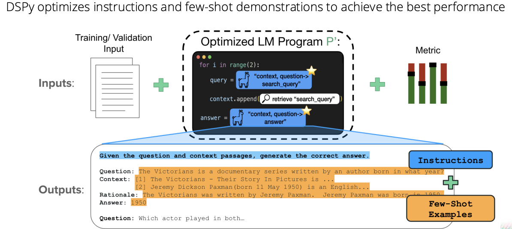

*The program, examples, and metric jointly determine what is optimized. A flawed metric can reward a flawed pipeline.*

## Lab: locate the failure before choosing a method

Build a small document QA set with known supporting passages. Compare no retrieval, retrieved evidence, and oracle evidence. If oracle evidence fails, improve the generator/interface. If oracle succeeds but retrieval fails, improve the corpus, query, or retriever. If added distractors cause failure, test filtering or evidence-aware training. Record citation support, correctness, latency, and token cost.

**Exercise.** Can a reranker fix missing source documents? No. Expand or repair the evidence collection before optimizing ordering.
