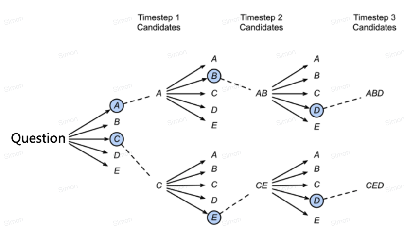

# Decoding: turn token probabilities into a response

A language model returns logits. Decoding chooses what to emit from those scores and when to stop. The same model can produce different outputs under different decoding settings, so evaluation must record them.

## Greedy and beam search

Greedy decoding selects the highest-probability next token. It is locally optimal, but the product of locally best choices need not be the highest-probability complete sequence. Determinism also depends on numerical kernels, ties, and the execution environment.

Beam search retains several candidate prefixes and expands them. A beam width of four keeps four sequences, not simply four independent top tokens at every position. Sequence scores generally sum log probabilities; length penalties and stopping rules affect results. Beam search costs more memory/computation and does not guarantee more factual or natural open-ended text.

*The branching diagram represents candidate sequences. Pruning a prefix discards all its future continuations.*

## Temperature, top-k, and top-p

Temperature transforms logits as $p_i=\operatorname{softmax}(z_i/T)$ for $T>0$. Lower temperature concentrates probability; higher temperature spreads it. Temperature controls sampling entropy, not truthfulness or creativity as a measurable guarantee.

Top-k retains the k highest-probability tokens and renormalizes. Top-p, or nucleus sampling, retains the smallest highest-probability set whose cumulative mass reaches p. With probabilities `[0.6,0.25,0.1,0.05]` and $p=0.8$, the first two tokens remain and renormalize to approximately `[0.706,0.294]`. A flatter distribution generally retains more tokens at the same p.

The order of temperature scaling and truncation matters. Libraries may combine multiple processors, repetition penalties, and constraints; report the complete policy.

## Practical choices

Use task accuracy and error analysis to choose settings. Structured outputs may need grammar/schema-constrained decoding and subsequent semantic validation. A valid JSON object can still contain wrong facts. For generation experiments, compare multiple seeds when sampling variance is material.

**Exercise.** Does top-k with $k=1$ still produce diverse sampling? No: only one candidate remains, so it behaves like greedy selection except for implementation/tie details.

Reference: [The Curious Case of Neural Text Degeneration](https://arxiv.org/abs/1904.09751). Continue with [KV caching](kv-cache.md).
