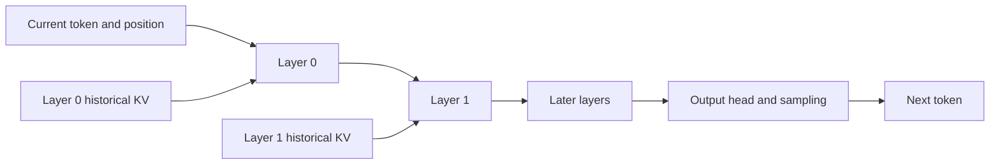
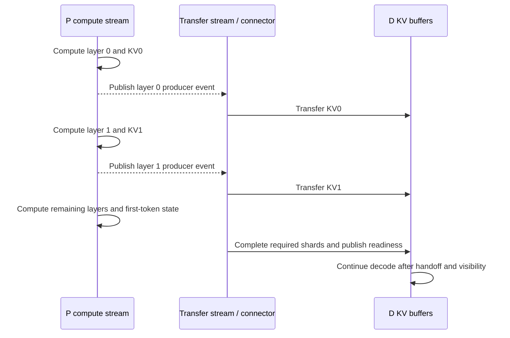

# 🪜 Layerwise inference: execution, KV movement, and scheduling

Transformer layer $\ell$ consumes hidden state $h_\ell$, produces $h_{\ell+1}$, and reads or updates **its own KV cache**. A layer being ready is different from an entire request being ready. Layerwise optimization exploits local readiness to interleave computation, loading, and transfer.

## 🧩 Four uses of layerwise

| Usage | What is organized by layer? | Opportunity and cost |
| --- | --- | --- |
| Execution | A token/batch passing through layers | Explicit dependencies; layers cannot run arbitrarily in parallel |
| KV transfer | A layer's KV moves once ready | Overlap with later computation; more small operations and completion state |
| KV loading/offloading | Cache across HBM, DRAM, or storage | Lower residency in some designs; data must arrive before consumption |
| Weight prefetch | The next layer's weight shard | More model capacity; repeated loading may be host-link limited |

These differ from [layer-first physical layout](layers-pages.md): layout controls contiguity, scheduling controls time. PP places layers on different stages; layerwise transfer can work with PP=1. Layerwise quantization calibration is a separate offline activity.

## 🔄 Follow one token through the model

For ordinary autoregressive decode, a layer receives the current hidden state, projects Q/K/V, appends new K/V to its cache, attends to its historical/current KV, and performs the remaining projections, residual operations, and FFN. All layers, final normalization, and the output head must finish before sampling logits are available. Exact ordering is architecture-specific.



Receiving layer 0's KV does not make a complete next-token result possible. A supported per-layer load/wait executor could enter ready layers and wait at a missing layer; another scheduler waits for all layers before decode admission. This depends on the connector/executor contract. See [KV-cache fundamentals](kv-cache.md).

## 🚚 Layerwise push in P/D serving

After P produces a layer or transfer block, it records readiness. Transfer work waits on that event while computation continues through later layers. D tracks readiness by request, layer, block, and TP shard. “Push” identifies transfer direction, not necessarily direct device-to-NIC submission; a host connector may submit it.



This conservative protocol sends incrementally but performs a complete handoff. The cited [vLLM Ascend P/D design](https://docs.vllm.ai/projects/ascend/en/main/developer_guide/Design_Documents/disaggregated_prefill.html) distinguishes ordinary D-side pulling from P-side layerwise pushing, and notifies D to begin decode after all layers have been pushed. The connector name alone does not establish decode starting during the first layer's transfer.

Connect this to [device initiation](../../../infra/device-initiated-transfer.md) and the [complete serving handoff](../../../infra/serving-frameworks.md).

## ⏱️ Estimate hidden transfer time

Assume $L$ layers, one compute pipeline, one transfer pipeline, per-layer KV ready only after that layer computes, and no contention. Let compute and transfer durations be $c_\ell$ and $x_\ell$:

$$C_\ell=\sum_{i=1}^{\ell}c_i,\qquad F_\ell=\max(C_\ell,F_{\ell-1})+x_\ell,\quad F_0=0.$$

All KV arrives at $F_L$. For identical layers, $F_L=c+x+(L-1)\max(c,x)$. Four layers with 2 ms compute and 1 ms transfer each take 12 ms if all computation precedes transfer, versus 9 ms with layerwise overlap. If transfer is slower, the queue accumulates and a drain tail remains.

This teaching model excludes logits, sampling, control, reordering, queue overhead, TP/EP communication, and HBM contention. Small transfers also pay startup, $x_\ell\approx\alpha+S_\ell/B$; coalescing adjacent layers/blocks may outperform finer subdivision. Overlap requires independent progress and correct dependencies, not just two APIs named Async.

## 🧠 Offloading requires a buffer ownership protocol

If only a few layer buffers remain resident, give each slot explicit states:

```text
Free → Prefetching/producing → Ready → In use
     → All compute and transfer users complete → Free in a new generation
```

Double buffering can put the current layer in A and prefetch the next into B, but A remains occupied until every user finishes. A producer event authorizes reading; it does not prove an asynchronous transfer has stopped reading. Apply the same rule to host registrations, device allocations, and request handles.

Budget weight and KV offloading separately. If a pass must serially load 40 GB of weights at 25 GB/s, loading alone takes about 1.6 seconds. Batching can share a load across more tokens and prefetch can overlap some computation, but neither removes the bandwidth budget. These are illustrative numbers, not framework benchmarks.

## 📅 Continuous batching, chunked prefill, and layerwise work

**Continuous batching** updates active requests at iteration boundaries, admitting new work and retiring completed requests. It reduces static-batch waiting but remains constrained by KV capacity and token budgets; it does not permit arbitrary insertion into a running kernel. [Orca](https://www.usenix.org/conference/osdi22/presentation/yu) provides the iteration-level scheduling foundation.

**Chunked prefill** splits a long prompt along the token dimension; each chunk still traverses the necessary model layers. Interleaving chunks with decode can reduce long-prefill interference with ITL, while chunk size affects TTFT, throughput, and scheduling overhead. [SARATHI](https://arxiv.org/abs/2308.16369) discusses this design and microbatch balance.

**Layerwise work** establishes readiness and transfer dependencies along model depth. Token chunks, layers, TP shards, and KV pages are different dimensions. A combined progress identity should cover at least `request / chunk / layer / shard / generation`, with execution still respecting causal attention dependencies.

## 📊 Evidence to collect

Trace per-layer compute, producer events, transfer submission/completion, and D-side readiness/waits. Measure TTFT, ITL, throughput, peak HBM, in-flight bytes, and buffer-reuse stalls. Reassess KV resharding when parallel groups change. Determine how much the critical path or residency improved rather than merely observing overlapping colors in a timeline.

Self-check: Does layer-first layout enable layerwise transfer automatically? Does PP=4 put a network boundary after every layer? Does a producer event permit source reuse? No: those require a scheduling protocol, actual stage boundaries, and transfer completion respectively.
