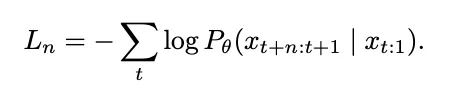
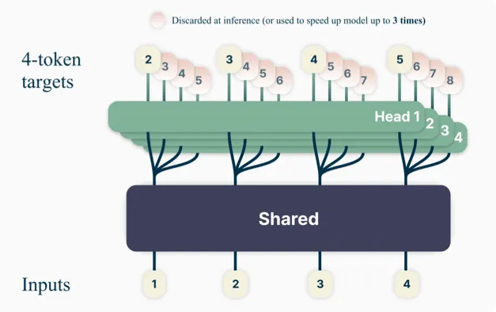
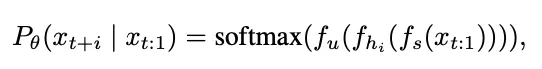
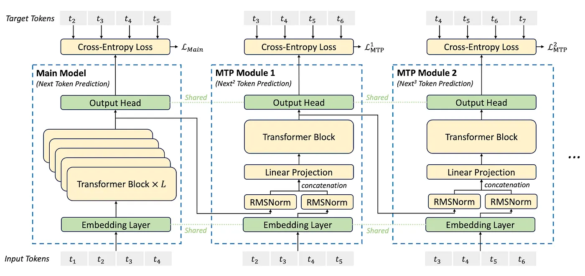

# Multi-token prediction and speculative decoding

Ordinary language-model training predicts the next token at each position. Multi-token prediction adds supervision for several future positions. It can improve learned representations and can supply draft tokens for faster inference, but these are two distinct uses.

## Independent prediction heads

One design shares a backbone and uses several heads to predict $x_{t+1},x_{t+2},\ldots$. A simplified loss is

$$
L=\sum_{k=1}^{K}\lambda_k\,[-\log p_k(x_{t+k}\mid x_{\leq t})].
$$

The heads provide auxiliary learning signals at different horizons. Predictions from a shared prefix are not automatically a coherent autoregressive joint distribution: the second head has not necessarily conditioned on the first head's sampled token.

*The original notes contrast a shared trunk with multiple future-token heads and shared output projection. Track the prediction offset attached to each head.*

## DeepSeek-V3's sequential modules

DeepSeek-V3 uses sequential MTP modules. Each depth combines the previous-depth representation with the embedding of a shifted token, normalizes both, projects their concatenation, and applies a Transformer block. Embedding and output-head parameters are shared with the main model. The shifted input is part of teacher-forced training; it must not be mistaken for access to an unknown future token during ordinary generation.

*The sequential design conditions deeper predictions through intermediate representations and shifted token embeddings, rather than treating all horizons as independent heads.*

MTP modules may be discarded for ordinary next-token inference or used to propose speculative tokens with a compatible verification algorithm.

## Verification is the critical step

Speculative decoding uses a cheap draft mechanism and a target model to verify several proposed tokens in parallel. Exact sampling algorithms include acceptance and correction steps that preserve the target distribution under their assumptions. Simply accepting all draft tokens changes the model's output distribution.

Speed depends on draft cost, acceptance rate, verification efficiency, batch size, and memory pressure. Predicting four tokens does not guarantee a fourfold speedup.

**Exercise.** A draft proposes five tokens but the target rejects the first. Was five-token progress achieved? No. The verification/correction policy determines how many tokens are actually committed.

References: [Multi-token prediction](https://arxiv.org/abs/2404.19737), [speculative decoding](https://arxiv.org/abs/2211.17192), [DeepSeek-V3](https://arxiv.org/abs/2412.19437).
