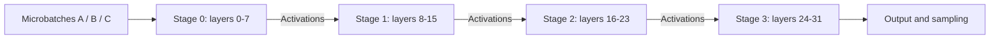

# 🧭 Inference parallelism: TP, PP, DP, EP, and CP

A model that does not fit, a slow individual request, insufficient concurrency, and an oversized long-context KV cache are different problems. Parallelism assigns **weights, tokens, layers, and caches to ranks and determines which intermediate results must move**. This chapter concerns inference: gradient reductions, backward pipelines, and optimizer state belong to a different cost model.

## 🗺️ Start with the partitioned object

| Strategy | Partition | Main state per rank | Typical communication / cost |
| --- | --- | --- | --- |
| TP, Tensor Parallelism | Matrices, heads, or features inside a layer | Per-layer weight shards and corresponding KV | Frequent AllReduce, AllGather, or ReduceScatter |
| PP, Pipeline Parallelism | Model depth, grouped into stages | Assigned layers and their KV | Stage-boundary activations, bubbles, and imbalance |
| DP, Data Parallelism | Requests/batches | A logical model replica, potentially using TP/PP internally | Dense replicas usually avoid per-layer activation exchange; routing and balancing remain |
| EP, Expert Parallelism | MoE expert set | Local experts; attention can use another partition | Token dispatch/combine, often all-to-all, and routing skew |
| CP, Context Parallelism | A request's context/sequence dimension | Context activations or KV shards, implementation-dependent | Attention must combine information across shards |

See [vLLM parallel deployment](https://docs.vllm.ai/en/stable/serving/parallelism_scaling/) and [DP deployment](https://docs.vllm.ai/en/stable/serving/data_parallel_deployment/). This is a responsibility map, not a universal backend algorithm.

## 🧮 TP: several ranks compute one layer

Consider a simplified FFN:

$$Y=\phi(XW_1)W_2$$

| Tensor | Shape |
| --- | --- |
| Input $X$ | $N\times H$ |
| Expansion weight $W_1$ | $H\times F$ |
| Projection weight $W_2$ | $F\times H$ |

Split $W_1$ by output columns and $W_2$ by matching input rows across $p$ ranks:

$$Z_i=\phi(XW_{1,i}),\qquad Y=\sum_{i=0}^{p-1}Z_iW_{2,i}.$$

Each rank computes local expanded features and an output contribution. An AllReduce can form replicated $Y$; a sharded successor may instead use ReduceScatter and related operations. SwiGLU requires consistent gate/up partitions. Attention, embeddings, and output heads have their own layouts. [Megatron-LM](https://arxiv.org/abs/1909.08053) introduces the underlying intra-layer matrix partitioning.

TP reduces per-rank weights and arithmetic, but per-layer communication startup enters the token's critical path. Evaluate TP inside a fast interconnect domain first; cross-node TP is possible but needs measured small-message latency and bandwidth. Tiny matrix shards, reductions, and synchronization can erase additional compute savings.

**KV does not always divide by TP.** Compatible MHA/GQA implementations can partition KV heads, but small KV-head counts or large TP may require replication. MQA, MLA, quantization, and specialized layouts require separate accounting. Inspect actual local KV shapes rather than dividing total bytes by device count.

## 🏗️ PP: partition layers and fill stages with independent work

A 32-layer PP=4 example assigns layers 0–7 to stage 0, 8–15 to stage 1, and so on. A token's activation traverses every stage. Historical KV normally stays with the stage holding its layers; stage boundaries carry intermediate activations rather than the entire cache every step.

An autoregressive request's next token normally depends on the current token reaching the last stage and being sampled, followed by feedback to the first stage. PP=4 therefore does not divide single-request latency by four.

Different requests/microbatches can occupy different stages to increase throughput. [GPipe](https://arxiv.org/abs/1811.06965) supplies the training background for layer/microbatch pipelining; inference adds autoregressive feedback and online scheduling.

In an ideal **single forward sweep** with equal stage time, no communication or feedback overhead, and $m$ independent microbatches across $p$ stages, execution takes $m+p-1$ slots. Average utilization is:

$$U=\frac{m}{m+p-1}.$$

For $p=4,m=8$, this is about 72.7%, not a general online-decode utilization formula. Balance runtime and peak memory rather than layer counts alone: embeddings, MoE, and the output head can skew stages.

## 📦 DP: increase request throughput and serving capacity

Dense DP=2 provides two logical replicas handling different requests. Each replica can use TP/PP, so a DP rank does not necessarily mean a whole model on one device. Ordinary replicas have no training-style gradient synchronization and allocate KV for their own active requests.

DP helps scale throughput after one replica meets capacity and latency requirements. Routing skew, dispersed prefix reuse, request-length variation, and exhausted KV pools prevent guaranteed linear scaling. Migrating an active request can require KV transfer or recomputation rather than just a new route.

In MoE, attention DP can couple to an expert group spanning replicas, so these DP participants are not necessarily independent executors. [vLLM DP documentation](https://docs.vllm.ai/en/stable/serving/data_parallel_deployment/) distinguishes dense and MoE behavior.

## 🧩 EP: tokens visit experts and return

A typical MoE layer performs `router → pack by destination expert → dispatch → expert FFN → combine → weighted merge`. EP partitions expert sets; TP partitions matrices. An expert may itself use TP inside a subgroup. Analyze shared experts, attention, and routers separately. Start with [MoE fundamentals](../components/moe.md).

For 64 experts over EP=8, each rank holds 8 experts. A batch of 128 tokens with top-2 routing creates 256 assignments, averaging 4 per expert, potentially with severe skew. With hidden width 4096 and BF16, assuming every assignment is remote and no deduplication, dispatch plus combine hidden-vector payload is approximately:

$$V\approx 2\times k\times N\times H\times b=4\ \text{MiB}.$$

The factor of two counts outbound and return payload, excluding metadata, padding, and protocol overhead. Local experts, same-destination merging, and backend algorithms change actual network volume. Larger top-k, uneven loads, and small batches can hurt tail latency. Expert capacity does not mean every token evaluates every expert. See [vLLM EP deployment](https://docs.vllm.ai/en/stable/serving/expert_parallel_deployment/).

## 🔢 Hybrid parallelism: draw groups before counting devices

For independent dense DP/PP/TP dimensions, $W=DP\times PP\times TP$. DP=2, PP=2, TP=4 gives 16 ranks. An illustrative numbering is $r=((d\times2)+p)\times4+t$:

| Logical replica | Stage 0 TP group | Stage 1 TP group |
| --- | --- | --- |
| DP 0 | Ranks 0–3, layers 0–15 | Ranks 4–7, layers 16–31 |
| DP 1 | Ranks 8–11, layers 0–15 | Ranks 12–15, layers 16–31 |

A request on DP 0 first uses ranks 0–3, then 4–7. Which ranks send across the stage boundary depends on activation layout and backend. Global numbers alone do not establish physical network routes; this numbering is a teaching convention.

**Do not automatically multiply EP again.** In the cited vLLM EP setup, expert-group size is `TP × DP`. TP=2, DP=4, PP=1 uses 8 devices and EP=8, not 64 devices. Other frameworks can define groups differently. Check [group semantics](https://docs.vllm.ai/en/stable/serving/expert_parallel_deployment/) before counting hardware.

## 🧠 Account for weights, KV, and activations separately

For evenly partitioned dense weights, start with $M_W\approx P_{param}b_W/(TP\times PP)$ per device. DP replicates the logical model rather than further dividing each replica's per-device weights. Add quantization scales, replicated layers, workspaces, graph capture, and allocator reservations. Separate shared and expert weights for MoE.

Ordinary KV payload is $L\times2\times H_{KV}\times D_{head}\times T\times b_{KV}$. With 32 layers, 8 KV heads, head dimension 128, 2048 tokens, and BF16, a sequence uses 256 MiB across the full model. PP=2 and fully head-sharded TP=4 yield about 32 MiB per rank for that sequence.

DP=2 normally assigns the sequence to one replica, so do not divide again by two. See [KV size](kv-cache.md) and [physical layouts](layers-pages.md).

## 📏 CP, SP, and P/D disaggregation

### CP: partition one sequence

CP partitions one sequence's context across ranks while attention combines information across partitions. Prefill and decode can use different algorithms.

### SP: check the framework definition

SP is framework-specific: classic Megatron SP partitions sequence activations for selected operations, rather than providing full CP or a universal division of KV memory.

The [Megatron CP description](https://docs.nvidia.com/megatron-core/developer-guide/latest/user-guide/features/context_parallel.html) defines this in a training context; inference support must be checked separately.

### P/D: separate serving phases

P/D disaggregation separates serving phases, while PP separates model layers. Each P or D worker can independently use TP/PP/DP/EP. Different P/D partitions may require KV aggregation, resharding, or layout conversion, if supported by the connector. [Layerwise execution and transfer](layerwise-inference.md) define granularity rather than another necessarily independent device-count dimension.

## 📊 Choose and validate

Measure one replica's weight/KV/activation peaks, TTFT, and ITL. Then evaluate TP/PP for capacity, DP for throughput, EP for expert placement, or CP for long contexts. Time TP reductions, PP activations, EP dispatch/combine, and P/D KV migration separately, and inspect [interconnect contention](../../../infra/interconnects.md).

Record model, hardware, rank groups, request lengths, and concurrency: “16 devices” alone does not explain the result.
