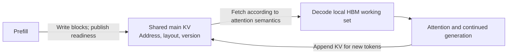

# 🗃️ Shared inference state: KV pools, tiers, and worker independence

[KV cache](kv-cache.md) explains the stored tensors; [serving frameworks](../../../infra/serving-frameworks.md)
follow P/D
handoff. This chapter asks whether a cache object can outlive one worker and how several workers share, fetch, and
reclaim it.
The shared-main-KV and agent flows below are application designs requiring framework, attention, and lifetime protocols.

## 🧩 Prefix reuse, KV handoff, and shared main KV

| Concept | Scope | Question |
| --- | --- | --- |
| Prefix cache | Common prefixes of compatible requests | Is prefill avoided, and where is the hit stored? |
| P/D handoff | One request moving from prefill to decode | Who allocates target blocks, completes, and releases? |
| Shared main KV | Authoritative history used throughout a request | Who owns it, how does decode fetch, who reclaims? |

Existing KV pools and connectors provide caching or transport foundations. A shared backend alone does not establish
that a full P/D copy has disappeared. Trace each allocation, its purpose, and its lifetime.
See [keys to copy addresses](../../../infra/kv-pool-call-chain.md).

## 🏗️ A shared-main-KV design



The last edge matters: decode continues producing KV after handoff. Define ownership, completion, and publication of new
blocks as well as the initial prefill data. An implementation may append locally and publish later rather than
synchronously
write back every token.

A handoff associates request identity, model/adapter version, tokens/positions, KV dtype, layout and sharding,
layer/block
ranges, readiness generations, and remaining readers. An address or handle alone cannot encode all of these semantics.

### Calculate the capacity change

In a teaching example, one history is 4 GiB. A design retaining full P and D histories simultaneously uses 8 GiB of
payload.
One authoritative 4 GiB history plus a 1 GiB local working set uses 5 GiB of payload.

```python
# runnable-example
main_kv_gib, local_cache_gib = 4, 1
two_full_copies_gib = 2 * main_kv_gib
shared_with_cache_gib = main_kv_gib + local_cache_gib
assert two_full_copies_gib == 8
assert shared_with_cache_gib == 5
```

This is not a universal P/D baseline: some implementations already release prefill blocks promptly.
Real memory also includes staging, block rounding, compute workspaces, and reliability replicas.
One authoritative object can have several physical copies; account for semantic ownership and physical capacity
separately.

## 🧠 Dense and sparse fetch costs

| Method | Required reads | Local strategy |
| --- | --- | --- |
| Dense full attention | Complete history within the attention range | Block streaming, double buffering, prefetch |
| Sparse attention | Positions or blocks selected by the algorithm | Indexer, hot cache, aggregated miss fetches |

Moving history into DRAM saves HBM residency but may require repeated fetches during decode.
If each step reads 4 GiB from the capacity tier at 40 tokens/s, payload alone requires 160 GiB/s per request.
This example ignores local hits, compression, protocols, and compute to expose the sustained-bandwidth requirement.

Sparse access can reduce the fetch range, but selection semantics belong to the model and algorithm; pooling alone
cannot
convert dense attention into sparse attention. [HiSparse][hisparse] is a hierarchical sparse-KV research reference;
its CUDA implementation and platform measurements do not establish an Ascend integration.
MLA, sliding windows, cross-layer sharing, and quantized layouts need their own
[layout/model accounting](../model-structures/index.md).

## 🚦 Production, visibility, and reclamation

1. Allocate the object or next block generation; record writer and layout.
2. Produce data; satisfy backend completion and visibility conditions.
3. Publish this generation's READY/version; readers acquire access before use.
4. Release references after consumption; handle in-flight accesses during cancellation or migration.
5. Reclaim or reuse only when protected readers and relevant in-flight work no longer remain.

This is a protocol sketch, not a fixed API sequence. Transfer completion, attention consumption, and request termination
protect different resources. Source-buffer release also depends on whether the consumer holds a shared reference or has
obtained its own copy.

## 🗂️ Other inference state

| Scenario | Objects to manage | Additional semantics |
| --- | --- | --- |
| Agent session | KV, task/tool state, results | Session versions, authorization, recovery, durability |
| Multimodal feature cache | Frame/patch/audio features | Encoder version, preprocessing, time range, compatibility |
| RAG / embedding | Vectors, document chunks, rerank features | Index version, filtering, retrieval algorithms |
| Model / LoRA cache | Weight shards and adapters | Model versions, load timing, local residency, references |
| Speculative KV tree | Shared prefix and branch deltas | Reference counts, copy-on-write, accepted paths, rollback |

These are directions built on memory access, not evidence of an existing universal object service.
For example, feature reuse needs compatible encoders and preprocessing. Saving an agent's memory state also does not
automatically provide transactional or replay guarantees for external tool effects.

### Two MoE data paths

An expert-weight pool manages where expert parameters live, when they enter local HBM, and how layouts migrate.
Token dispatch/combine manages token routing, communication, expert execution, and output combination each batch.
The first concerns weight capacity and scheduling; the second concerns communication kernels and synchronization.
They can compose but need separate measurement. See [MoE](../components/moe.md) and
[memory-fabric patterns](../../../infra/memory-fabric-patterns.md).

## 📊 Design a convincing comparison

Hold model, context length, request distribution, device count, and SLO fixed. Compare:

- Authoritative data and physical copies, peak HBM/DRAM, and staging buffers.
- Capacity-tier reads/writebacks per token or request, cache hits, and exposed waiting.
- TTFT, ITL/TPOT, P99, goodput meeting the SLO, and cancellation/recovery correctness.

TTFT is time to first token; ITL is the interval between output tokens; specify how TPOT is aggregated.
Lower memory usage with substantially greater waiting may fail to improve useful throughput under the SLO.

**Exercise.** A pool has sufficient capacity, but dense decode exceeds available link bandwidth. What can change?
Separate local caching, layout/compression, algorithm, and concurrency changes; their costs and semantics differ.

## 📚 References and next steps

- [Hugging Face: how KV caching works][cache].
- [vLLM prefix-caching design][prefix].
- [MemFabric and integration entry points][mf]. Check hardware, release, and backend requirements in each
implementation.
- [Layerwise inference](layerwise-inference.md), [cache layouts](layers-pages.md), and [LoRA](../adaptation/lora.md).

[cache]: https://huggingface.co/docs/transformers/main/cache_explanation
[prefix]: https://docs.vllm.ai/en/latest/design/prefix_caching/
[hisparse]: https://arxiv.org/abs/2608.07009
[mf]: https://gitcode.com/Ascend/memfabric_hybrid
