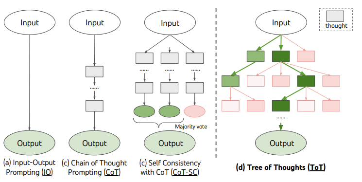

# 🌳 Tree of Thoughts: search over candidate solution steps

Tree of Thoughts organizes inference as search over intermediate states. Instead of committing to one continuation, a system proposes several meaningful next steps, evaluates them, and explores promising branches. It changes the inference procedure; it does not inherently update model weights.

## 🧭 Four design choices

1. **State/decomposition:** choose a unit that can be evaluated, such as a partial equation or puzzle assignment.
2. **Proposal:** sample or enumerate candidate next steps.
3. **Evaluation:** score feasibility or progress using a model, a verifier, or both.
4. **Search:** retain and expand branches using a budgeted strategy such as breadth-first or depth-first search.

**Figure guide.** The four panels progress from direct answer, through one reasoning chain, to several independent chains with a vote, then to a search tree that evaluates intermediate states and can backtrack. A branch is a reasoning state, not necessarily a single generated token.

*The tree makes alternatives and backtracking explicit. A node is a task state or meaningful step, not necessarily one token.*

## 🧩 A small puzzle example

To make 24 from four numbers, a state records remaining numbers and the expression history. One branch may multiply two numbers; another may subtract them. A deterministic arithmetic checker can reject invalid operations and verify the final expression. Model-generated confidence can help prioritize branches, but executable checks provide stronger evidence for this task.

Breadth-first search with pruning keeps several states at each depth. Depth-first search follows one branch and backtracks. Neither is universally best for “short” or “creative” problems; branching factor, evaluator quality, memory, and the distribution of solutions matter.

## ⚠️ Cost and failure modes

With branching factor b and depth d, an unpruned tree can grow exponentially. Limit proposals, retained states, total calls, and elapsed time. Deduplicate equivalent states when possible. A weak evaluator can confidently prune the correct branch, so more search can amplify its bias rather than improve answers.

Compare against simpler baselines such as multiple independent samples with a verifier. Report success at equal compute budgets, not only equal numbers of user prompts.

## 🎯 Relationship to training

RLHF, PPO, and GRPO optimize model behavior during training. Tree search chooses among possibilities during inference. They can be combined. Neither preference training nor search automatically guarantees coherent, safe, or correct reasoning, and neither has a universal diversity advantage.

**Exercise.** If the evaluator always favors fluent explanations over valid arithmetic, will doubling the search width reliably solve more puzzles? No. Improve the evaluation signal first.

Reference: [Tree of Thoughts](https://arxiv.org/abs/2305.10601). Compare [tree-based RNNs](../models/tree-rnn.md), which use trees inside a learned representation model.
