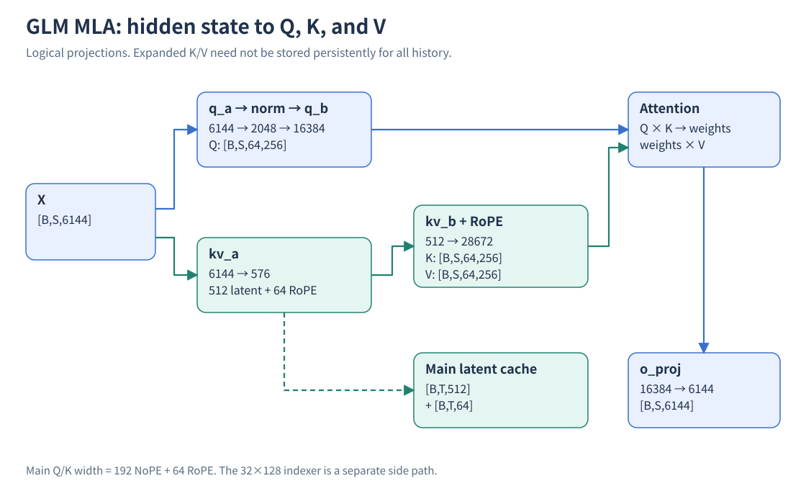
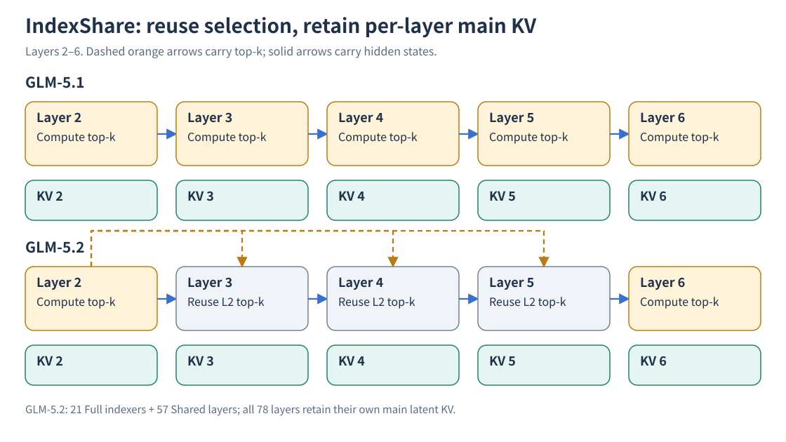

# 🧠 GLM-5.2: shared top-k selection with the same backbone widths

GLM-5.2 retains GLM-5.1’s backbone widths and introduces **IndexShare**: selected layers compute top-k and others reuse their selection. Compare the configs, then follow index and cache ownership.

??? note "Pinned configuration, implementation, and scope"

    This page pins the [official config](https://huggingface.co/zai-org/GLM-5.2/blob/cf457fa734ab149ffef225f80893eb38c6ff5cdc/config.json) at `zai-org/GLM-5.2@cf457fa734ab`. The important structural changes from GLM-5.1 are **IndexShare** and context settings, rather than new main-attention widths. Interpretation follows pinned [attention code](https://github.com/huggingface/transformers/blob/d8f10a82213a3a9db48385aba3a4b57ab535de50/src/transformers/models/glm_moe_dsa/modeling_glm_moe_dsa.py) and its [configuration class](https://github.com/huggingface/transformers/blob/d8f10a82213a3a9db48385aba3a4b57ab535de50/src/transformers/models/glm_moe_dsa/configuration_glm_moe_dsa.py).

## 🗺️ Comparison with GLM-5.1

| Setting | GLM-5.1 | GLM-5.2 |
| --- | --- | --- |
| Backbone layers / hidden width / vocabulary | 78 / 6144 / 154880 | Same |
| Dense / MoE layers | 0–2 / 3–77 | Same, explicitly listed in `mlp_layer_types` |
| Experts / top-k / shared experts / expert F | 256 / 8 / 1 / 2048 | Same |
| Q heads / main QK width / V width | 64 / 256 / 256 | Same |
| Q rank / KV latent / RoPE width | 2048 / 512 / 64 | Same |
| Index heads / width / top-k | 32 / 128 / 2048 | Same |
| Independent indexer layers in these configs | 78 | 21; 57 layers reuse selected positions |
| Maximum positions / RoPE theta | 202752 / 1000000 | 1048576 / 8000000 |
| MTP layers | 1 | 1; acceptance and unrolling are separate quantities |

The [official model card](https://huggingface.co/zai-org/GLM-5.2/blob/cf457fa734ab149ffef225f80893eb38c6ff5cdc/README.md) calls this IndexShare; see the [original paper](https://arxiv.org/abs/2603.12201). The layer map below records the config's 78 backbone layers and selection-reuse relationships.

## 📐 Main per-layer projections

<figure class="model-figure" markdown="1">

</figure>

| Module | Logical weight `[out,in]` | Output |
| --- | --- | --- |
| Embedding / untied LM head | Each `[154880,6144]` | Hidden `[B,S,6144]` / logits `[B,S,154880]` |
| `q_a` → Q norm | `[2048,6144]`, norm `[2048]` | `[B,S,2048]` |
| `q_b` | `[16384,2048]` | `[B,S,64,256]` |
| `kv_a` → KV norm | `[576,6144]`, norm `[512]` | Latent 512 + RoPE 64 |
| `kv_b` | `[28672,512]` | K-NoPE `[B,S,64,192]`, V `[B,S,64,256]` |
| `o_proj` | `[6144,16384]` | `[B,S,6144]` |
| Dense gate/up → down | Each `[12288,6144]` → `[6144,12288]` | 12288 → 6144 |
| Router / expert gate/up → down | `[256,6144]` / each `[2048,6144]` → `[6144,2048]` | Top-8 routing plus shared expert |

As in [GLM-5.1](glm-5-1.md), full K combines 192 NoPE and 64 RoPE dimensions. The JSON `head_dim=192` is not total main Q/K width; it must not turn `q_b` into a `64×192` output.

## 🔎 IndexShare reuses top-k positions, not main KV

<figure class="model-figure" markdown="1">

<figcaption markdown="span">Figure: dashed orange arrows carry selected positions only. Each green KV box remains owned by its layer.</figcaption>

</figure>

The explicit `indexer_types` lists layers 0, 1, 2 and `6,10,14,…,74` as `full`, with the rest `shared`:

| Layers | Selection behavior | Main MLA KV |
| --- | --- | --- |
| 2 | Compute and publish top-k | Its own latent KV |
| 3, 4, 5 | Reuse layer 2's selection | Separate latents in each layer |
| 6 | Recompute top-k | Its own latent KV |
| 7, 8, 9 | Reuse layer 6's selection | Separate latents in each layer |
| 74 → 75, 76, 77 | 74 computes, the next three reuse | Separate main KV |

- **`full`:** run an independent indexer and publish selected positions; this does not mean dense full attention.

- **`shared`:** reuse the preceding Full layer's top-k, without reusing its complete attention output or hidden state.

The implementation instantiates indexers only where required and carries `prev_topk_indices`. Independent indexer projections are:

| Projection | Weight shape |
| --- | --- |
| `wq_b` | `[4096,2048]` |
| `wk` | `[128,6144]` |
| `weights_proj` | `[32,6144]` |

## 🧠 Cache implications of a longer context

Main MLA latent width remains 512+64 per layer. Having 21 indexers does not reduce 78 main-cache owners to 21. Indexer-key and selection storage follow the sharing strategy and backend implementation. A larger configured maximum does not mean every deployment has already allocated a full 1M-token cache.

Under the same BF16 main-cache-only assumptions, B=1 and T=4096 still cost 351 MiB. Growing T increases the capacity requirement. Actual supported lengths depend on memory, sparse kernels, and configuration. See [shape conventions](shape-conventions.md) and [KV budgets](../../../infra/serving-frameworks.md).

## 🪜 Complete backbone map

<!-- BEGIN GENERATED LAYERS glm-5-2 -->
??? info "GLM-5.2 · 78 backbone layers"

    | Layer | Hidden in/out | FFN | Indexer / selection source | Main KV (owned per layer) |
    | --- | --- | --- | --- | --- |
    | 0 | `[B,S,6144]` | Dense F=12288 | full; L0 | own L0: `[B,T,512]` + `[B,T,64]` |
    | 1 | `[B,S,6144]` | Dense F=12288 | full; L1 | own L1: `[B,T,512]` + `[B,T,64]` |
    | 2 | `[B,S,6144]` | Dense F=12288 | full; L2 | own L2: `[B,T,512]` + `[B,T,64]` |
    | 3 | `[B,S,6144]` | MoE E=256, k=8, F=2048 | shared; L2 | own L3: `[B,T,512]` + `[B,T,64]` |
    | 4 | `[B,S,6144]` | MoE E=256, k=8, F=2048 | shared; L2 | own L4: `[B,T,512]` + `[B,T,64]` |
    | 5 | `[B,S,6144]` | MoE E=256, k=8, F=2048 | shared; L2 | own L5: `[B,T,512]` + `[B,T,64]` |
    | 6 | `[B,S,6144]` | MoE E=256, k=8, F=2048 | full; L6 | own L6: `[B,T,512]` + `[B,T,64]` |
    | 7 | `[B,S,6144]` | MoE E=256, k=8, F=2048 | shared; L6 | own L7: `[B,T,512]` + `[B,T,64]` |
    | 8 | `[B,S,6144]` | MoE E=256, k=8, F=2048 | shared; L6 | own L8: `[B,T,512]` + `[B,T,64]` |
    | 9 | `[B,S,6144]` | MoE E=256, k=8, F=2048 | shared; L6 | own L9: `[B,T,512]` + `[B,T,64]` |
    | 10 | `[B,S,6144]` | MoE E=256, k=8, F=2048 | full; L10 | own L10: `[B,T,512]` + `[B,T,64]` |
    | 11 | `[B,S,6144]` | MoE E=256, k=8, F=2048 | shared; L10 | own L11: `[B,T,512]` + `[B,T,64]` |
    | 12 | `[B,S,6144]` | MoE E=256, k=8, F=2048 | shared; L10 | own L12: `[B,T,512]` + `[B,T,64]` |
    | 13 | `[B,S,6144]` | MoE E=256, k=8, F=2048 | shared; L10 | own L13: `[B,T,512]` + `[B,T,64]` |
    | 14 | `[B,S,6144]` | MoE E=256, k=8, F=2048 | full; L14 | own L14: `[B,T,512]` + `[B,T,64]` |
    | 15 | `[B,S,6144]` | MoE E=256, k=8, F=2048 | shared; L14 | own L15: `[B,T,512]` + `[B,T,64]` |
    | 16 | `[B,S,6144]` | MoE E=256, k=8, F=2048 | shared; L14 | own L16: `[B,T,512]` + `[B,T,64]` |
    | 17 | `[B,S,6144]` | MoE E=256, k=8, F=2048 | shared; L14 | own L17: `[B,T,512]` + `[B,T,64]` |
    | 18 | `[B,S,6144]` | MoE E=256, k=8, F=2048 | full; L18 | own L18: `[B,T,512]` + `[B,T,64]` |
    | 19 | `[B,S,6144]` | MoE E=256, k=8, F=2048 | shared; L18 | own L19: `[B,T,512]` + `[B,T,64]` |
    | 20 | `[B,S,6144]` | MoE E=256, k=8, F=2048 | shared; L18 | own L20: `[B,T,512]` + `[B,T,64]` |
    | 21 | `[B,S,6144]` | MoE E=256, k=8, F=2048 | shared; L18 | own L21: `[B,T,512]` + `[B,T,64]` |
    | 22 | `[B,S,6144]` | MoE E=256, k=8, F=2048 | full; L22 | own L22: `[B,T,512]` + `[B,T,64]` |
    | 23 | `[B,S,6144]` | MoE E=256, k=8, F=2048 | shared; L22 | own L23: `[B,T,512]` + `[B,T,64]` |
    | 24 | `[B,S,6144]` | MoE E=256, k=8, F=2048 | shared; L22 | own L24: `[B,T,512]` + `[B,T,64]` |
    | 25 | `[B,S,6144]` | MoE E=256, k=8, F=2048 | shared; L22 | own L25: `[B,T,512]` + `[B,T,64]` |
    | 26 | `[B,S,6144]` | MoE E=256, k=8, F=2048 | full; L26 | own L26: `[B,T,512]` + `[B,T,64]` |
    | 27 | `[B,S,6144]` | MoE E=256, k=8, F=2048 | shared; L26 | own L27: `[B,T,512]` + `[B,T,64]` |
    | 28 | `[B,S,6144]` | MoE E=256, k=8, F=2048 | shared; L26 | own L28: `[B,T,512]` + `[B,T,64]` |
    | 29 | `[B,S,6144]` | MoE E=256, k=8, F=2048 | shared; L26 | own L29: `[B,T,512]` + `[B,T,64]` |
    | 30 | `[B,S,6144]` | MoE E=256, k=8, F=2048 | full; L30 | own L30: `[B,T,512]` + `[B,T,64]` |
    | 31 | `[B,S,6144]` | MoE E=256, k=8, F=2048 | shared; L30 | own L31: `[B,T,512]` + `[B,T,64]` |
    | 32 | `[B,S,6144]` | MoE E=256, k=8, F=2048 | shared; L30 | own L32: `[B,T,512]` + `[B,T,64]` |
    | 33 | `[B,S,6144]` | MoE E=256, k=8, F=2048 | shared; L30 | own L33: `[B,T,512]` + `[B,T,64]` |
    | 34 | `[B,S,6144]` | MoE E=256, k=8, F=2048 | full; L34 | own L34: `[B,T,512]` + `[B,T,64]` |
    | 35 | `[B,S,6144]` | MoE E=256, k=8, F=2048 | shared; L34 | own L35: `[B,T,512]` + `[B,T,64]` |
    | 36 | `[B,S,6144]` | MoE E=256, k=8, F=2048 | shared; L34 | own L36: `[B,T,512]` + `[B,T,64]` |
    | 37 | `[B,S,6144]` | MoE E=256, k=8, F=2048 | shared; L34 | own L37: `[B,T,512]` + `[B,T,64]` |
    | 38 | `[B,S,6144]` | MoE E=256, k=8, F=2048 | full; L38 | own L38: `[B,T,512]` + `[B,T,64]` |
    | 39 | `[B,S,6144]` | MoE E=256, k=8, F=2048 | shared; L38 | own L39: `[B,T,512]` + `[B,T,64]` |
    | 40 | `[B,S,6144]` | MoE E=256, k=8, F=2048 | shared; L38 | own L40: `[B,T,512]` + `[B,T,64]` |
    | 41 | `[B,S,6144]` | MoE E=256, k=8, F=2048 | shared; L38 | own L41: `[B,T,512]` + `[B,T,64]` |
    | 42 | `[B,S,6144]` | MoE E=256, k=8, F=2048 | full; L42 | own L42: `[B,T,512]` + `[B,T,64]` |
    | 43 | `[B,S,6144]` | MoE E=256, k=8, F=2048 | shared; L42 | own L43: `[B,T,512]` + `[B,T,64]` |
    | 44 | `[B,S,6144]` | MoE E=256, k=8, F=2048 | shared; L42 | own L44: `[B,T,512]` + `[B,T,64]` |
    | 45 | `[B,S,6144]` | MoE E=256, k=8, F=2048 | shared; L42 | own L45: `[B,T,512]` + `[B,T,64]` |
    | 46 | `[B,S,6144]` | MoE E=256, k=8, F=2048 | full; L46 | own L46: `[B,T,512]` + `[B,T,64]` |
    | 47 | `[B,S,6144]` | MoE E=256, k=8, F=2048 | shared; L46 | own L47: `[B,T,512]` + `[B,T,64]` |
    | 48 | `[B,S,6144]` | MoE E=256, k=8, F=2048 | shared; L46 | own L48: `[B,T,512]` + `[B,T,64]` |
    | 49 | `[B,S,6144]` | MoE E=256, k=8, F=2048 | shared; L46 | own L49: `[B,T,512]` + `[B,T,64]` |
    | 50 | `[B,S,6144]` | MoE E=256, k=8, F=2048 | full; L50 | own L50: `[B,T,512]` + `[B,T,64]` |
    | 51 | `[B,S,6144]` | MoE E=256, k=8, F=2048 | shared; L50 | own L51: `[B,T,512]` + `[B,T,64]` |
    | 52 | `[B,S,6144]` | MoE E=256, k=8, F=2048 | shared; L50 | own L52: `[B,T,512]` + `[B,T,64]` |
    | 53 | `[B,S,6144]` | MoE E=256, k=8, F=2048 | shared; L50 | own L53: `[B,T,512]` + `[B,T,64]` |
    | 54 | `[B,S,6144]` | MoE E=256, k=8, F=2048 | full; L54 | own L54: `[B,T,512]` + `[B,T,64]` |
    | 55 | `[B,S,6144]` | MoE E=256, k=8, F=2048 | shared; L54 | own L55: `[B,T,512]` + `[B,T,64]` |
    | 56 | `[B,S,6144]` | MoE E=256, k=8, F=2048 | shared; L54 | own L56: `[B,T,512]` + `[B,T,64]` |
    | 57 | `[B,S,6144]` | MoE E=256, k=8, F=2048 | shared; L54 | own L57: `[B,T,512]` + `[B,T,64]` |
    | 58 | `[B,S,6144]` | MoE E=256, k=8, F=2048 | full; L58 | own L58: `[B,T,512]` + `[B,T,64]` |
    | 59 | `[B,S,6144]` | MoE E=256, k=8, F=2048 | shared; L58 | own L59: `[B,T,512]` + `[B,T,64]` |
    | 60 | `[B,S,6144]` | MoE E=256, k=8, F=2048 | shared; L58 | own L60: `[B,T,512]` + `[B,T,64]` |
    | 61 | `[B,S,6144]` | MoE E=256, k=8, F=2048 | shared; L58 | own L61: `[B,T,512]` + `[B,T,64]` |
    | 62 | `[B,S,6144]` | MoE E=256, k=8, F=2048 | full; L62 | own L62: `[B,T,512]` + `[B,T,64]` |
    | 63 | `[B,S,6144]` | MoE E=256, k=8, F=2048 | shared; L62 | own L63: `[B,T,512]` + `[B,T,64]` |
    | 64 | `[B,S,6144]` | MoE E=256, k=8, F=2048 | shared; L62 | own L64: `[B,T,512]` + `[B,T,64]` |
    | 65 | `[B,S,6144]` | MoE E=256, k=8, F=2048 | shared; L62 | own L65: `[B,T,512]` + `[B,T,64]` |
    | 66 | `[B,S,6144]` | MoE E=256, k=8, F=2048 | full; L66 | own L66: `[B,T,512]` + `[B,T,64]` |
    | 67 | `[B,S,6144]` | MoE E=256, k=8, F=2048 | shared; L66 | own L67: `[B,T,512]` + `[B,T,64]` |
    | 68 | `[B,S,6144]` | MoE E=256, k=8, F=2048 | shared; L66 | own L68: `[B,T,512]` + `[B,T,64]` |
    | 69 | `[B,S,6144]` | MoE E=256, k=8, F=2048 | shared; L66 | own L69: `[B,T,512]` + `[B,T,64]` |
    | 70 | `[B,S,6144]` | MoE E=256, k=8, F=2048 | full; L70 | own L70: `[B,T,512]` + `[B,T,64]` |
    | 71 | `[B,S,6144]` | MoE E=256, k=8, F=2048 | shared; L70 | own L71: `[B,T,512]` + `[B,T,64]` |
    | 72 | `[B,S,6144]` | MoE E=256, k=8, F=2048 | shared; L70 | own L72: `[B,T,512]` + `[B,T,64]` |
    | 73 | `[B,S,6144]` | MoE E=256, k=8, F=2048 | shared; L70 | own L73: `[B,T,512]` + `[B,T,64]` |
    | 74 | `[B,S,6144]` | MoE E=256, k=8, F=2048 | full; L74 | own L74: `[B,T,512]` + `[B,T,64]` |
    | 75 | `[B,S,6144]` | MoE E=256, k=8, F=2048 | shared; L74 | own L75: `[B,T,512]` + `[B,T,64]` |
    | 76 | `[B,S,6144]` | MoE E=256, k=8, F=2048 | shared; L74 | own L76: `[B,T,512]` + `[B,T,64]` |
    | 77 | `[B,S,6144]` | MoE E=256, k=8, F=2048 | shared; L74 | own L77: `[B,T,512]` + `[B,T,64]` |
<!-- END GENERATED LAYERS glm-5-2 -->
