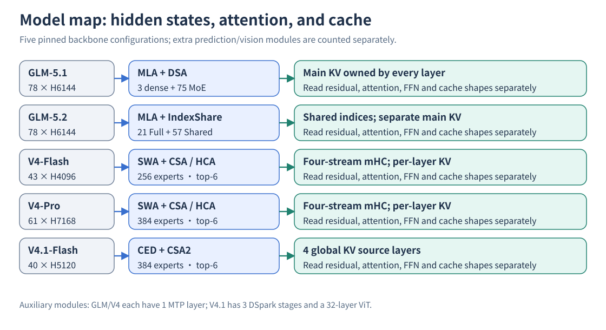
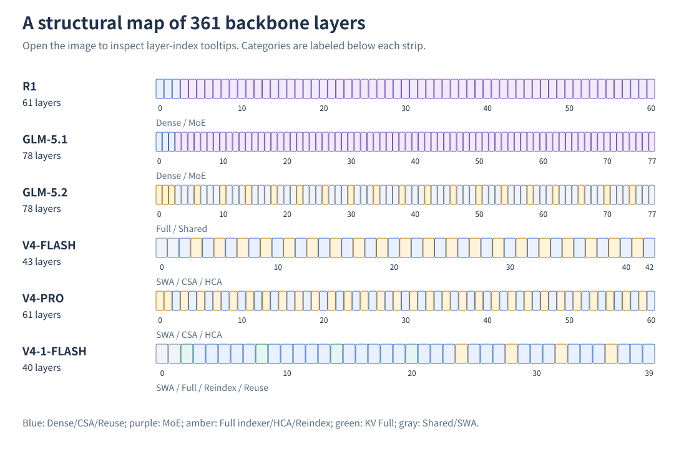

# 🧬 Model structures: from official configs to every layer's shape

This reference complements the [LLM learning map](../index.md). Each entry follows **checkpoint → global dimensions → layer responsibilities → weights and activations → KV cache → deployment boundaries**. Numbers come from official configs and reference implementations; calculated shapes are deductions, not device measurements.

<figure class="model-figure" markdown="1">

<figcaption markdown="span">Figure: distinguish depth, compute width, and cache ownership. Click a figure to open its original vector image.</figcaption>

</figure>

## 🗺️ Models and reading paths

Start with [compressed attention and indexers](../components/compressed-attention.md) for SWA/CSA/HCA responsibilities, then compare the model configurations below.

| Model | Backbone layers | Hidden width H | Main query heads × head width | Routed experts / selected per token | Structure |
| --- | ---: | ---: | --- | --- | --- |
| DeepSeek-R1 | 61 | 7168 | 128 × 192 | 256 / 8 | [MLA, equal per-layer caches, and dense → MoE](deepseek-r1.md) |
| GLM-5.1 | 78 | 6144 | 64 × 256 | 256 / 8 | [MLA, DSA, dense → MoE](glm-5-1.md) |
| GLM-5.2 | 78 | 6144 | 64 × 256 | 256 / 8 | [IndexShare and cross-layer top-k reuse](glm-5-2.md) |
| DeepSeek-V4-Flash | 43 | 4096 | 64 × 512 | 256 / 6 | [Flash / Pro comparison](deepseek-v4.md) |
| DeepSeek-V4-Pro | 61 | 7168 | 128 × 512 | 384 / 6 | [Flash / Pro comparison](deepseek-v4.md) |
| DeepSeek-V4.1-Flash | 40, plus a 32-layer ViT | 5120 | 64 × 512 | 384 / 6 | [CED, CSA2, Engram, vision, and DSpark](deepseek-v4-1.md) |

For GLM, main Q/K width is `qk_nope_head_dim + qk_rope_head_dim = 192 + 64`, rather than the JSON `head_dim` alone. Tables first describe the unpartitioned logical model. Quantized storage, TP/EP, and fused runtime layouts are separate. Start with [shape conventions](shape-conventions.md).

## 📦 128-token cache blocks as size formulas

These formulas follow the [pinned MMC benchmark profiles](https://github.com/nbbb24/self_test/blob/2a7ca1333ac3ce5710764ba84d75850b1586b520/mmc_benchmark/model_profiles.py): **one key represents 128 original tokens, each cache element occupies two BF16 bytes, and `k` means KiB (1024 bytes)**. Each summand is a separate buffer segment; multipliers count actual cache owners.

| Model | Cache model per key | Buffer segments | Payload |
| --- | --- | ---: | ---: |
| DeepSeek-R1 | `61 × (128k + 16k)` | 122 | 8.578125 MiB |
| GLM-5.1 | `78 × (128k + 16k + 32k)` | 234 | 13.40625 MiB |
| GLM-5.2 | `78 × (128k + 16k) + 21 × 32k` | 177 | 11.625 MiB |
| DeepSeek-V4-Flash | `21 × (32k + 8k) + 20 × 1k` | 62 | 860 KiB |
| DeepSeek-V4-Pro | `30 × (32k + 8k) + 31 × 1k` | 91 | 1231 KiB |
| DeepSeek-V4.1-Flash | `3 × (64k + 16k) + (128k + 32k)` | 8 | 400 KiB |

- **R1 / GLM:** `128k` is the 512-dimensional main latent KV; `16k` is the 64-dimensional RoPE key. GLM adds a 128-dimensional indexer key occupying `32k`. Every R1 layer has the same `128k + 16k`, split into two segments. GLM-5.2 counts only 21 full indexer keys, without duplicating them for sharing layers.
- **V4:** CSA compresses four original tokens into one entry: `32 × 512 × 2 = 32k` for KV and `32 × 128 × 2 = 8k` for indexer K. HCA uses 128-fold compression and contributes only `1 × 512 × 2 = 1k` of KV. The 512-dimensional KV already includes its RoPE part. Each CSA layer supplies two segments; each HCA layer supplies one.
- **V4.1:** count only the four global KV/indexer-key owners at layers 2, 8, 14, and 20. The first three use twofold compression, each contributing `64k + 16k`. The last is uncompressed and contributes `128k + 32k`. Reuse layers do not allocate another copy.

These are BF16-equivalent storage/transfer workloads. They load no weights and execute neither inference nor compression operators. V4/V4.1 formulas cover global prefix KV and indexer K, **excluding SWA, compressor state, and MTP**. Native quantized packing, scales, padding, TP/PP partitioning, and replication require separate accounting. Consult each model's cache section for implementation layouts.

## 📌 Versions and evidence

Existing models were checked on **2026-11-24**; DeepSeek-R1 was added and checked on **2026-11-26**. These official repository snapshots define the reference; moving `main` branches are not immutable specifications:

| Official repository | Pinned revision | Config snapshot |
| --- | --- | --- |
| `deepseek-ai/DeepSeek-R1` | `56d4cbbb4d29` | [JSON](../../../../assets/model-specs/deepseek-r1.config.json) |
| `zai-org/GLM-5.1` | `26e1bd6e011f` | [JSON](../../../../assets/model-specs/glm-5-1.config.json) |
| `zai-org/GLM-5.2` | `cf457fa734ab` | [JSON](../../../../assets/model-specs/glm-5-2.config.json) |
| `deepseek-ai/DeepSeek-V4-Flash` | `60d8d70770c6` | [JSON](../../../../assets/model-specs/deepseek-v4-flash.config.json) |
| `deepseek-ai/DeepSeek-V4-Pro` | `b5968e9190ef` | [JSON](../../../../assets/model-specs/deepseek-v4-pro.config.json) |
| `deepseek-ai/DeepSeek-V4.1-Flash` | `314113f8a7da` | [JSON](../../../../assets/model-specs/deepseek-v4-1-flash.config.json) |
| `deepseek-ai/DeepSeek-V4.1-Flash-1017` | `08c8657f0229` | [JSON](../../../../assets/model-specs/deepseek-v4-1-flash-1017.config.json) |

The [source manifest](../../../../assets/model-specs/sources.json) records full revisions, config SHA-256 hashes, and implementation links. Snapshots retain the upstream [GLM MIT license](../../../../assets/model-specs/glm.LICENSE.txt), [DeepSeek-R1 MIT license](../../../../assets/model-specs/deepseek-r1.LICENSE.txt), and [DeepSeek V4/V4.1 MIT license](../../../../assets/model-specs/deepseek.LICENSE.txt). The V4.1 Flash and 1017 configs are equal in these snapshots; this does not establish equal weights, post-training, or behavior.

Here, “DSV4.1” means the verified **V4.1-Flash / Flash-1017** checkpoints. No official V4.1-Pro structure config was obtained for this reference, so it has no guessed layer counts. An API name such as `deepseek-v4-pro` is also distinct from a particular downloadable checkpoint.

Bind structural analysis to a repository and revision. Consult the [official DeepSeek model directory](https://huggingface.co/deepseek-ai/models) for names.

## 🔎 Inspect a particular layer

<figure class="model-figure" markdown="1">

<figcaption markdown="span">Figure: one tile per layer. Categories differ between rows; read each row label with the legend.</figcaption>

</figure>

Each model page has expandable, complete backbone maps with **zero-based layer indices**. They enumerate R1 dense/MoE placement and equal per-layer main caches, GLM dense/MoE and IndexShare placement, V4 compression and hash routing, and V4.1 KV/index ownership. Repeated modules use the common shape tables in the chapter. MTP, vision, and Engram are documented separately so their counts are not silently added to backbone depth.

Run `python scripts/model_shapes.py --check` from the repository root to verify the generated maps against pinned configs. After updating snapshots, use `--write` and recheck implementation assumptions and prose. The script performs shape/layer-map calculations without downloading or loading model weights.

Continue into [TP / PP / DP / EP / CP](../inference/parallelism.md), [layerwise execution and transfers](../inference/layerwise-inference.md), and [device submission](../../../infra/device-initiated-transfer.md) when mapping structures onto devices.
