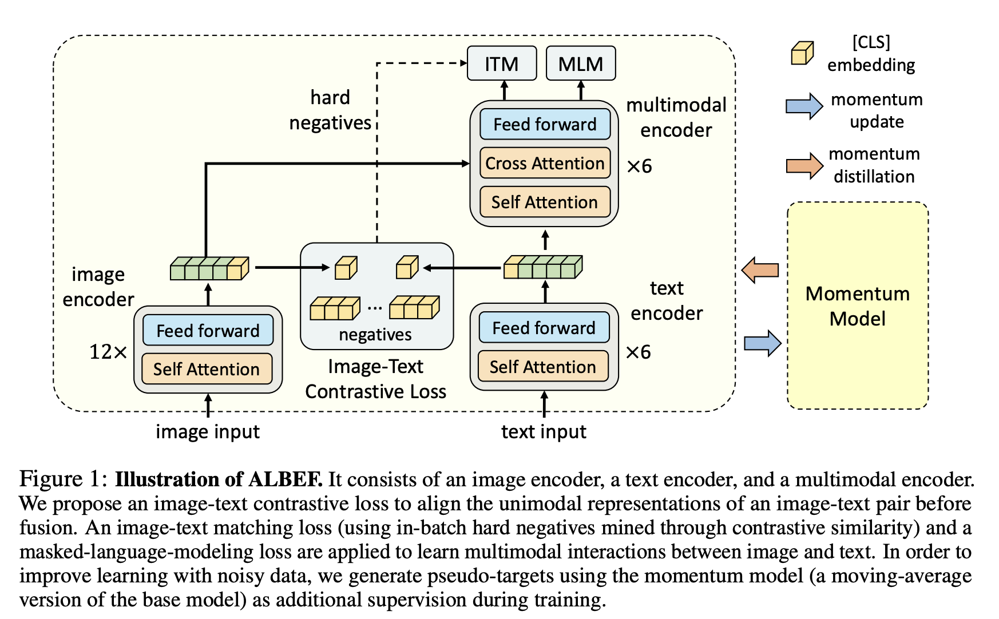

# 🖼️ ALBEF: align before fusing image and text

A dual encoder is efficient at global retrieval but may miss fine-grained interactions. A fusion encoder can compare words and image regions but is expensive to run for every candidate. ALBEF combines global alignment with cross-modal interaction, while using momentum-generated targets to learn from noisy image–text data.

## 🏗️ Read the architecture

The image and text encoders first produce unimodal features. The multimodal encoder adds cross-attention, letting text states read visual features. The momentum branch supplies slowly changing targets; dashed hard-negative paths connect similarity-based sampling to the matching objective.

## 🎯 Three complementary objectives

| Objective | What it compares or predicts | Why it helps |
| --- | --- | --- |
| ITC: image–text contrastive | Global image/text embeddings | Establish a useful shared retrieval space |
| ITM: image–text matching | A fused pair representation | Distinguish subtle matching errors |
| MLM: masked language modeling | Hidden words conditioned on text and image | Ground token prediction in visual evidence |

For an image of a red bicycle, “a blue bicycle” is a useful hard negative: it shares the object category but differs in an important attribute. Random unrelated negatives may be too easy to teach that distinction. Hard-negative selection must still account for noisy or incomplete captions.

## 📌 Momentum updates

Online parameters are optimized by gradients. A momentum copy is updated using

$$
\theta_m\leftarrow\alpha\theta_m+(1-\alpha)\theta.
$$

“No gradient update” does not mean “never changes.” The moving average smooths the teacher trajectory. Its soft pseudo-targets can represent plausible alternatives beyond a single noisy paired caption. The full objective combines contrastive, matching, and masked-token losses; their contributions should be evaluated rather than assumed redundant.

## 🔄 Training and retrieval workflow

Encode the pair, compute contrastive similarities and momentum targets, sample difficult mismatches, run multimodal interaction, calculate the losses, update online weights, then update momentum weights. “Align before fuse” describes architectural and objective structure; it need not mean training the whole system in two completely separate chronological stages.

At retrieval time, independent embeddings can shortlist candidates and the fusion model can rerank them. This separates broad search from costly fine-grained comparison.

**Exercise.** Why not run the multimodal encoder against every image in a million-image database? Query-dependent pair computation is costly. Precomputed global embeddings offer an efficient first stage.

Reference: [ALBEF](https://arxiv.org/abs/2107.07651). Continue with [BLIP and BLIP-2](blip.md).
