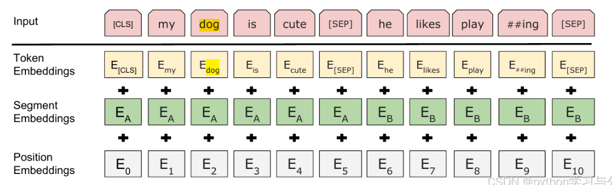
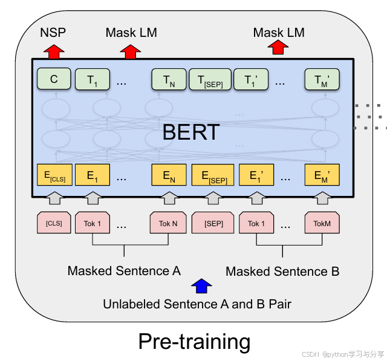

# BERT: learning from both sides of a token

BERT is an encoder model trained to build contextual representations using left and right context. It is useful for understanding tasks such as classification, entity recognition, and extractive question answering. The original 2018 recipe is described here; later BERT-family models change parts of it.

## Inputs and pretraining

Each input position combines token, position, and segment embeddings. `[CLS]` is a sequence-level token and `[SEP]` separates segments. A segment embedding distinguishes portions of a sentence pair; it is not a grammatical label.

Masked language modeling selects 15% of token positions. In the original recipe, 80% of selected positions become `[MASK]`, 10% become a random token, and 10% remain unchanged. The loss applies to selected positions. Seeing both sides is valid because the target token is hidden or otherwise included in this corruption task, rather than exposed as an ordinary causal next-token label.

Next-sentence prediction classifies whether two segments are consecutive or randomly paired, with equal proportions in the original construction. It is a pretraining choice, not an indispensable property of every bidirectional encoder.

## Adapting the representation

| Task | Readout | Example |
| --- | --- | --- |
| Classification | Classifier on `[CLS]` state | Positive/negative review |
| Named-entity recognition | Token-level classifier | Person and organization spans |
| Extractive QA | Start/end position scores | Locate the answer inside a passage |

For “The bank approved a loan” versus “They sat beside the bank,” the state for `bank` changes with context. A static Word2Vec lookup would start with the same vector in both sentences.

## Practical limits

Subword tokenization complicates word-level labels: decide whether to label the first subtoken, all subtokens, or aggregate them. Extractive QA cannot produce an answer absent from the supplied passage without an additional mechanism. Bidirectional attention also makes an ordinary BERT encoder unsuitable as a drop-in causal generator.

**Exercise.** Does `[CLS]` automatically produce a good semantic-similarity embedding? Not necessarily. Pooling and a suitable sentence-level training objective often matter.

Reference: [BERT paper](https://arxiv.org/abs/1810.04805). Compare [ELMo](elmo.md) and [GPT](gpt.md).
