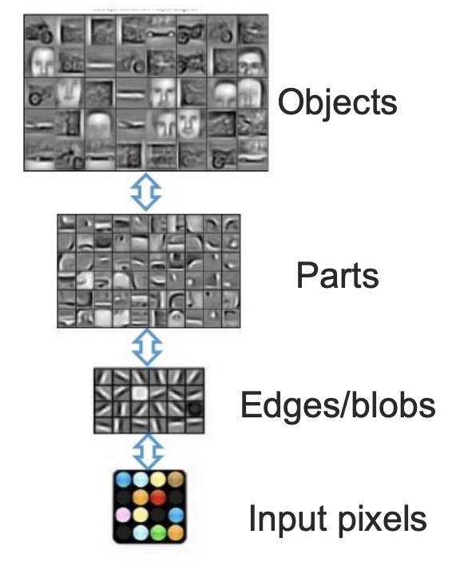
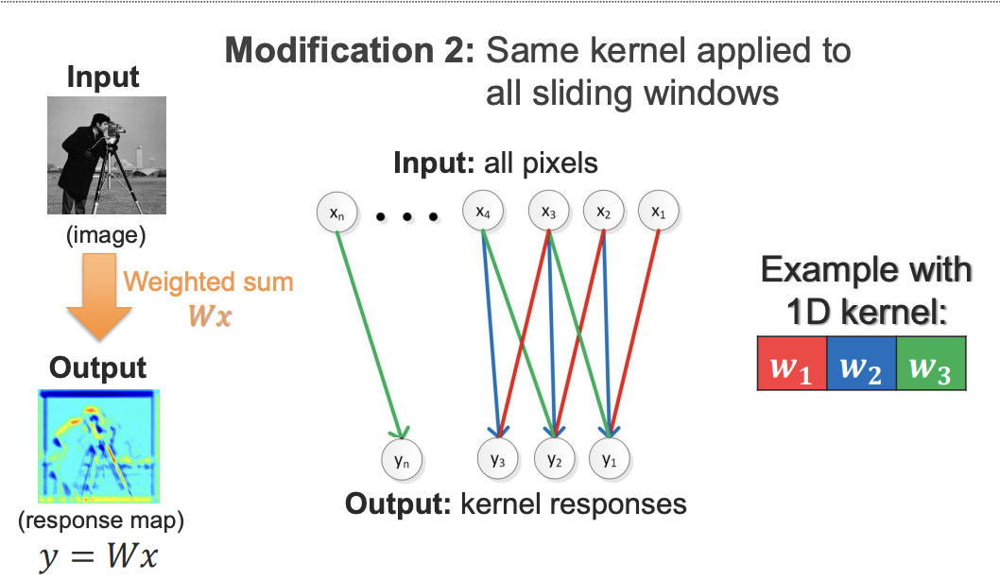
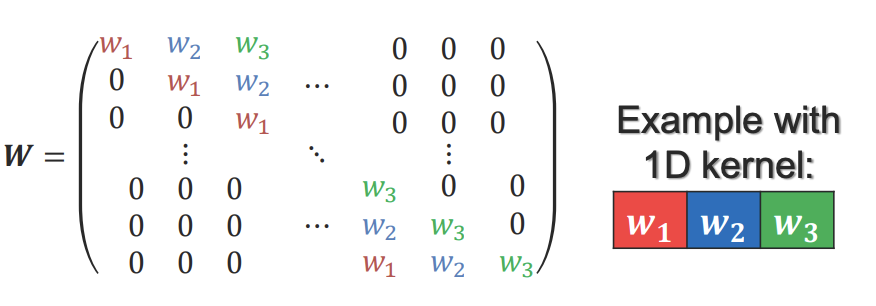
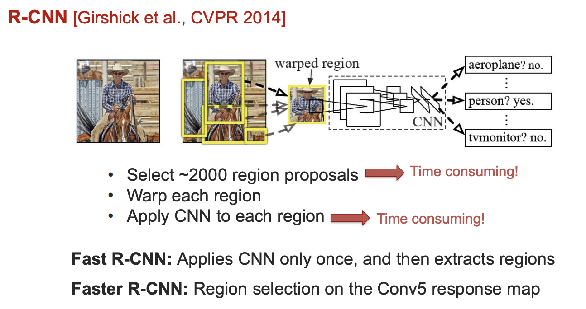
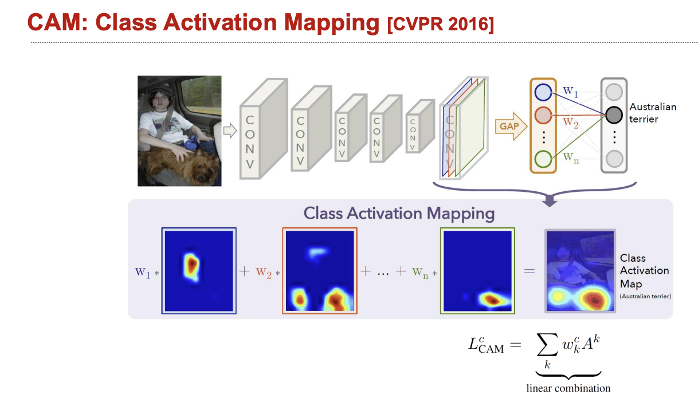

# CNNs: learning local patterns with shared filters

A convolutional neural network scans learned filters across an input. Reusing a filter at different positions reduces parameter count and expresses the assumption that a useful local pattern can occur anywhere. Early layers often detect edges or textures; deeper layers combine patterns over larger receptive fields. These interpretations are tendencies, not fixed labels for every channel.

## Shapes and a concrete calculation

For input width $W$, kernel size $K$, padding $P$, dilation $D$, and stride $S$, one spatial output dimension is

$$
W_{out}=\left\lfloor\frac{W+2P-D(K-1)-1}{S}+1\right\rfloor.
$$

A $3\times3$ filter with stride 1 and padding 1 preserves a $32\times32$ spatial size. Mapping three input channels to 16 output channels uses $3\cdot3\cdot3\cdot16=432$ weights, plus 16 biases when enabled. This count is independent of image width and height.

Pooling or strided convolutions reduce resolution and expand effective context. Translation equivariance is approximate in practical pipelines because boundaries, strides, resizing, and padding matter; it should not be confused with complete translation invariance.

## Detection: distinguish R-CNN generations

Original R-CNN generates region proposals, warps each region, and runs a CNN on those region images. Fast R-CNN computes a shared feature map for the whole image and pools proposal regions from it. Faster R-CNN learns a region-proposal network. Saying “R-CNN runs one CNN on the whole image” conflates these generations.

## Class activation maps

For a network with global average pooling and a linear classifier, a class activation map is

$$
M_c(u,v)=\sum_k w_{ck}A_k(u,v),
$$

where $A_k$ is a final spatial feature map and $w_{ck}$ is its class weight. This highlights locations contributing to that class score under the model. Flattening before a dense layer does not literally delete location indices; rather, it changes the structure and does not provide the same direct CAM decomposition. Grad-CAM uses gradients and applies more broadly than original CAM.

## Practice and limits

To diagnose a classifier, compare predictions on translated, cropped, and background-swapped images. A heatmap can reveal background reliance, but it is not proof that the model reasons like a person. Test the hypothesis with interventions and held-out data.

**Exercise.** Does doubling image width double convolution parameters? No. It increases activations and computation; the shared kernel parameters stay the same.

References: [R-CNN](https://arxiv.org/abs/1311.2524), [Fast R-CNN](https://arxiv.org/abs/1504.08083), [CAM](https://arxiv.org/abs/1512.04150). Compare [ViT](vit.md).
