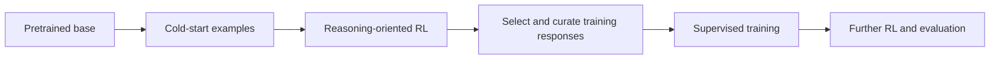

# DeepSeek-R1: reasoning training and distillation

DeepSeek-R1 studies how reinforcement learning and curated training stages can improve reasoning-oriented behavior. Distinguish R1-Zero, the full R1 pipeline, and distilled models: they are different experiments and checkpoints.

## R1-Zero versus R1

R1-Zero applies reinforcement learning to a pretrained base without an initial supervised cold-start stage. Rule-based correctness and format rewards provide a signal on verifiable tasks. The report observes useful reasoning behaviors but also readability and language-mixing issues.

The full R1 pipeline adds cold-start data, reasoning-oriented RL, rejection-sampled supervised data, and further training for broader behavior. This does not contradict R1-Zero; it addresses different practical objectives. GRPO supplies the group-relative policy-optimization mechanism, while the reward design determines what is encouraged.

## What verifiable rewards buy

For a coding task, executable tests can provide a clearer correctness signal than a fluent explanation score. But passing a finite test set does not prove universal correctness. Reward exploitation, incomplete tests, and distribution shift remain possible. Separate a final-answer reward from claims that every intermediate explanation is faithful or valid.

## Distilled models

The report also trains smaller models using generated and curated reasoning data. These students have their own base architectures; a distilled checkpoint is not necessarily a smaller sparse copy of the full R1 model. Sequence-level distillation transfers behavior through examples and must be evaluated independently.

## A useful evaluation protocol

Record exact checkpoint, prompt template, sampling settings, number of attempts, and token budget. Compare accuracy at equal inference budgets. Longer outputs or multiple samples can improve some scores while increasing cost; report both. Include non-reasoning tasks if the intended application requires them.

**Exercise.** If a model gives a correct answer with an invalid explanation, did an outcome-only reward necessarily detect the invalid step? No. Process quality requires additional evaluation or supervision.

Reference: [DeepSeek-R1 report](https://arxiv.org/abs/2501.12948). Review [GRPO](../alignment/grpo.md) and [distillation](../adaptation/distillation.md).
