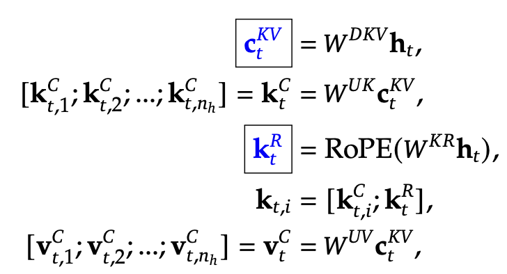
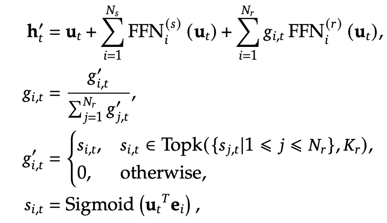
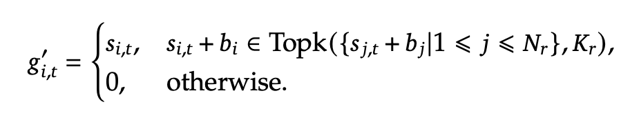
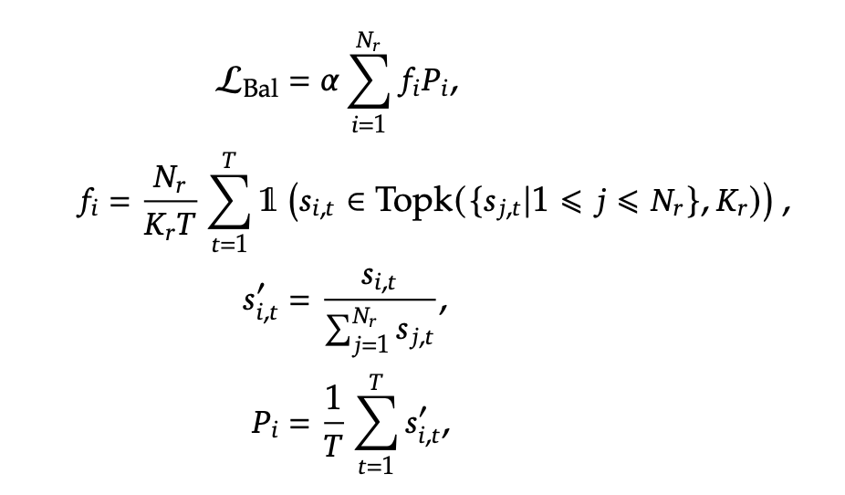
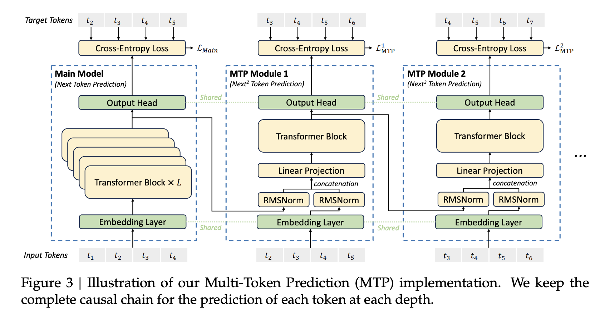

# 🧠 DeepSeek-V3: attention compression, sparse experts, and training systems

DeepSeek-V3 is a useful case study in designing model architecture and infrastructure together. The original report describes 671 billion total parameters with about 37 billion activated per token. Sparse activation reduces per-token arithmetic relative to using every expert; it does not make all stored weights disappear.

## 🧭 Multi-head Latent Attention

MLA compresses key/value information into a lower-dimensional latent state. Learned projections recover the needed attention quantities, with algebraic rearrangements enabling efficient inference. A separate positional component handles the rotary part. This is more specific than simply “down-project then up-project”: the cache representation and how projections are absorbed determine the actual saving.

*Track the latent content path separately from the rotary positional path. Standard full-K/V cache formulas do not directly describe this storage.*

## 🧩 Experts and balancing

Shared experts process common information while routed experts provide sparse capacity. Selection biases are adjusted according to load: overloaded experts become less attractive and underused experts more attractive. The balancing bias affects expert selection rather than necessarily the final combination weights.

*The expert diagram and selection-bias equation describe capacity and routing, two different design concerns.*

A complementary sequence-wise auxiliary loss remains in the recipe. Therefore, “auxiliary-loss-free load balancing” should not be expanded into “the model has no auxiliary losses.”

*The sequence-level term discourages severe imbalance within a sequence even when aggregate balancing is handled separately.*

## 📦 Multi-token prediction and systems design

*Sequential MTP modules provide additional future-token learning signals. Their role during training differs from speculative verification at inference.*

The report combines these choices with FP8 training and computation/communication overlap. Evaluating a claimed efficiency gain requires separating architecture, numeric format, cluster utilization, and workload. A paper's accounting of one training run is not automatically the total cost of research, data preparation, and deployment.

**Exercise.** Does 37B active parameters mean a single device with room for 37B weights can hold the full unoffloaded model? No. Inactive experts still require storage somewhere in the system.

Reference: [DeepSeek-V3 Technical Report](https://arxiv.org/abs/2412.19437). Continue with [MoE](../components/moe.md), [MTP](../inference/multi-token-prediction.md), and [cache layouts](../inference/layers-pages.md).
