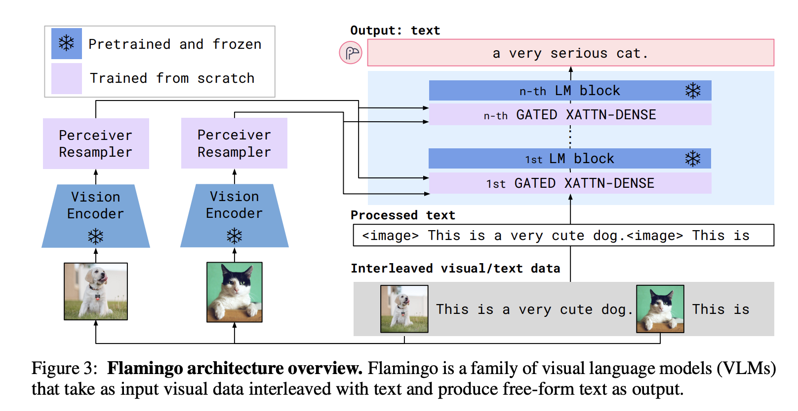

# Flamingo: connect frozen models with visual cross-attention

Flamingo was designed to accept interleaved visual and textual examples and generate text. Its central engineering idea is to preserve pretrained vision/language backbones while learning a bridge that lets the language model access images or video frames.

## Follow the data

The original figure marks frozen components with snowflakes. Visual features pass through a trainable Perceiver Resampler. New gated cross-attention blocks are inserted among frozen language-model blocks. The diagram's interleaved dog and cat examples demonstrate the input format, not a requirement to fine-tune on each new prompt.

The paper uses a pretrained NFNet visual encoder; “any EfficientNet or ViT” describes a possible adaptation, not the exact original architecture. The resampler uses learned latent queries to convert a variable visual input into a fixed-size set of visual states. This controls how much visual information the language-side cross-attention must process.

## Gated interaction

A simplified residual update is

$$
h'=h+\tanh(\alpha)\,\operatorname{CrossAttention}(h,v).
$$

Initializing the gate near zero allows the model to begin close to its pretrained language behavior while learning how strongly to use the new visual path. The trainable additions include the resampler and gated cross-attention/dense modules. The frozen backbones still perform computation and consume memory.

## Interleaved examples and masks

A prompt can contain an image, its description, another image, and a question. Visual-attention masking controls which image features a text position can access. The original method uses a restricted image-conditioning scheme rather than freely attending to every image at every step. Text self-attention can still carry information from earlier context.

For video, frame encoding and temporal structure matter: a fixed number of resampled states cannot preserve unlimited frame detail. Test event ordering and motion separately from single-frame recognition.

**Exercise.** Does few-shot prompting update Flamingo's weights? No. It conditions generation on examples in the input. Learning the bridge happened during training.

Reference: [Flamingo](https://arxiv.org/abs/2204.14198). Compare [BLIP-2](blip.md), which feeds a learned visual interface into a frozen LLM through a different connection strategy.
