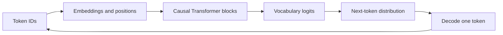
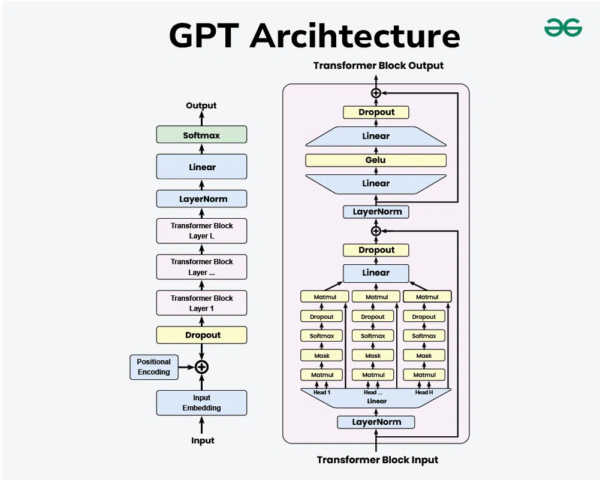

# ✍️ GPT: generation with a causal Transformer

GPT-style models use a decoder-only Transformer to predict the next token. Here, “decoder-only” means causal self-attention without a separate source encoder and its cross-attention block. Exact normalization, activation, positional encoding, and training choices vary across model generations.

## 🧭 The complete prediction path

For tokens $x_1,\ldots,x_T$, training minimizes $-\sum_t\log p_\theta(x_t\mid x_{<t})$ on eligible targets. All target positions can be evaluated in parallel during teacher-forced training. At generation time, the chosen output becomes part of the next input.

## 🧩 A prediction is a distribution

Given `The capital of France is`, suppose the model assigns probabilities 0.8 to `Paris`, 0.1 to `Lyon`, and 0.1 elsewhere. Greedy decoding selects `Paris`; sampling can select another token. Temperature and truncation modify the decoding distribution, not the stored model weights. See [decoding](../inference/decoding.md).

A base model is trained to continue text. Instruction tuning and preference optimization teach conversational behavior and response preferences. They are additional training stages, not consequences of the causal mask alone.

## 💡 Why caching matters

Past keys and values can be reused because a past position cannot read future tokens in a causal model. The new query still needs to interact with the relevant history, so a cache saves repeated work without making context length free. Memory and attention cost grow with stored context.

## 📊 Evaluate the right thing

Perplexity measures predictive fit on tokenized text. It does not directly measure instruction following, factual reliability, tool use, or long-context retrieval. Compare models using the same tokenizer/task protocol where appropriate, and report generation settings.

**Exercise.** If a generated response is wrong, must the attention mask be wrong? No. Data limitations, decoding, missing context, or learned associations can produce errors even with a correct implementation.

Reference: [Language Models are Few-Shot Learners](https://arxiv.org/abs/2005.14165). Continue with [language-model foundations](../foundations.md).
