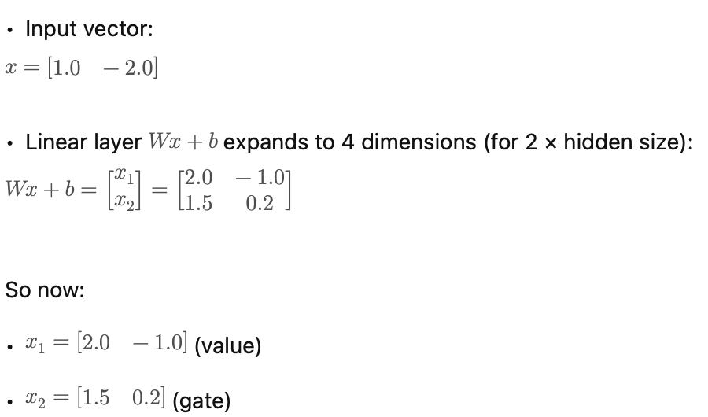
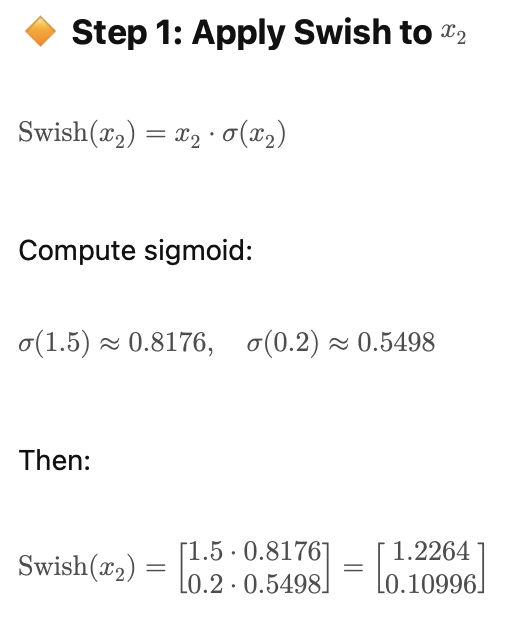
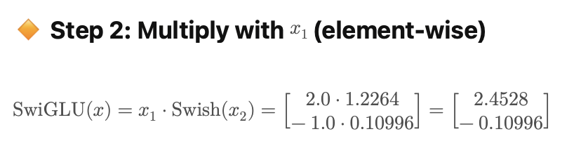

# LLaMA: a compact set of Transformer design choices

The original LLaMA paper describes decoder-only language models built from established components with careful training. This chapter explains those components; later Llama releases have their own configurations and should not be treated as identical architectures.

## Pre-normalization and RMSNorm

A pre-norm residual block computes $x+F(\operatorname{Norm}(x))$. The identity path helps gradient flow through a deep stack. The original Transformer used a post-norm arrangement, but neither placement alone guarantees or prevents vanishing/exploding gradients.

LLaMA uses RMSNorm, which rescales using the root mean square without subtracting the feature mean. See [normalization](../components/normalization.md) for the exact formula. Replacing it with LayerNorm changes the computation and cannot be assumed compatible with trained weights.

## SwiGLU, with the projections kept separate

A common bias-free formulation is

$$
\operatorname{FFN}(x)=W_{down}\left[\operatorname{SiLU}(W_{gate}x)\odot(W_{up}x)\right],
\qquad \operatorname{SiLU}(u)=u\sigma(u).
$$

One projection supplies gated nonlinear features; another supplies values to modulate. The down projection restores the hidden width. This differs from ordinary GLU, which uses a sigmoid gate without the extra multiplication by the gate preactivation. The product is a learned feature interaction, not attention over sequence positions.

The first panel illustrates two projected branches of a small SwiGLU example. The displayed two-by-two arrangement is a presentation of branch values, not the shape of the original weight matrix.

The second panel applies SiLU/Swish to the gate branch elementwise. It uses the $\beta=1$ form; a general Swish parameter changes the sigmoid argument.

The third panel multiplies the value and activated gate elementwise. A full transformer feed-forward block then applies an output projection; Llama-family implementations commonly use bias-free projections, unlike the illustrative $Wx+b$.

*Use the original activation diagrams to distinguish sigmoid gating, Swish/SiLU, and the two projected branches of SwiGLU. The final down projection is also part of the FFN.*

## RoPE and generation

Rotary position embeddings modify Q/K coordinate pairs so attention scores encode relative displacement. The model remains causal and benefits from KV caching during generation. These design choices interact with training data, optimization, and scale; naming the components does not predict benchmark quality by itself.

**Exercise.** If two FFN branches each expand width d to m, is the parameter count the same as a two-matrix ReLU FFN of width m? No. SwiGLU has gate, up, and down matrices, so intermediate widths are often adjusted for comparable budgets.

Reference: [LLaMA](https://arxiv.org/abs/2302.13971). Continue with [Llama 3.1](llama-3-1.md).
