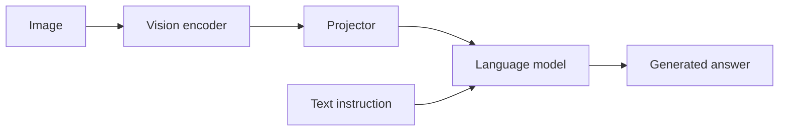

# 🖼️ LLaVA: visual instruction tuning with a simple connector

LLaVA connects a pretrained vision encoder to a language model and trains the combination to follow image-based instructions. Its importance is not only the connector architecture: the visual instruction data teaches how image evidence should shape an answer.

## 🔄 Architecture and two training stages

In the original recipe, a CLIP vision encoder produces visual features. A linear projector maps them to the language-model hidden width. During feature-alignment pretraining, the projector is trained while the vision encoder and language model are frozen. During visual instruction tuning, the projector and language model are updated while the vision encoder remains frozen.

LLaVA-1.5 uses a two-layer MLP projector and other data/resolution improvements. These statements describe those specific recipes; they should not be generalized to every later model using the LLaVA name.

## 🧩 What alignment means here

Matching vector dimensions is necessary for the interface but insufficient for semantics. The training loss must teach the language model how projected visual states relate to textual output. For an image showing two cups, the instruction “How many cups are visible?” supplies a different task than a broad caption. Data diversity matters for counting, spatial relations, OCR, and conversation.

A projector can map 1024-dimensional vision states to 4096-dimensional language states without generating new visual evidence. Increasing the width does not recover details that image resizing or the encoder already discarded.

## 📊 Evaluate grounding

Compare answers when the image is replaced, shuffled, or removed. Include questions where language priors suggest a plausible but wrong answer. Separate image recognition errors from instruction-following errors, and evaluate at the exact input resolution and preprocessing used in deployment.

**Exercise.** If a model answers an image question correctly with no image, has it demonstrated visual understanding? Not on that example. The answer may be available from textual shortcuts or dataset priors.

References: [Visual Instruction Tuning](https://arxiv.org/abs/2304.08485), [Improved Baselines with Visual Instruction Tuning](https://arxiv.org/abs/2310.03744). Compare [BLIP-2](blip.md) and [multimodal alignment](../multimodal/alignment.md).
