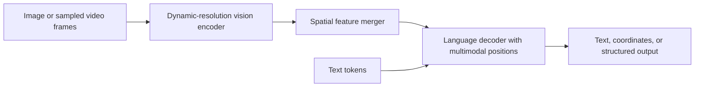

# 🖼️ Qwen2.5-VL: dynamic visual inputs and time-aware positions

Qwen2.5-VL connects a vision encoder, a vision–language merger, and a Qwen2.5-derived language decoder. It supports image/document and video tasks through visual tokens and multimodal training. It is not one undifferentiated Transformer operating directly on raw pixels and text.

## 📦 Image path and token budget

The vision encoder uses patch processing, window attention in most layers, and selected full-attention layers. An MLP-based merger groups adjacent visual features before they enter the language model, reducing sequence length. Dynamic resolution adapts the visual-token count to the input and configured budget; a fixed “up to 1K resolution” rule does not describe the design accurately.

For a dense document, higher resolution may preserve small characters but consume more visual tokens. For a simple photograph, the same budget may be unnecessary. Choose preprocessing based on measured task quality and latency.

## 📍 Multimodal rotary positions

MRoPE divides position information into temporal, height, and width components. Text uses matching position IDs across components; images vary spatial IDs while keeping temporal position fixed. Video uses frame-related temporal positions. Qwen2.5-VL aligns temporal IDs with absolute time so different frame sampling rates can preserve meaningful timing relationships.

A clip sampled at two frames per second and one sampled at four frames per second should not imply that the event unfolds at a different physical speed merely because frame indices differ.

## 🎯 Fusion and training

Projected visual tokens and text interact within the language decoder. This does not make it uniquely “unified” compared with LLaVA, which also injects visual tokens. BLIP-2, Flamingo, and LLaVA use different interfaces; none should be grouped under a single inaccurate cross-attention description.

The report combines visual, document, grounding, video, and instruction data. Being able to parse a document without an external OCR engine does not mean OCR-like recognition is absent or error-free. Evaluate transcription, layout, tables, coordinates, and reasoning separately.

**Exercise.** If the model emits valid table JSON but swaps two numeric columns, did structured-output validation establish success? No. Schema validity and evidence-grounded extraction are different checks.

Reference: [Qwen2.5-VL Technical Report](https://arxiv.org/abs/2502.13923). Review [ViT](vit.md) and [multimodal foundations](../multimodal/foundations.md).
