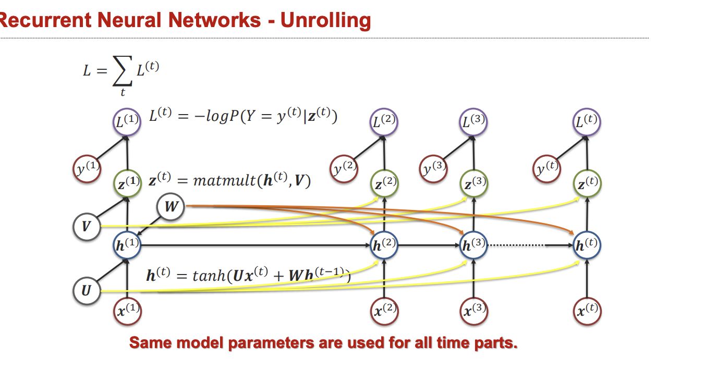

# 🔁 RNNs, LSTMs, and GRUs

A recurrent neural network processes a sequence by updating a state. It is useful when information arrives over time and the model needs a compact summary of the past.

$$
h_t=\tanh(W_xx_t+W_hh_{t-1}+b).
$$

The same parameters are reused at every step. A final state can classify a sequence, or each state can produce a token-level output. Unlike a feed-forward model applied independently to tokens, an RNN's output depends on history.

## 💡 Why long dependencies are hard

Backpropagation through time repeatedly multiplies Jacobians. Products can shrink toward zero or grow rapidly, causing vanishing or exploding gradients. Gradient clipping limits an excessive gradient norm; it does not recover a vanished learning signal. Sequential state dependencies also limit parallelism along time.

LSTMs introduce a cell state and gates:

$$
c_t=f_t\odot c_{t-1}+i_t\odot\tilde c_t,\qquad
h_t=o_t\odot\tanh(c_t).
$$

The forget gate $f_t$ controls retention, the input gate $i_t$ controls new content, and the output gate $o_t$ controls exposure. An additive cell path helps preserve information but does not guarantee perfect memory for arbitrarily long sequences. GRUs combine state/memory more compactly using update and reset gates; whether they are faster or better depends on dimensions, kernels, and data.

**Figure guide.** Unrolling copies the *same* recurrent parameters across time steps; it does not create a different network for each token. Backpropagation through time passes gradients along the horizontal state chain, which helps explain why very long dependencies can be difficult.

## 🧩 A useful example

For a sensor sequence, a recurrent state can summarize recent measurements and update when a new sample arrives. An LSTM forget gate near one can preserve a slowly changing baseline while input gates admit new events. This is a learned computation, not a manually guaranteed decomposition.

Bidirectional RNNs combine forward and backward states. They are useful when the full sequence is available, but a backward pass over future observations is unavailable in strict streaming prediction. “Bidirectional” describes information flow, not forward/backward differentiation.

## 📌 Beyond recurrence

Attention supplies direct access to earlier states rather than relying solely on a fixed summary. Transformers remove the recurrent time dependency during training, trading it for attention's memory/computation costs. RNNs can still offer compact streaming state and useful inductive structure.

**Exercise.** Can a bidirectional model classify a completed sentence? Yes. Can its unmodified backward component process an unfinished live sentence without future information? No.

References: [LSTM](https://www.bioinf.jku.at/publications/older/2604.pdf), [GRU-based encoder–decoder](https://arxiv.org/abs/1406.1078).
