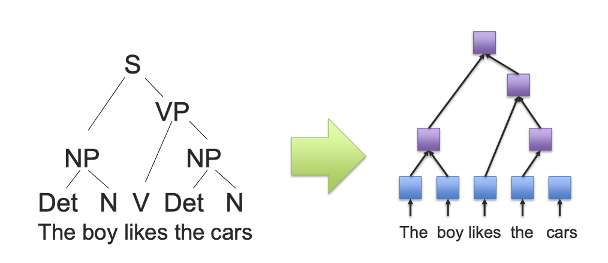
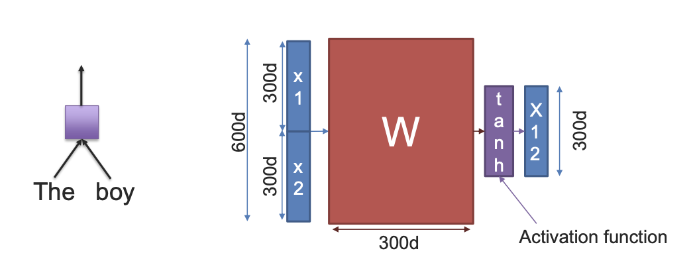

# Tree-based RNNs: compose meaning along structure

A sequence RNN combines tokens in linear order. A tree-structured recurrent model combines children according to a supplied hierarchy, such as a syntactic parse. Its motivation is compositional meaning: the phrase “not very good” should be interpreted through interactions among words, not just their independent scores.

## Composition at a parent node

A simple binary recursive network computes

$$
h_p=\tanh(W[h_l;h_r]+b).
$$

Here $h_l$ and $h_r$ summarize the left and right children. The same composition parameters can be reused across the tree. Leaves may start from word embeddings; internal nodes represent phrases. A classifier can operate at the root or at labeled subtrees.

Tree-LSTMs extend the LSTM cell to multiple children. A child-sum variant aggregates child hidden states and uses a separate forget gate per child. An N-ary variant can distinguish ordered child positions. The distinction matters: summing children is insensitive to their order unless order is encoded elsewhere.

**Figure guide.** The first image maps a syntactic parse into a tree computation; the second composes two child vectors into their parent. Parameters may be shared across nodes, while the tree structure changes with the input. The dimension labels in the source drawing are illustrative rather than a required Tree-RNN size.

## Example: negation scope

Compare “not [very good]” with “[not very] good.” Different groupings change the composition path. A parse tree can supply a useful structural bias, but a wrong parse can also send the model down an inappropriate path. This is why tree quality and downstream task quality must be evaluated separately.

A balanced tree can shorten the number of composition steps between distant leaves compared with a long chain. It does not eliminate gradient problems, and real parse trees need not be balanced. Variable structures also complicate batching and efficient execution.

## When this perspective helps

Tree models are useful for studying syntax, compositional sentiment, and hierarchical data. They are different from decision trees: a decision tree routes examples by feature tests, whereas a tree-RNN computes vector representations over an input structure. They also differ from Tree of Thoughts, which organizes inference-time search over generated candidates.

**Exercise.** If two child vectors are added before a shared transformation, can swapping those children change the result? Not without additional position-dependent information. Use an ordered composition when that distinction is necessary.

Reference: [Tree-LSTM](https://arxiv.org/abs/1503.00075). Compare [RNNs](rnn.md) and [Tree of Thoughts](../inference/tree-of-thoughts.md).
