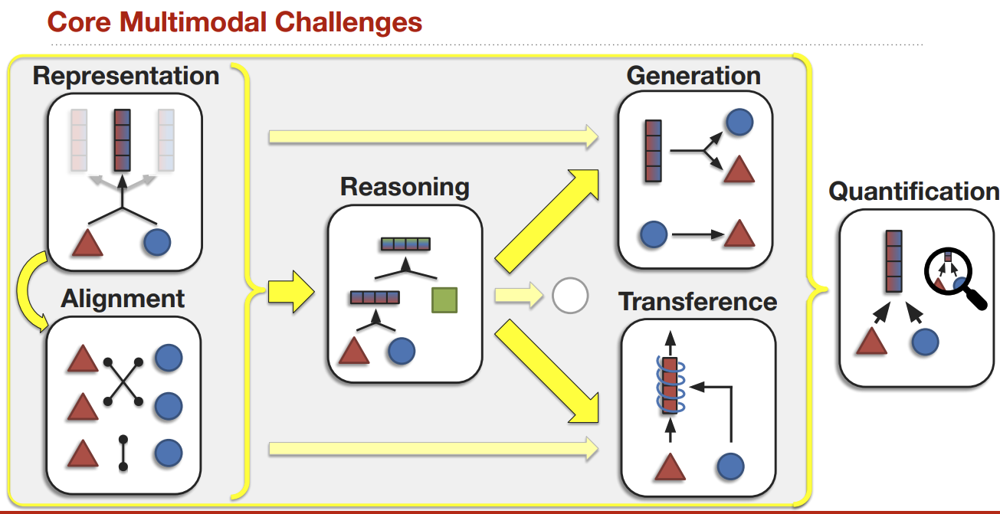

# 🖼️ Multimodal learning: what changes when inputs differ

A modality is a form of observation: text, images, audio, video, or sensor signals. Multimodal learning asks how their information can be represented, connected, and used together. Adding a second modality helps only when it contributes usable information and the learning procedure can exploit it.

## 🧭 A map of the problems

The original map separates representation, alignment, reasoning, generation, transfer, and quantification. These are related questions, not a mandatory linear pipeline.

| Question | Concrete example | What to test |
| --- | --- | --- |
| Representation | Turn image patches into vectors | Information preserved by the encoder |
| Alignment | Match a caption to an image | Retrieval rank and hard negatives |
| Fusion/reasoning | Answer a question about a chart | Cross-modal interaction, not text shortcuts |
| Generation | Produce a caption from an image | Grounding, coverage, unsupported claims |
| Transfer | Use text supervision to improve vision | Performance with limited visual labels |
| Quantification | Measure complementarity and robustness | Ablations, missing modalities, uncertainty |

## 🧩 Follow a visual question

For “What color is the left car?”, a system must locate a car, resolve `left`, recognize color, and express an answer. A global image/text similarity score may recognize the overall topic without resolving that spatial relation. Fine-grained interaction or suitable training data is needed. Conversely, retrieving likely images from a million-item collection benefits from independent embeddings that can be indexed in advance.

## 📌 Alignment is not fusion

[Alignment](alignment.md) establishes correspondence. [Fusion](fusion.md) combines information for a prediction. A dual encoder can align without token-level interaction. A cross-attention network can fuse modalities without forcing every representation into one identical metric space.

## 🚀 Build an informative baseline

Compare text-only, image-only, simple late fusion, and the proposed multimodal system under the same split. Remove or shuffle one modality at evaluation time. If performance barely changes, the model may ignore it—or the dataset may not require it. Distinguish these possibilities with task-specific examples.

**Exercise.** Is improved performance after adding captions proof of visual reasoning? No. Captions may directly reveal the label. Check whether the intended visual evidence remains necessary.

Reference: [Multimodal Machine Learning: A Survey and Taxonomy](https://arxiv.org/abs/1705.09406). Continue with [CLIP](../models/clip.md).
