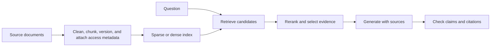

# 🔎 Retrieval-augmented generation: build answers from evidence

RAG retrieves external information and supplies it to a generator. It is useful when answers need traceable, domain-specific, or changing evidence. Retrieval adds access to documents; it does not guarantee that the generator uses them faithfully.

## 🔄 End-to-end pipeline

Keep source titles, URLs, timestamps, section positions, versions, and access metadata with chunks. Synchronize deletions and permission changes as well as new content. Indexing a document is not permanent permission to show it to every user.

## 🧩 Chunking and embeddings

Chunks should preserve useful semantic units such as a paragraph, table, or procedure. Fixed windows with overlap are a baseline, not a universal 400–800-token rule. Small chunks can lose context; large chunks can dilute relevance and consume the generator's budget. Preserve headings and table meaning during extraction.

Cosine similarity is

$$
\cos(q,d)=\frac{q^\top d}{\|q\|\|d\|}.
$$

For normalized vectors, dot product and cosine coincide. Use the embedding model's intended query/document formatting and similarity convention. Changing the embedding model usually requires re-embedding the corpus; equal dimensions do not imply compatible spaces.

## 🔎 Retrieval and indexing

Sparse methods such as BM25 are strong for exact terms, identifiers, and rare symbols. Dense retrieval can match semantic paraphrases but may miss exact numerical distinctions. Hybrid retrieval combines candidate sets or calibrated rankings; raw BM25 and cosine scores are not automatically comparable. Reciprocal-rank fusion is one way to combine rankings without assuming common score scales.

Exact vector search offers a useful baseline. Approximate indexes such as HNSW or IVF trade recall for latency and memory. HNSW search effort and IVF probe count are tuning variables, not quality guarantees. Measure approximate retrieval against exact search on representative queries.

Query rewriting, decomposition, or HyDE can improve recall but can also alter intent or inject invented terms. A hypothetical generated document is a retrieval aid, not evidence to cite.

## 🚀 Reranking and context assembly

A cross-encoder jointly scores a query and candidate passage. It can improve ordering among retrieved candidates, but cannot recover a relevant document that never entered the candidate pool. A pairwise hinge objective has the form

$$
L=\max(0,m-s(q,d^+)+s(q,d^-)).
$$

Select evidence within the context budget, deduplicate near-identical chunks, preserve useful source diversity, and handle conflicting versions explicitly. Reserving output tokens and instructions is part of the budget. Longer context is not automatically better if distractors crowd out decisive evidence.

## ✅ Generation and checks

Ask for answers supported by the supplied passages, with citations attached to the claims they support. Verify that cited passages actually entail those claims. An instruction to “use only evidence” reduces neither hallucination nor prompt-injection risk to zero. Retrieved text is untrusted content; it should not acquire authority to change tool permissions or system behavior. Validate structured output against a schema and separately check semantic correctness.

## 📊 Evaluate each stage

| Metric | Definition or purpose |
| --- | --- |
| Recall@k | Relevant documents retrieved divided by all labeled relevant documents |
| Hit@k | Whether at least one relevant document appears in the top k |
| Precision@k | Relevant results divided by k |
| MRR | Mean reciprocal rank of the first relevant result; zero when absent |
| nDCG | Ranking quality with graded relevance and position discount |
| Faithfulness | Whether generated claims are supported by evidence |

If three relevant documents exist and top five contains two, Recall@5 is $2/3$, Precision@5 is $2/5$, and Hit@5 is 1. These are not interchangeable definitions.

**Exercise.** Retrieval recall is high but answers are wrong. What next? Inspect reranking, evidence truncation, contradictory sources, and generation/citation behavior before replacing the embedding model.

References: [original RAG formulation](https://arxiv.org/abs/2005.11401), [Dense Passage Retrieval](https://arxiv.org/abs/2004.04906), [HyDE](https://arxiv.org/abs/2212.10496). Continue with the [RAG course lab](courses/llm/rag.md).
